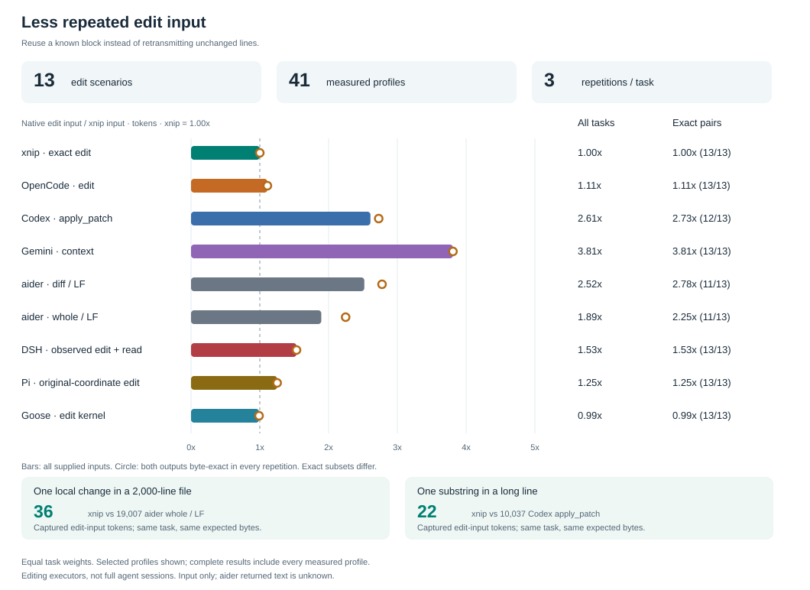

[中文](README.zh.md) | English

# xnip

**Precise text edits with less repeated context.** Give your coding agent a known old block and its replacement. xnip edits that block, preserves untouched bytes, and returns a compact result.

- **Reuse what the agent already knows.** Read missing context when needed; a known edit goes straight to the editor.
- **Send the change.** Exact blocks avoid copying an unchanged file or a long source line into every edit.
- **Keep results small.** Short receipts, bounded reads/previews and five default MCP tools keep routine context compact.
- **Keep the edit precise.** Missing or ambiguous blocks fail before writing; an explicit `all` enables global replacement. Exact edits preserve CRLF and final-newline bytes.
- **Use one editor across harnesses.** CLI and stdio MCP share file lifecycle, batch, patch, line and anchor operations.

## Measured editing costs

The benchmark runs real **Codex, Gemini CLI, OpenCode and aider editing executors** against xnip: **13 scenarios × 12 profiles × 3 repetitions**, with expected file bytes checked after each run. Counts use `tiktoken 0.14.0 / o200k_base`.

Selected profiles below report **native / xnip**, with **xnip = 1.00x**. Geometric means give each scenario equal weight.

| Editor / profile | All edit input | Byte-exact paired input | Exact pairs | Input + captured return, all |
|---|---:|---:|---:|---:|
| xnip edit | 1.00x | 1.00x | 13/13 | 1.00x |
| OpenCode edit | 1.11x | 1.11x | 13/13 | 1.20x |
| Codex apply_patch | 2.61x | 2.73x | 12/13 | 3.05x |
| Gemini context | 3.81x | 3.81x | 13/13 | 4.35x |
| aider diff / LF | 2.52x | 2.78x | 11/13 | unknown return |
| aider whole / LF | 1.89x | 2.25x | 11/13 | unknown return |

**Where it helps:** changing a substring in the long-line fixture needs **22 xnip input tokens**, versus **10,037** for Codex's patch. A local change in a 2,000-line file needs **36**, versus **19,007** for aider whole / LF. Unchanged text dominates those alternatives.

**Where the gap is small:** OpenCode's literal editor is close to xnip. A native patch can also batch efficiently: Codex's same-file batch uses **45 input tokens** versus **46** for separate xnip edits. xnip also has `apply` for batching; this native profile measures `edit`.

“All” includes supplied inputs with incompatible output bytes. The exact-pair column keeps only tasks where both editors produce the expected bytes in every repetition; its cohorts differ by profile. Captured return is the observed tool text, and aider's unavailable return stays unknown. These are editor measurements, rather than complete agent-session or billing totals.

[Full results and per-task charts](docs/benchmarks/results.md) · [Raw evidence](docs/benchmarks/results.json) · [Method and reproduction](docs/benchmarks/README.md)

## Install

Prebuilt stable releases need no Rust. Both installers verify the downloaded archive's SHA256:

~~~sh
# macOS / Linux
curl -fsSL https://github.com/SeaLoong/xnip/releases/latest/download/install.sh | sh
~~~

~~~powershell
# Windows
Invoke-RestMethod https://github.com/SeaLoong/xnip/releases/latest/download/install.ps1 | Invoke-Expression
~~~

Or download a binary from [GitHub Releases](https://github.com/SeaLoong/xnip/releases). See [installation](docs/installation.md) for supported platforms, PATH, pinned versions, checksums and removal.

Source installation needs **Rust 1.89+**:

~~~sh
cargo install --git https://github.com/SeaLoong/xnip --tag v0.3.1 --locked xnip
~~~

## Edit

~~~sh
xnip edit config.txt --old 'PORT=8080' --text 'PORT=3000'
xnip edit src/new.txt --create --text-file content.txt
xnip edit old-name.txt --rename-to new-name.txt
xnip edit obsolete.txt --delete
xnip apply edits.json --dry-run
xnip apply edits.json
~~~

Literal replacement requires a unique nonempty old block. Extend it with surrounding context when ambiguous; use `--all` for an intentional global change. `--dry-run` previews and `--check` validates; both leave files unchanged. For portable multiline content, use payload files or stdin.

Known line ranges, anchors, moves and indentation have dedicated commands. Use `peek` or `find` to fill gaps in known context; repository discovery and semantic analysis use the harness's search/language tools. Start with the [CLI tutorial](docs/cli.md), [edit reference](docs/edit.md) or [examples](docs/examples.md).

Reads default to 200 lines / 100 search hits / 12,000 payload bytes; previews default to 12,000 bytes. Truncation is explicit; zero disables the corresponding limit. `edit/apply/recover` return compact receipts; `--output json` provides complete machine results and `--output human` expands status and previews.

## Agent integration

Use the CLI already on PATH, or configure `xnip mcp` for structured arguments. MCP advertises `edit/apply/peek/find/recover` by default; `--toolset full` adds specialized line tools and diagnostics. Several known blocks fit one `xnip_apply({edits:[{file,old,text},...]})` call. Client setup and result fields are in [MCP](docs/mcp.md).

| Client | Guidance | Placement |
|---|---|---|
| Codex | [instructions and guide](docs/codex.md) | Merge AGENTS section; guide under `~/.codex/guides/xnip-editing/` |
| Claude Code | [skill](integrations/claude-code/SKILL.md) | `.claude/skills/xnip/`, including references |
| Cursor | [rule](integrations/cursor/xnip.mdc) | Project rule, `alwaysApply: false` |
| Copilot | [instruction](integrations/copilot/xnip.md) | Project instructions |
| Aider | [convention](integrations/aider/CONVENTIONS.md) | Project conventions |
| Other agents | [generic skill](integrations/generic/SKILL.md) | Load for editing; include references |

The [AGENTS snippet](integrations/agents-md/AGENTS.md) is a short project-level alternative. The canonical [agent guide](docs/SKILL.md) selects operations and loads detailed rules on demand.

## Silent updates

A detached singleton worker checks releases and stages verified binaries without blocking edits or showing update messages. Installation normally waits until earlier usage becomes idle and the next invocation opens an opportunity. CLI uses a 30-minute idle window; MCP follows connection lifetime. Prepared releases have a 24-hour maximum deferral. Existing sessions continue running their loaded image.

See [update scheduling and private state](docs/updates.md). Set `XNIP_AUTO_UPDATE=0` for pinned/offline deployments.

## Limits

- Batches validate all operations before committing, then write one file at a time. Commit failures attempt rollback; inspect the [recovery journal](docs/recovery.md) before retrying after exit 4.
- Preconditions check observed bytes; they do not lock out external writers. Rewritten files preserve ordinary permissions, with [filesystem metadata limits](docs/architecture.md#persistence-and-limits).
- Backups append `.bak` to the complete filename and replace an existing sidecar. Git/backups provide exact recovery; `--revert` has [restricted inverse semantics](docs/apply-format.md#--revert-semantics).
- Line operations split on LF and require the caller to supply CRLF payloads when needed. CLI strings follow shell quoting.
- MCP uses the launching user's permissions and working directory, for trusted local clients.

## Documentation and development

| Need | Reference |
|---|---|
| Installation and client setup | [installation](docs/installation.md), [Codex](docs/codex.md), [MCP](docs/mcp.md) |
| Editing and automation | [CLI](docs/cli.md), [edit](docs/edit.md), [manifests](docs/apply-format.md), [patches](docs/patch.md), [exit codes](docs/error-codes.md) |
| Failure recovery | [recovery](docs/recovery.md) |
| Design and verification | [architecture](docs/architecture.md), [glossary](GLOSSARY.md), [tests](docs/testing.md), [update tests](docs/update-testing.md), [benchmarks](docs/benchmarks/README.md) |
| Contribution and release | [contributing](CONTRIBUTING.md), [release procedure](docs/releasing.md), [changelog](CHANGELOG.md) |

~~~sh
cargo test --workspace --locked
cargo fmt --all --check
cargo clippy --workspace --all-targets --locked -- -D warnings
cargo run --locked -p xtask -- sync-integrations
~~~

Additional platform, dependency, MSRV and packaging checks are in [CONTRIBUTING.md](CONTRIBUTING.md). MIT; see [LICENSE](LICENSE) and [third-party notices](THIRD_PARTY_LICENSES.md).
