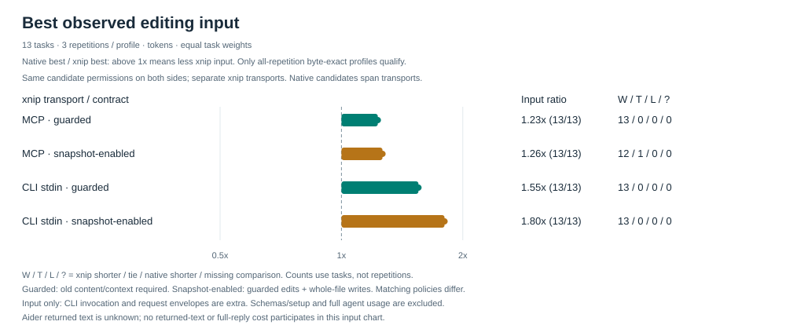

# xnip

English | [中文](README.zh.md)

**Precise text edits with less repeated context.** Give your coding agent a known old block and its replacement. xnip changes that block, preserves untouched bytes, and returns a compact receipt.

- **Send the change.** Reuse known context instead of repeating unchanged files or long lines.
- **Edit precisely.** Missing or ambiguous blocks fail before writing; exact edits preserve CRLF and final-newline bytes.
- **Use it across agents.** The CLI and stdio MCP server share exact edits, batches, previews and file lifecycle operations.

## Install

Use the standalone installer for your platform:

~~~sh
# macOS / Linux
curl -fsSL https://github.com/SeaLoong/xnip/releases/latest/download/install.sh | sh
~~~

~~~powershell
# Windows
Invoke-RestMethod https://github.com/SeaLoong/xnip/releases/latest/download/install.ps1 | Invoke-Expression
~~~

Or use [release downloads](https://github.com/SeaLoong/xnip/releases) or the [npm package, `xnip-cli`](docs/installation.md#npm). The [npm command-path checks](docs/installation.md#find-the-global-command) locate its global launcher. See [installation](docs/installation.md) for PATH setup, checksums and all options.

Standalone binaries support silent updates. Set `XNIP_AUTO_UPDATE=0` to disable them; npm installations update through npm. See [update behavior](docs/updates.md).

## Make an edit

Preview a change, then apply it:

~~~sh
xnip edit config.env --old 'PORT=8080' --text 'PORT=3000' --dry-run
xnip edit config.env --old 'PORT=8080' --text 'PORT=3000'
~~~

The old block must be nonempty and unique. Extend it with context when ambiguous; use `--all` for an intentional global replacement. `--check` validates without writing.

For an explicit complete-file rewrite, use `xnip edit generated.txt --write --text-file content.txt`. For multiline content, payload files or stdin avoid shell-escaping mistakes.

Save several edits as `edits.json`:

~~~json
{
  "config.env": [["PORT=8080", "PORT=3000"]],
  "src/settings.py": [["DEBUG = True", "DEBUG = False"]]
}
~~~

~~~sh
xnip apply edits.json --format compact --dry-run
xnip apply edits.json --format compact
~~~

Pairs within a file run in order. Use `peek` and `find` when context is missing. See [CLI usage](docs/cli.md), [editing examples](docs/examples.md) and [batch formats](docs/apply-format.md) for insertion, line edits, patches, create, rename and delete.

## Connect your agent

Use the CLI from your agent's shell, or add the stdio MCP server. For clients with a `mcpServers` configuration:

~~~json
{
  "mcpServers": {
    "xnip": {
      "command": "xnip",
      "args": ["mcp", "--cwd", "/absolute/project", "--receipts", "text"]
    }
  }
}
~~~

Replace `/absolute/project` with the intended project directory. The five default tools cover editing, batches, reading, search and recovery. `--toolset full` adds specialized tools; omit `--receipts text` when the client needs structured change metadata. `--cwd` fixes relative tool paths across GUI and CLI launchers. See [MCP setup](docs/mcp.md) for client-specific details.

| Integration route | Setup |
|---|---|
| DSH, Pi, Gemini SDK, Cline SDK, OpenHands, aider, DeepAgents | [Host backends and existing editing surfaces](docs/support.md#host-backends-and-registered-tools) |
| OpenCode, LangGraph | [Additional registered xnip tools](docs/support.md#host-backends-and-registered-tools) |
| PydanticAI, OpenAI Agents, AutoGen, smolagents, Google ADK, CrewAI | [Official MCP SDK toolsets](docs/support.md#official-mcp-sdk-toolsets) |
| Codex, Claude Code, Cursor, VS Code/Copilot, Copilot CLI, Roo, Cline GUI, Windsurf, Goose, Continue, Zed, Gemini CLI, Qwen Code | [Client MCP profiles](docs/support.md#client-mcp-profiles) |

The [support matrix](docs/support.md) covers current catalog entries, their tool names and evidence. Project guidance remains available for [Codex](docs/codex.md), [Claude Code](integrations/claude-code/SKILL.md), [Cursor](integrations/cursor/xnip.mdc), [Copilot](integrations/copilot/xnip.md) and [aider](integrations/aider/CONVENTIONS.md). Use the [AGENTS snippet](integrations/agents-md/AGENTS.md) or [operation guide](docs/SKILL.md) for concise editing instructions.

The [native DSH provider](docs/native.md) keeps the host's `read`, `write` and
`edit` tools, approval, sandbox and optional rewind while calling the same core
transactions as CLI and MCP. Its profile installer verifies a real edit and
retains snapshots for restoration.
`xnip-cli` 0.6.2 bundles its DSH adapter for the
[installed-command lifecycle](docs/native.md#dsh-profile-setup).
DSH host-lifecycle evidence is on Linux;
the CLI and MCP have their own cross-platform verification.
The [Pi native extension](docs/pi-native.md) preserves Pi `1.3.0` tool schemas,
matching, rendering and hooks through its official extension API.
The [SDK adapters](docs/native.md) also connect Gemini's local filesystem service,
Cline's `apply_patch` executor and OpenHands' `file_editor` IO to the same core.
The [375-check E2E matrix](docs/testing.md#native-host-e2e) starts real registered tools
across the catalog routes and checks file bytes, governance and restoration.

## Why it saves editing context

The archived editing-executor study compares real editors across **13 tasks**. Only results that produce the expected file bytes in every repetition qualify for that recorded frontier.

Ratios are equal-task geometric means of **best observed native input / best observed xnip input**; above **1x** means less xnip input. Guarded pools retain old-content checks. Snapshot-enabled pools allow both guarded edits and whole-file writes on both sides.

| xnip interface / allowed operations | Native best / xnip best | xnip shorter / tied / native shorter |
|---|---:|---:|
| MCP · guarded | 1.23x | 13 / 0 / 0 |
| MCP · snapshot-enabled | 1.26x | 12 / 1 / 0 |
| CLI stdin · guarded | 1.55x | 13 / 0 / 0 |
| CLI stdin · snapshot-enabled | 1.80x | 13 / 0 / 0 |

With complete file context, the long-line edit takes **11 MCP input tokens**, versus **18** for the best observed native input (Goose) and **10,037** for Codex's unique-context patch.

Compared with structured receipts, text receipts reduce captured full JSON-RPC reply tokens by about **56%**. The five-tool discovery catalog is **23.8% smaller**, with identical edit inputs and file outcomes.

These are captured editing payload costs, not complete agent usage or billing. CLI invocation costs are separate. DSH's policy-specific results include required reads and are reported outside this pooled table.

[Historical results and charts](docs/benchmarks/archive/README.md) · [Current benchmark index](docs/benchmarks/README.md)

Current [benchmark reports](docs/benchmarks/README.md) cover host/storage
adapters, framework tools and MCP SDK/client routes. They record host-compatible
outcomes, independent byte goals and actual local execution costs. Earlier
provider and fixed-binary encoding studies remain in the
[evidence archive](docs/benchmarks/archive/README.md).

## Know the limits

- Preconditions check current bytes; they do not lock out external writers. Keep Git or backups for exact recovery.
- Batches validate before committing files individually. After a commit/rollback failure, inspect the [recovery journal](docs/recovery.md) before retrying.
- Reads and previews have explicit output limits. Narrow the request or adjust the applicable limit when truncated.
- MCP runs with the launching user's permissions and working directory. Use trusted local clients.

[Installation](docs/installation.md) · [CLI](docs/cli.md) · [Edit reference](docs/edit.md) · [MCP](docs/mcp.md) · [Exit codes](docs/error-codes.md) · [Changelog](CHANGELOG.md) · [Contributing](CONTRIBUTING.md)

MIT licensed. See [LICENSE](LICENSE) and [third-party notices](THIRD_PARTY_LICENSES.md).
