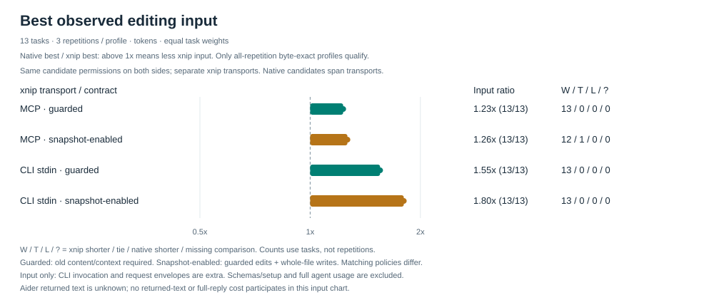

# xnip

中文 | [English](README.md)

**用更少的重复上下文，完成精准文本编辑。** 编码 agent 传入已知的原文本块与替换内容，xnip 精确修改目标、保留未修改字节，并返回简短回执。

- **只传需要修改的内容。** 复用已知上下文，省去重复发送未变化的文件或长行。
- **明确定位，精准修改。** 原文本缺失或存在歧义时不写入；精确编辑保留 CRLF 与末尾换行字节。
- **跨 agent 复用。** CLI 与 stdio MCP 共用精确编辑、批量、预览和文件生命周期操作。

## 安装

使用对应平台的独立安装器：

~~~sh
# macOS / Linux
curl -fsSL https://github.com/SeaLoong/xnip/releases/latest/download/install.sh | sh
~~~

~~~powershell
# Windows
Invoke-RestMethod https://github.com/SeaLoong/xnip/releases/latest/download/install.ps1 | Invoke-Expression
~~~

也可[下载发布文件](https://github.com/SeaLoong/xnip/releases)，或使用 [npm 包 `xnip-cli`](docs/installation.md#npm)。[npm 命令路径检查](docs/installation.md#find-the-global-command)可定位全局 launcher；PATH、校验和及其他选项见[安装说明](docs/installation.md)。

独立二进制支持静默更新；设置 `XNIP_AUTO_UPDATE=0` 可关闭。npm 安装通过 npm 更新。详见[更新行为](docs/updates.md)。

## 完成一次编辑

先预览，再应用：

~~~sh
xnip edit config.env --old 'PORT=8080' --text 'PORT=3000' --dry-run
xnip edit config.env --old 'PORT=8080' --text 'PORT=3000'
~~~

原文本块必须非空且唯一。有歧义时扩展上下文；有意全局替换时使用 `--all`。`--check` 只校验，不写入。

显式重写完整文件可用 `xnip edit generated.txt --write --text-file content.txt`。多行内容使用文件或 stdin 传入，可避免 shell 转义错误。

将多处修改保存为 `edits.json`：

~~~json
{
  "config.env": [["PORT=8080", "PORT=3000"]],
  "src/settings.py": [["DEBUG = True", "DEBUG = False"]]
}
~~~

~~~sh
xnip apply edits.json --format compact --dry-run
xnip apply edits.json --format compact
~~~

同一文件内的文本对依次执行。上下文缺失时用 `peek` 和 `find` 补足。插入、行编辑、补丁、创建、重命名与删除见 [CLI 用法](docs/cli.md)、[编辑示例](docs/examples.md)和[批量格式](docs/apply-format.md)。

## 接入 agent

可直接使用 agent shell 中的 CLI，也可添加 stdio MCP 服务。使用 `mcpServers` 配置的客户端可参考：

~~~json
{
  "mcpServers": {
    "xnip": {
      "command": "xnip",
      "args": ["mcp", "--cwd", "/absolute/project", "--receipts", "text"]
    }
  }
}
~~~

把 `/absolute/project` 替换为目标项目目录。默认五个工具覆盖编辑、批量、读取、搜索和恢复。`--toolset full` 增加专用工具；客户端需要结构化修改元数据时，可省略 `--receipts text`。`--cwd` 为 GUI 和 CLI 启动方式固定相对工具路径。各客户端差异见 [MCP 配置](docs/mcp.md)。

| 接入方式 | 指南 |
|---|---|
| DSH、Pi、Gemini SDK、Cline SDK、OpenHands、aider、DeepAgents | [宿主后端与现有编辑接口](docs/support.md#host-backends-and-registered-tools) |
| OpenCode、LangGraph | [新增注册的 xnip 工具](docs/support.md#host-backends-and-registered-tools) |
| PydanticAI、OpenAI Agents、AutoGen、smolagents、Google ADK、CrewAI | [官方 MCP SDK 工具集](docs/support.md#official-mcp-sdk-toolsets) |
| Codex、Claude Code、Cursor、VS Code/Copilot、Copilot CLI、Roo、Cline GUI、Windsurf、Goose、Continue、Zed、Gemini CLI、Qwen Code | [客户端 MCP 配置](docs/support.md#client-mcp-profiles) |

[支持矩阵](docs/support.md)列出当前 catalog 的入口、工具名和验证证据。[Codex](docs/codex.md)、[Claude Code](integrations/claude-code/SKILL.md)、[Cursor](integrations/cursor/xnip.mdc)、[Copilot](integrations/copilot/xnip.md)和 [aider](integrations/aider/CONVENTIONS.md)仍提供项目指令。简短接入可用 [AGENTS 片段](integrations/agents-md/AGENTS.md)或[操作指南](docs/SKILL.md)。

[原生 DSH provider](docs/native.md) 保留宿主的 `read`、`write`、`edit` 工具及审批、沙箱和可选 rewind，与 CLI、MCP 共用现有 core 事务。按 profile 安装时会验证真实编辑，并保留恢复快照。
`xnip-cli` 0.6.4 内置 DSH 适配器，通过[安装后的命令](docs/native.md#dsh-profile-setup)管理完整生命周期。DSH 宿主生命周期的证据来自 Linux；CLI、MCP 的跨平台验证分别统计。
[Pi 原生扩展](docs/pi-native.md)通过官方 extension API 保留 Pi `1.3.0` 的工具 schema、匹配、渲染和 hooks。
[SDK 适配](docs/native.md)还支持 Gemini 本地文件系统服务、Cline `apply_patch` 执行器和 OpenHands `file_editor` IO，共用现有 core。[375 项 E2E](docs/testing.md#native-host-e2e)执行真实注册工具，核验文件字节、治理链和恢复行为。

## 为什么能节省编辑上下文

历史编辑执行器 benchmark 比较真实编辑器在 **13 个任务**中的表现。只有每次都得到预期文件字节的结果才进入该次记录的前沿表。

比值为逐任务 **实测原生最小输入 / 实测 xnip 最小输入** 的几何平均，各任务权重相同；高于 **1x** 表示 xnip 输入更少。“保留旧内容校验”要求原内容检查；“允许整文件写入”对双方同时开放有校验的局部编辑与整文件写入。

| xnip 接口 / 允许的操作 | 原生最小 / xnip 最小 | xnip 更少 / 持平 / 原生更少 |
|---|---:|---:|
| MCP · 保留旧内容校验 | 1.23x | 13 / 0 / 0 |
| MCP · 允许整文件写入 | 1.26x | 12 / 1 / 0 |
| CLI stdin · 保留旧内容校验 | 1.55x | 13 / 0 / 0 |
| CLI stdin · 允许整文件写入 | 1.80x | 13 / 0 / 0 |

已知完整文件时，长行中的局部修改只需 **11 个 MCP 输入 token**，实测原生最佳输入（Goose）为 **18**，Codex 的唯一上下文补丁为 **10,037**。

相比结构化回执，精简文本回执让捕获的完整 JSON-RPC 返回 token 约减少 **56%**，五工具发现目录减少 **23.8%**；编辑输入和最终文件结果保持一致。

这些数值是捕获的编辑 payload 成本，不代表完整 agent 用量或计费。CLI 执行命令参数另计。DSH 各策略的结果计入必需的读取，单独列出，不混入上表。

[历史结果与图表](docs/benchmarks/archive/README.md) · [当前 benchmark 索引](docs/benchmarks/README.md)

当前 [benchmark 报告](docs/benchmarks/README.md)覆盖宿主存储后端、框架工具和 MCP SDK/客户端接入，并列记录宿主兼容结果、独立字节目标及实际本地执行成本。此前的 provider 和固定二进制编码对照研究保留在[证据归档](docs/benchmarks/archive/README.md)中。

## 使用边界

- 原内容检查不锁住外部写入者。需要精确恢复时保留 Git 或备份。
- 批量操作先验证，再逐文件提交。提交或回滚失败后，重试前检查[恢复记录](docs/recovery.md)。
- 读取和预览有明确的输出上限。截断后缩小请求范围，或调整对应限制。
- MCP 使用启动用户的权限和工作目录，面向可信本地客户端。

[安装](docs/installation.md) · [CLI](docs/cli.md) · [Edit 手册](docs/edit.md) · [MCP](docs/mcp.md) · [退出码](docs/error-codes.md) · [变更记录](CHANGELOG.md) · [贡献指南](CONTRIBUTING.md)

采用 MIT 许可证。参见 [LICENSE](LICENSE) 和[第三方声明](THIRD_PARTY_LICENSES.md)。
