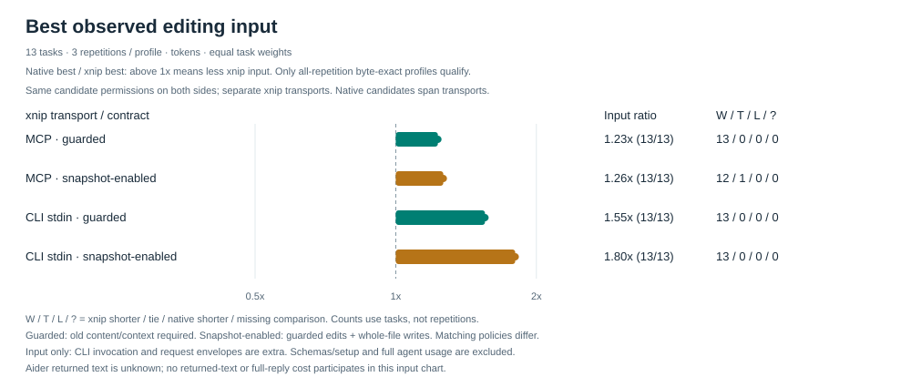

中文 | [English](README.md)

# xnip

**用更少的重复上下文，完成精准文本编辑。** 编码 agent 传入已知的原文本块与替换内容，xnip 精确修改目标、保留未修改字节，并返回精简结果。

- **复用已知上下文。** 需要时补读缺失内容；已知如何修改时直接编辑。
- **按场景选择精简编辑。** 局部修改传精确文本块，多处修改共享文件路径，插入只传锚点与新增内容，小文件重写可直接传完整结果。
- **保持输入输出精简。** 简短回执、有限读取与预览、默认五个 MCP 工具，减少日常上下文负担。
- **保证定位明确。** 原文本缺失或存在歧义时不写入；显式 `all` 才做全局替换。精确编辑保留 CRLF 与末尾换行字节。
- **跨 harness 复用。** CLI 与 stdio MCP 共享文件生命周期、批量、补丁、行与锚点编辑能力。

## 实测编辑成本

Benchmark 对当前 0.5.4 源码构建，实际运行 **Codex、Gemini CLI、OpenCode、aider、DSH、Pi、Goose 的编辑器**：**13 个场景 × 41 种编辑配置 × 3 次重复**，另测六种宿主→xnip MCP 配置。只有每次都得到预期文件字节的配置才进入有效对比。计数使用 `tiktoken 0.14.0 / o200k_base`。

每个任务对比 **实测原生最小输入 / 实测 xnip 最小输入**，高于 **1x** 表示 xnip 输入更少；几何平均让各任务权重相同。“保留旧内容校验”只允许有原内容前置检查的编辑；“允许整文件写入”对双方都同时开放局部编辑和整文件写入。

| xnip 接口 / 允许的操作 | 原生最小 / xnip 最小 | xnip 更少 / 持平 / 原生更少 |
|---|---:|---:|
| MCP · 保留旧内容校验 | 1.23x | 13 / 0 / 0 |
| MCP · 允许整文件写入 | 1.26x | 12 / 1 / 0 |
| CLI stdin · 保留旧内容校验 | 1.55x | 13 / 0 / 0 |
| CLI stdin · 允许整文件写入 | 1.80x | 13 / 0 / 0 |

**为什么使用：** 已知完整文件时，长行中的局部修改只需 **11 个 MCP 输入 token**，实测原生最佳输入（Goose）为 **18**，Codex 的唯一上下文补丁需要 **10,037**。文件分组还能省去重复路径和调用。在两组条件下，CLI stdin 策略的输入都在 13 个场景中更少；执行命令参数是另计的额外成本。

**发送前先选择表达方式：** 已知完整当前内容且旧内容校验可选时，原生行清单、缩短后仍唯一的精确文本对，可能比整份文件更省。多行函数的 xnip MCP 输入为 **25 token**，aider whole 为 **26**；同文件批量为 **18 对 20**。明确要求的旧内容检查保持不变。允许整写的 MCP 组中，xnip 在 12 个任务中更少、1 个持平。

**返回也更精简：** `xnip mcp --receipts text` 在 26 组配对中，让捕获的完整 JSON-RPC 返回 token 约减少 **56%**；输入、正文回执和最终文件字节与默认结构化模式一致。同样五个工具的发现目录也减少 **23.8%**（2,303 → 1,754 token）。

**新增 harness 的结论：** Goose 的简短参数结构在多数原生旧内容校验输入中胜出；Pi 将同文件多处编辑按原始坐标处理。DSH 的 observed 配置计入编辑前实际必需的 read/view，其 bare 与 observed 策略分别比较，不混入上表；外部 xnip MCP 进程不继承 DSH 文件系统策略。[宿主交互证据](docs/benchmarks/host-exchange-results.json)分别记录真实公开工具名、schema 投影、指令与返回内容，Goose 的 provider 投影仍为未知。

对比已加入原生相对路径、更紧凑的上下文，以及同样适用的已知文件字面裁剪配置。前沿只使用字节正确的结果，原有配置和字节不符结果均保留。aider 最终返回文本未知；CLI 命令参数、MCP 请求/返回、工具正文与启动耗时分别计量，不能当作完整 agent 会话或计费总量。

[完整结果与逐场景图表](docs/benchmarks/results.md) · [原始证据](docs/benchmarks/results.json) · [方法与复现](docs/benchmarks/README.md) · [核心性能](docs/benchmarks/core-performance.md)

## 安装

### npm（首选）

需要 Node **22.14+**；安装预先打包的程序无需 Rust。
`xnip-cli` 发布后，可通过 npm 安装：

~~~sh
npm install --global xnip-cli
xnip --version
~~~

通过 `npm install --global xnip-cli@latest` 更新，升级后重启 MCP 会话。
npm 安装的子进程关闭原生自动更新；DSH/Pi 插件仍需显式启用。

未发布的开发构建或离线验证，可通过
`npm install --global --offline --ignore-scripts ./xnip-cli-0.5.4.tgz`
安装匹配平台的私有 host tarball。
平台包、本地构建和 CI 发布步骤见 [npm 指南](npm/README.md)。

### 独立二进制与源码

**0.5.4** 包含 DSH/Pi/Goose 接入与 npm 分发，详情见[变更记录](CHANGELOG.md)。
不使用 Node 时，可使用以下校验 SHA256 的安装器：

~~~sh
# macOS / Linux
curl -fsSL https://github.com/SeaLoong/xnip/releases/latest/download/install.sh | sh
~~~

~~~powershell
# Windows
Invoke-RestMethod https://github.com/SeaLoong/xnip/releases/latest/download/install.ps1 | Invoke-Expression
~~~

也可从 [GitHub Releases](https://github.com/SeaLoong/xnip/releases) 下载。
平台、PATH、固定版本、校验与卸载见[安装说明](docs/installation.md)。
源码安装需要 **Rust 1.89+**：

~~~sh
cargo install --git https://github.com/SeaLoong/xnip --tag v0.5.4 --locked xnip
~~~

## 编辑

~~~sh
xnip edit config.txt --old 'PORT=8080' --text 'PORT=3000'
xnip edit generated.txt --write --text-file content.txt
xnip edit imports.py --old 'import os' --text-file new-import.txt --position after
xnip edit src/new.txt --create --text-file content.txt
xnip edit old-name.txt --rename-to new-name.txt
xnip edit obsolete.txt --delete
xnip apply edits.json --dry-run
xnip apply edits.json
~~~

字面替换要求 old 非空且唯一；有歧义时扩展原文本上下文，有意全局替换时使用 `--all`。`--dry-run` 预览，`--check` 校验，两者均不写入。需要跨 shell 可靠传入多行字节时使用文件或 stdin。

`--write` 显式创建或覆盖完整文件，可用 `--old` 校验整个已有文件。`--position before|after` 在唯一锚点旁插入所给字节，不额外补换行。独立修改可在紧凑 JSON 清单中共享路径：

~~~json
{"a.txt":[["old","new"],["next","final"]],"b.txt":{"old":"was","text":"now"}}
~~~

已知行范围、锚点、移动与缩进可用专门命令。`peek` 与 `find` 用于补足上下文；仓库发现与语义分析继续使用 harness 的搜索/语言工具。参见 [CLI 教程](docs/cli.md)、[edit 手册](docs/edit.md)和[示例](docs/examples.md)。

读取默认限制为 200 行、100 个搜索命中、12,000 个 payload 字节；预览默认限制 12,000 字节。截断会明确提示，对应限制设为零可取消。`edit/apply/recover` 默认返回精简回执，`--output json` 返回完整机器结果，`--output human` 展开状态与预览。

## Agent 集成

复用 PATH 上的 CLI，或配置 `xnip mcp` 使用结构化参数。MCP 默认提供 `edit/apply/peek/find/recover`；`--toolset full` 增加行级工具与诊断。`xnip mcp --receipts text` 省去结构化修改元数据及其输出 schema，精简 agent 返回；默认模式保留机器可读结果。多个已知文本块可一次调用 `xnip_apply({files:{"a.txt":[["old","new"],["next","final"]]}})`；需要显式全局替换时可用 `edits` 数组。配置与返回字段见 [MCP 手册](docs/mcp.md)。

| 客户端 | 指南 | 放置位置 |
|---|---|---|
| Codex | [普通指令与指南](docs/codex.md) | 合并 AGENTS 片段；指南放在 `~/.codex/guides/xnip-editing/` |
| Claude Code | [skill](integrations/claude-code/SKILL.md) | `.claude/skills/xnip/`，保留 references |
| Cursor | [规则](integrations/cursor/xnip.mdc) | 项目规则，`alwaysApply: false` |
| Copilot | [简短指令](integrations/copilot/xnip.md) | 项目指令 |
| Aider | [约定](integrations/aider/CONVENTIONS.md) | 项目约定 |
| DSH | [bundle 与 MCP 插件](docs/dsh.md) | 显式启用本地包 bundle，经官方 MCP bridge 接入 |
| Pi | [extension](docs/pi.md) | 从本地包加载，按会话注册 MCP server |
| Goose | [stdio extension](docs/goose.md) | 合并配置或使用 `--with-extension`；需 xnip 0.5.4+ |
| 其他 agent | [通用 skill](integrations/generic/SKILL.md) | 编辑任务按需加载，保留 references |

[npm 分发](npm/README.md)打包同一个原生程序，包内同时提供 `xnip-cli/dsh` 与 `xnip-cli/pi`；当前 MCP 接入无需另建 `dsh-xnip` 包。CI 验证六个平台包后先发平台包，再发主包；本地 host tarball 保持 private，用于离线验证。仅 npm wrapper 和 JavaScript host 集成需要 Node。

[AGENTS 片段](integrations/agents-md/AGENTS.md)提供项目级精简入口。[Agent 指南](docs/SKILL.md)负责选择操作，详细规则按需加载。Codex 使用普通指令与指南，不增加 `$xnip-editing` 菜单项。

## 静默更新

单例独立进程后台检查版本、下载并校验，不阻塞编辑，也不显示更新消息。通常等此前使用空闲后，由下一次调用打开安装窗口：CLI 空闲窗口为 30 分钟，MCP 按连接存活判断。已准备版本最长延期 24 小时，已有会话继续运行已加载的程序。

调度与内部状态见[更新说明](docs/updates.md)。固定版本或离线环境设置 `XNIP_AUTO_UPDATE=0`。

## 限制

- 批量计划先验证全部操作，再逐文件提交；提交失败尝试回滚。遇到退出码 4，重试前检查[恢复记录](docs/recovery.md)。
- 原内容校验不能锁住外部写入者。重写保留普通权限，[其他文件系统元数据有明确限制](docs/architecture.md#persistence-and-limits)。
- 备份在完整文件名后追加 `.bak`，会覆盖已有 sidecar。精确恢复使用 Git/备份；`--revert` 只支持[受限逆操作](docs/apply-format.md#--revert-semantics)。
- 行操作以 LF 分隔，需要 CRLF 时由调用方提供相应 payload。CLI 字符串遵循 shell 转义。
- MCP 使用启动用户的权限和工作目录，面向可信本地客户端。

## 文档与开发

| 需求 | 文档 |
|---|---|
| 安装与接入 | [安装](docs/installation.md)、[Codex](docs/codex.md)、[MCP](docs/mcp.md) |
| 编辑与自动化 | [CLI](docs/cli.md)、[edit](docs/edit.md)、[清单](docs/apply-format.md)、[补丁](docs/patch.md)、[退出码](docs/error-codes.md) |
| 失败恢复 | [recovery](docs/recovery.md) |
| 设计与验证 | [架构](docs/architecture.md)、[术语](GLOSSARY.md)、[测试](docs/testing.md)、[更新测试](docs/update-testing.md)、[benchmark](docs/benchmarks/README.md) |
| 贡献与发布 | [贡献指南](CONTRIBUTING.md)、[发布流程](docs/releasing.md)、[变更记录](CHANGELOG.md) |

~~~sh
cargo test --workspace --locked
cargo fmt --all --check
cargo clippy --workspace --all-targets --locked -- -D warnings
cargo run --locked -p xtask -- sync-integrations
~~~

平台、依赖、最低 Rust 和打包检查见[贡献指南](CONTRIBUTING.md)。MIT；参见 [LICENSE](LICENSE) 与[第三方声明](THIRD_PARTY_LICENSES.md)。
