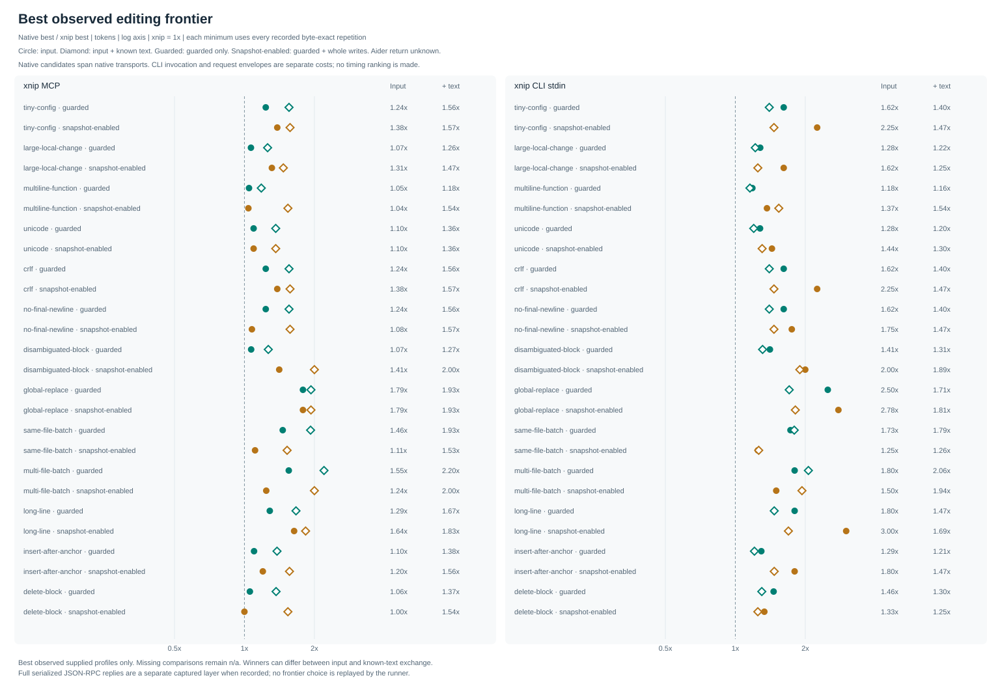

# Native editing tools versus xnip

The real native editors and xnip edited fresh copies of the same 13 fixtures. No model calls were performed. These results measure captured tool payloads and file behavior, not complete agent sessions or billed tokens.

Counter: {"encoding": "o200k_base", "tokenizer": "tiktoken", "unit": "tokens", "version": "0.14.0"}. Repetitions per task/profile: 3.
Platform: win32. xnip binary SHA-256: 59ac9e1ef100f25874579a8772cf45199702ed5d668c71a8f67b04bbe39b891c.
Raw calls, expected bytes, per-repetition hashes and source provenance: [results.json](results.json). Derived statistics: [relative-results.json](relative-results.json).
Published display metadata replaces machine HOME prefixes with `<HOME>`; the JSON disclosure_redaction ledger hashes affected original strings. Costs retain the actual pre-redaction measurements, while fixture bytes, serialized payloads and tool inputs remain unchanged. Sessions use repository target/native-bench/sessions only when outside HOME/USERPROFILE; otherwise they use an external temporary directory.
Sampling fingerprints stay as recorded; derived JSON separately records the sampled and current report-renderer fingerprints.

## Best observed frontier

Profiles declaring a separate policy lane or host bridge are excluded from these pooled minima; their raw rows remain visible. DSH policy-specific frontiers and host exchanges follow separately.

For each task, candidate-permission pool and xnip transport, select the smallest measured input and independently the smallest input plus known captured returned text. Only profiles whose files are byte-exact in every recorded repetition qualify. This is the **best observed** among supplied profiles, not a global optimum, a model success rate or an editing policy replayed by the runner.
Both sides use identical candidate permissions. The **guarded** pool accepts guarded profiles only, requiring old-content/context preconditions. The **snapshot-enabled** pool permits whole-file writes and accepts both guarded and snapshot profiles on each side. Its winner may therefore be a guarded edit. Winning records and profile cost rows retain their actual contract. Matching strictness can still differ; the probes record those differences.
**xnip MCP and CLI minima stay separate.** Native executor-input candidates may span native transports; each winning profile below retains its transport. This compares executor inputs, not uniform invocation costs. CLI argument invocation and serialized tool-request envelopes are reported separately and never added to executor input. Schema/setup costs are outside these minima. CLI cold-start and warm MCP times are not ranked together.
Three cost layers stay distinct: supplied input, known captured returned text, and the canonical serialized full JSON-RPC reply when recorded. The last includes structured fields and can duplicate text; it is available only for recorded xnip MCP replies. Unknown data stays unavailable. Aider returned text is always unknown and never contributes a zero-cost exchange winner.

| xnip transport | Candidate permissions | Input geometric mean native / xnip | Paired tasks | Input + known text geometric mean | Paired tasks |
|---|---|---:|---:|---:|---:|
| cli-stdin | guarded | 1.55x | 13 | 1.41x | 13 |
| cli-stdin | snapshot-enabled | 1.80x | 13 | 1.51x | 13 |
| mcp | guarded | 1.23x | 13 | 1.53x | 13 |
| mcp | snapshot-enabled | 1.26x | 13 | 1.64x | 13 |

Each task has equal weight in these geometric means. Input and known-text exchange can have different winning profiles and task subsets; compare the paired-task counts.

| Task | xnip transport | Candidate permissions | Native best input tokens (profile; transport; actual contract) | xnip best input tokens (profile; transport; actual contract) | Native / xnip | Native best input + text | xnip best input + text | Native / xnip |
|---|---|---|---:|---:|---:|---:|---:|---:|
| tiny-config | cli-stdin | guarded | 21 (goose-native-edit; native-function; guarded) | 13 (xnip-cli-native-guarded; cli-stdin; guarded) | 1.62x | 28 (opencode-edit-relative; native-function; guarded) | 20 (xnip-cli-native-guarded; cli-stdin; guarded) | 1.40x |
| tiny-config | cli-stdin | snapshot-enabled | 18 (opencode-relative-known-file-trim; native-function; guarded) | 8 (xnip-cli-native-snapshot; cli-stdin; guarded) | 2.25x | 22 (opencode-relative-known-file-trim; native-function; guarded) | 15 (xnip-cli-native-snapshot; cli-stdin; guarded) | 1.47x |
| tiny-config | mcp | guarded | 21 (goose-native-edit; native-function; guarded) | 17 (xnip-adaptive-guarded; mcp; guarded) | 1.24x | 28 (opencode-edit-relative; native-function; guarded) | 18 (xnip-adaptive-guarded; mcp; guarded) | 1.56x |
| tiny-config | mcp | snapshot-enabled | 18 (opencode-relative-known-file-trim; native-function; guarded) | 13 (xnip-adaptive-snapshot; mcp; guarded) | 1.38x | 22 (opencode-relative-known-file-trim; native-function; guarded) | 14 (xnip-adaptive-snapshot; mcp; guarded) | 1.57x |
| large-local-change | cli-stdin | guarded | 32 (goose-native-edit; native-function; guarded) | 25 (xnip-cli-native-guarded; cli-stdin; guarded) | 1.28x | 39 (opencode-edit-relative; native-function; guarded) | 32 (xnip-cli-native-guarded; cli-stdin; guarded) | 1.22x |
| large-local-change | cli-stdin | snapshot-enabled | 21 (opencode-relative-known-file-trim; native-function; guarded) | 13 (xnip-cli-native-snapshot; cli-stdin; guarded) | 1.62x | 25 (opencode-relative-known-file-trim; native-function; guarded) | 20 (xnip-cli-native-snapshot; cli-stdin; guarded) | 1.25x |
| large-local-change | mcp | guarded | 32 (goose-native-edit; native-function; guarded) | 30 (xnip-adaptive-guarded; mcp; guarded) | 1.07x | 39 (opencode-edit-relative; native-function; guarded) | 31 (xnip-adaptive-guarded; mcp; guarded) | 1.26x |
| large-local-change | mcp | snapshot-enabled | 21 (opencode-relative-known-file-trim; native-function; guarded) | 16 (xnip-adaptive-snapshot; mcp; guarded) | 1.31x | 25 (opencode-relative-known-file-trim; native-function; guarded) | 17 (xnip-adaptive-snapshot; mcp; guarded) | 1.47x |
| multiline-function | cli-stdin | guarded | 45 (goose-native-edit; native-function; guarded) | 38 (xnip-cli-native-guarded; cli-stdin; guarded) | 1.18x | 52 (opencode-edit-relative; native-function; guarded) | 45 (xnip-cli-native-guarded; cli-stdin; guarded) | 1.16x |
| multiline-function | cli-stdin | snapshot-enabled | 26 (aider-whole-eof-aware-lf; native-function; snapshot) | 19 (xnip-cli-native-snapshot; cli-stdin; snapshot) | 1.37x | 40 (pi-native-write; native-function; snapshot) | 26 (xnip-cli-native-snapshot; cli-stdin; snapshot) | 1.54x |
| multiline-function | mcp | guarded | 45 (goose-native-edit; native-function; guarded) | 43 (xnip-adaptive-guarded; mcp; guarded) | 1.05x | 52 (opencode-edit-relative; native-function; guarded) | 44 (xnip-adaptive-guarded; mcp; guarded) | 1.18x |
| multiline-function | mcp | snapshot-enabled | 26 (aider-whole-eof-aware-lf; native-function; snapshot) | 25 (xnip-adaptive-snapshot; mcp; snapshot) | 1.04x | 40 (pi-native-write; native-function; snapshot) | 26 (xnip-adaptive-snapshot; mcp; snapshot) | 1.54x |
| unicode | cli-stdin | guarded | 23 (goose-native-edit; native-function; guarded) | 18 (xnip-cli-native-guarded; cli-stdin; guarded) | 1.28x | 30 (opencode-edit-relative; native-function; guarded) | 25 (xnip-cli-native-guarded; cli-stdin; guarded) | 1.20x |
| unicode | cli-stdin | snapshot-enabled | 23 (aider-whole-eof-aware-lf; native-function; snapshot) | 16 (xnip-cli-native-snapshot; cli-stdin; snapshot) | 1.44x | 30 (opencode-edit-relative; native-function; guarded) | 23 (xnip-cli-native-snapshot; cli-stdin; snapshot) | 1.30x |
| unicode | mcp | guarded | 23 (goose-native-edit; native-function; guarded) | 21 (xnip-adaptive-guarded; mcp; guarded) | 1.10x | 30 (opencode-edit-relative; native-function; guarded) | 22 (xnip-adaptive-guarded; mcp; guarded) | 1.36x |
| unicode | mcp | snapshot-enabled | 23 (aider-whole-eof-aware-lf; native-function; snapshot) | 21 (xnip-adaptive-guarded; mcp; guarded) | 1.10x | 30 (opencode-edit-relative; native-function; guarded) | 22 (xnip-adaptive-guarded; mcp; guarded) | 1.36x |
| crlf | cli-stdin | guarded | 21 (goose-native-edit; native-function; guarded) | 13 (xnip-cli-native-guarded; cli-stdin; guarded) | 1.62x | 28 (opencode-edit-relative; native-function; guarded) | 20 (xnip-cli-native-guarded; cli-stdin; guarded) | 1.40x |
| crlf | cli-stdin | snapshot-enabled | 18 (opencode-relative-known-file-trim; native-function; guarded) | 8 (xnip-cli-native-snapshot; cli-stdin; guarded) | 2.25x | 22 (opencode-relative-known-file-trim; native-function; guarded) | 15 (xnip-cli-native-snapshot; cli-stdin; guarded) | 1.47x |
| crlf | mcp | guarded | 21 (goose-native-edit; native-function; guarded) | 17 (xnip-adaptive-guarded; mcp; guarded) | 1.24x | 28 (opencode-edit-relative; native-function; guarded) | 18 (xnip-adaptive-guarded; mcp; guarded) | 1.56x |
| crlf | mcp | snapshot-enabled | 18 (opencode-relative-known-file-trim; native-function; guarded) | 13 (xnip-adaptive-snapshot; mcp; guarded) | 1.38x | 22 (opencode-relative-known-file-trim; native-function; guarded) | 14 (xnip-adaptive-snapshot; mcp; guarded) | 1.57x |
| no-final-newline | cli-stdin | guarded | 21 (goose-native-edit; native-function; guarded) | 13 (xnip-cli-native-guarded; cli-stdin; guarded) | 1.62x | 28 (opencode-edit-relative; native-function; guarded) | 20 (xnip-cli-native-guarded; cli-stdin; guarded) | 1.40x |
| no-final-newline | cli-stdin | snapshot-enabled | 14 (aider-whole-eof-aware-lf; native-function; snapshot) | 8 (xnip-cli-native-snapshot; cli-stdin; guarded) | 1.75x | 22 (opencode-relative-known-file-trim; native-function; guarded) | 15 (xnip-cli-native-snapshot; cli-stdin; guarded) | 1.47x |
| no-final-newline | mcp | guarded | 21 (goose-native-edit; native-function; guarded) | 17 (xnip-adaptive-guarded; mcp; guarded) | 1.24x | 28 (opencode-edit-relative; native-function; guarded) | 18 (xnip-adaptive-guarded; mcp; guarded) | 1.56x |
| no-final-newline | mcp | snapshot-enabled | 14 (aider-whole-eof-aware-lf; native-function; snapshot) | 13 (xnip-adaptive-snapshot; mcp; guarded) | 1.08x | 22 (opencode-relative-known-file-trim; native-function; guarded) | 14 (xnip-adaptive-snapshot; mcp; guarded) | 1.57x |
| disambiguated-block | cli-stdin | guarded | 31 (goose-native-edit; native-function; guarded) | 22 (xnip-cli-native-guarded; cli-stdin; guarded) | 1.41x | 38 (opencode-edit-relative; native-function; guarded) | 29 (xnip-cli-native-guarded; cli-stdin; guarded) | 1.31x |
| disambiguated-block | cli-stdin | snapshot-enabled | 24 (aider-whole-eof-aware-lf; native-function; snapshot) | 12 (xnip-cli-native-snapshot; cli-stdin; snapshot) | 2.00x | 36 (opencode-relative-known-file-trim; native-function; guarded) | 19 (xnip-cli-native-snapshot; cli-stdin; snapshot) | 1.89x |
| disambiguated-block | mcp | guarded | 31 (goose-native-edit; native-function; guarded) | 29 (xnip-adaptive-guarded; mcp; guarded) | 1.07x | 38 (opencode-edit-relative; native-function; guarded) | 30 (xnip-adaptive-guarded; mcp; guarded) | 1.27x |
| disambiguated-block | mcp | snapshot-enabled | 24 (aider-whole-eof-aware-lf; native-function; snapshot) | 17 (xnip-adaptive-snapshot; mcp; snapshot) | 1.41x | 36 (opencode-relative-known-file-trim; native-function; guarded) | 18 (xnip-adaptive-snapshot; mcp; snapshot) | 2.00x |
| global-replace | cli-stdin | guarded | 25 (opencode-edit-relative; native-function; guarded) | 10 (xnip-cli-native-guarded; cli-stdin; guarded) | 2.50x | 29 (opencode-edit-relative; native-function; guarded) | 17 (xnip-cli-native-guarded; cli-stdin; guarded) | 1.71x |
| global-replace | cli-stdin | snapshot-enabled | 25 (opencode-edit-relative; native-function; guarded) | 9 (xnip-cli-native-snapshot; cli-stdin; guarded) | 2.78x | 29 (opencode-edit-relative; native-function; guarded) | 16 (xnip-cli-native-snapshot; cli-stdin; guarded) | 1.81x |
| global-replace | mcp | guarded | 25 (opencode-edit-relative; native-function; guarded) | 14 (xnip-adaptive-guarded; mcp; guarded) | 1.79x | 29 (opencode-edit-relative; native-function; guarded) | 15 (xnip-adaptive-guarded; mcp; guarded) | 1.93x |
| global-replace | mcp | snapshot-enabled | 25 (opencode-edit-relative; native-function; guarded) | 14 (xnip-adaptive-guarded; mcp; guarded) | 1.79x | 29 (opencode-edit-relative; native-function; guarded) | 15 (xnip-adaptive-guarded; mcp; guarded) | 1.93x |
| same-file-batch | cli-stdin | guarded | 38 (goose-native-edit; native-function; guarded) | 22 (xnip-cli-native-guarded; cli-stdin; guarded) | 1.73x | 52 (opencode-edit-relative; native-function; guarded) | 29 (xnip-cli-native-guarded; cli-stdin; guarded) | 1.79x |
| same-file-batch | cli-stdin | snapshot-enabled | 20 (aider-whole-eof-aware-lf; native-function; snapshot) | 16 (xnip-cli-compact-snapshot; cli-stdin; guarded) | 1.25x | 29 (pi-native-write; native-function; snapshot) | 23 (xnip-cli-compact-snapshot; cli-stdin; guarded) | 1.26x |
| same-file-batch | mcp | guarded | 38 (goose-native-edit; native-function; guarded) | 26 (xnip-adaptive-guarded; mcp; guarded) | 1.46x | 52 (opencode-edit-relative; native-function; guarded) | 27 (xnip-adaptive-guarded; mcp; guarded) | 1.93x |
| same-file-batch | mcp | snapshot-enabled | 20 (aider-whole-eof-aware-lf; native-function; snapshot) | 18 (xnip-adaptive-snapshot; mcp; guarded) | 1.11x | 29 (pi-native-write; native-function; snapshot) | 19 (xnip-adaptive-snapshot; mcp; guarded) | 1.53x |
| multi-file-batch | cli-stdin | guarded | 45 (goose-native-edit; native-function; guarded) | 25 (xnip-cli-native-guarded; cli-stdin; guarded) | 1.80x | 66 (opencode-edit-relative; native-function; guarded) | 32 (xnip-cli-native-guarded; cli-stdin; guarded) | 2.06x |
| multi-file-batch | cli-stdin | snapshot-enabled | 36 (aider-whole-eof-aware-lf; native-function; snapshot) | 24 (xnip-cli-native-snapshot; cli-stdin; guarded) | 1.50x | 60 (pi-native-write; native-function; snapshot) | 31 (xnip-cli-native-snapshot; cli-stdin; guarded) | 1.94x |
| multi-file-batch | mcp | guarded | 45 (goose-native-edit; native-function; guarded) | 29 (xnip-adaptive-guarded; mcp; guarded) | 1.55x | 66 (opencode-edit-relative; native-function; guarded) | 30 (xnip-adaptive-guarded; mcp; guarded) | 2.20x |
| multi-file-batch | mcp | snapshot-enabled | 36 (aider-whole-eof-aware-lf; native-function; snapshot) | 29 (xnip-adaptive-guarded; mcp; guarded) | 1.24x | 60 (pi-native-write; native-function; snapshot) | 30 (xnip-adaptive-guarded; mcp; guarded) | 2.00x |
| long-line | cli-stdin | guarded | 18 (goose-native-edit; native-function; guarded) | 10 (xnip-cli-native-guarded; cli-stdin; guarded) | 1.80x | 25 (opencode-edit-relative; native-function; guarded) | 17 (xnip-cli-native-guarded; cli-stdin; guarded) | 1.47x |
| long-line | cli-stdin | snapshot-enabled | 18 (goose-native-edit; native-function; guarded) | 6 (xnip-cli-native-snapshot; cli-stdin; guarded) | 3.00x | 22 (opencode-relative-known-file-trim; native-function; guarded) | 13 (xnip-cli-native-snapshot; cli-stdin; guarded) | 1.69x |
| long-line | mcp | guarded | 18 (goose-native-edit; native-function; guarded) | 14 (xnip-adaptive-guarded; mcp; guarded) | 1.29x | 25 (opencode-edit-relative; native-function; guarded) | 15 (xnip-adaptive-guarded; mcp; guarded) | 1.67x |
| long-line | mcp | snapshot-enabled | 18 (goose-native-edit; native-function; guarded) | 11 (xnip-adaptive-snapshot; mcp; guarded) | 1.64x | 22 (opencode-relative-known-file-trim; native-function; guarded) | 12 (xnip-adaptive-snapshot; mcp; guarded) | 1.83x |
| insert-after-anchor | cli-stdin | guarded | 22 (goose-native-edit; native-function; guarded) | 17 (xnip-cli-native-guarded; cli-stdin; guarded) | 1.29x | 29 (opencode-edit-relative; native-function; guarded) | 24 (xnip-cli-native-guarded; cli-stdin; guarded) | 1.21x |
| insert-after-anchor | cli-stdin | snapshot-enabled | 18 (aider-whole-eof-aware-lf; native-function; snapshot) | 10 (xnip-cli-native-snapshot; cli-stdin; snapshot) | 1.80x | 25 (opencode-relative-known-file-trim; native-function; guarded) | 17 (xnip-cli-native-snapshot; cli-stdin; snapshot) | 1.47x |
| insert-after-anchor | mcp | guarded | 22 (goose-native-edit; native-function; guarded) | 20 (xnip-adaptive-guarded; mcp; guarded) | 1.10x | 29 (opencode-edit-relative; native-function; guarded) | 21 (xnip-adaptive-guarded; mcp; guarded) | 1.38x |
| insert-after-anchor | mcp | snapshot-enabled | 18 (aider-whole-eof-aware-lf; native-function; snapshot) | 15 (xnip-adaptive-snapshot; mcp; snapshot) | 1.20x | 25 (opencode-relative-known-file-trim; native-function; guarded) | 16 (xnip-adaptive-snapshot; mcp; snapshot) | 1.56x |
| delete-block | cli-stdin | guarded | 19 (goose-native-edit; native-function; guarded) | 13 (xnip-cli-native-guarded; cli-stdin; guarded) | 1.46x | 26 (opencode-edit-relative; native-function; guarded) | 20 (xnip-cli-native-guarded; cli-stdin; guarded) | 1.30x |
| delete-block | cli-stdin | snapshot-enabled | 12 (aider-whole-eof-aware-lf; native-function; snapshot) | 9 (xnip-cli-native-snapshot; cli-stdin; snapshot) | 1.33x | 20 (pi-native-write; native-function; snapshot) | 16 (xnip-cli-native-snapshot; cli-stdin; snapshot) | 1.25x |
| delete-block | mcp | guarded | 19 (goose-native-edit; native-function; guarded) | 18 (xnip-adaptive-guarded; mcp; guarded) | 1.06x | 26 (opencode-edit-relative; native-function; guarded) | 19 (xnip-adaptive-guarded; mcp; guarded) | 1.37x |
| delete-block | mcp | snapshot-enabled | 12 (aider-whole-eof-aware-lf; native-function; snapshot) | 12 (xnip-adaptive-snapshot; mcp; snapshot) | 1.00x | 20 (pi-native-write; native-function; snapshot) | 13 (xnip-adaptive-snapshot; mcp; snapshot) | 1.54x |

Three captured cost layers and separate invocation overhead for every supplied profile

| Task | Profile | Transport | Actual profile contract | Byte-exact / main-pool eligible | Input tokens | Known returned text tokens | Full JSON-RPC reply tokens | Input + full JSON-RPC reply tokens | Invocation arguments tokens | Serialized tool request tokens |
|---|---|---|---|---|---:|---:|---:|---:|---:|---:|
| tiny-config | xnip-edit | mcp | guarded | True / True | 25 | 1 | 63 | 88 | not captured | 53 |
| tiny-config | xnip-relative | mcp | guarded | True / True | 21 | 1 | 59 | 80 | not captured | 49 |
| tiny-config | xnip-adaptive-guarded | mcp | guarded | True / True | 17 | 1 | 60 | 77 | not captured | 45 |
| tiny-config | xnip-adaptive-snapshot | mcp | guarded | True / True | 13 | 1 | 60 | 73 | not captured | 41 |
| tiny-config | xnip-cli-native-guarded | cli-stdin | guarded | True / True | 13 | 7 | not captured | not captured | 20 | not captured |
| tiny-config | xnip-cli-native-snapshot | cli-stdin | guarded | True / True | 8 | 7 | not captured | not captured | 20 | not captured |
| tiny-config | xnip-cli-compact-guarded | cli-stdin | guarded | True / True | 17 | 7 | not captured | not captured | 20 | not captured |
| tiny-config | xnip-cli-compact-snapshot | cli-stdin | guarded | True / True | 11 | 7 | not captured | not captured | 20 | not captured |
| tiny-config | xnip-adaptive-guarded-text | mcp | guarded | True / True | 17 | 1 | 27 | 44 | not captured | 45 |
| tiny-config | xnip-adaptive-snapshot-text | mcp | guarded | True / True | 13 | 1 | 27 | 40 | not captured | 41 |
| tiny-config | codex-apply-patch | cli-stdin | guarded | True / True | 41 | 12 | not captured | not captured | not captured | not captured |
| tiny-config | codex-apply-patch-unique | cli-stdin | guarded | True / True | 29 | 12 | not captured | not captured | not captured | not captured |
| tiny-config | gemini-edit-context | native-function | guarded | True / True | 64 | 15 | not captured | not captured | not captured | not captured |
| tiny-config | gemini-edit-minimal | native-function | guarded | True / True | 48 | 15 | not captured | not captured | not captured | not captured |
| tiny-config | gemini-edit-relative-context | native-function | guarded | True / True | 60 | 15 | not captured | not captured | not captured | not captured |
| tiny-config | gemini-edit-relative-minimal | native-function | guarded | True / True | 44 | 15 | not captured | not captured | not captured | not captured |
| tiny-config | gemini-relative-known-file-trim | native-function | guarded | True / True | 38 | 15 | not captured | not captured | not captured | not captured |
| tiny-config | opencode-edit | native-function | guarded | True / True | 28 | 4 | not captured | not captured | not captured | not captured |
| tiny-config | opencode-edit-relative | native-function | guarded | True / True | 24 | 4 | not captured | not captured | not captured | not captured |
| tiny-config | opencode-relative-known-file-trim | native-function | guarded | True / True | 18 | 4 | not captured | not captured | not captured | not captured |
| tiny-config | opencode-apply-patch | native-function | guarded | True / True | 47 | 11 | not captured | not captured | not captured | not captured |
| tiny-config | opencode-apply-patch-unique | native-function | guarded | True / True | 35 | 11 | not captured | not captured | not captured | not captured |
| tiny-config | aider-diff-platform | native-function | guarded | False / True | 40 | not captured | not captured | not captured | not captured | not captured |
| tiny-config | aider-diff-lf | native-function | guarded | True / True | 40 | not captured | not captured | not captured | not captured | not captured |
| tiny-config | aider-whole-platform | native-function | snapshot | False / True | 20 | not captured | not captured | not captured | not captured | not captured |
| tiny-config | aider-whole-lf | native-function | snapshot | True / True | 20 | not captured | not captured | not captured | not captured | not captured |
| tiny-config | aider-udiff-platform | native-function | guarded | False / True | 44 | not captured | not captured | not captured | not captured | not captured |
| tiny-config | aider-udiff-lf | native-function | guarded | True / True | 44 | not captured | not captured | not captured | not captured | not captured |
| tiny-config | aider-diff-unique-lf | native-function | guarded | True / True | 26 | not captured | not captured | not captured | not captured | not captured |
| tiny-config | aider-whole-eof-aware-platform | native-function | snapshot | False / True | 20 | not captured | not captured | not captured | not captured | not captured |
| tiny-config | aider-whole-eof-aware-lf | native-function | snapshot | True / True | 20 | not captured | not captured | not captured | not captured | not captured |
| tiny-config | dsh-fs-observed-edit | native-function | guarded | True / False | 40 | 63 | not captured | not captured | not captured | not captured |
| tiny-config | dsh-fs-observed-write | native-function | snapshot | True / False | 39 | 77 | not captured | not captured | not captured | not captured |
| tiny-config | dsh-fs-bare-edit | native-function | guarded | True / False | 24 | 14 | not captured | not captured | not captured | not captured |
| tiny-config | dsh-fs-bare-write | native-function | snapshot | True / False | 23 | 28 | not captured | not captured | not captured | not captured |
| tiny-config | dsh-str-observed-edit | native-function | guarded | True / False | 54 | 55 | not captured | not captured | not captured | not captured |
| tiny-config | dsh-str-bare-edit | native-function | guarded | True / False | 32 | 14 | not captured | not captured | not captured | not captured |
| tiny-config | pi-native-edit | native-function | guarded | True / True | 28 | 12 | not captured | not captured | not captured | not captured |
| tiny-config | pi-native-write | native-function | snapshot | True / True | 22 | 6 | not captured | not captured | not captured | not captured |
| tiny-config | goose-native-edit | native-function | guarded | True / True | 21 | not captured | not captured | not captured | not captured | not captured |
| tiny-config | goose-native-write | native-function | snapshot | True / True | 22 | not captured | not captured | not captured | not captured | not captured |
| large-local-change | xnip-edit | mcp | guarded | True / True | 36 | 1 | 63 | 99 | not captured | 64 |
| large-local-change | xnip-relative | mcp | guarded | True / True | 32 | 1 | 59 | 91 | not captured | 60 |
| large-local-change | xnip-adaptive-guarded | mcp | guarded | True / True | 30 | 1 | 60 | 90 | not captured | 58 |
| large-local-change | xnip-adaptive-snapshot | mcp | guarded | True / True | 16 | 1 | 60 | 76 | not captured | 44 |
| large-local-change | xnip-cli-native-guarded | cli-stdin | guarded | True / True | 25 | 7 | not captured | not captured | 20 | not captured |
| large-local-change | xnip-cli-native-snapshot | cli-stdin | guarded | True / True | 13 | 7 | not captured | not captured | 20 | not captured |
| large-local-change | xnip-cli-compact-guarded | cli-stdin | guarded | True / True | 28 | 7 | not captured | not captured | 20 | not captured |
| large-local-change | xnip-cli-compact-snapshot | cli-stdin | guarded | True / True | 14 | 7 | not captured | not captured | 20 | not captured |
| large-local-change | xnip-adaptive-guarded-text | mcp | guarded | True / True | 30 | 1 | 27 | 57 | not captured | 58 |
| large-local-change | xnip-adaptive-snapshot-text | mcp | guarded | True / True | 16 | 1 | 27 | 43 | not captured | 44 |
| large-local-change | codex-apply-patch | cli-stdin | guarded | True / True | 96 | 12 | not captured | not captured | not captured | not captured |
| large-local-change | codex-apply-patch-unique | cli-stdin | guarded | True / True | 39 | 12 | not captured | not captured | not captured | not captured |
| large-local-change | gemini-edit-context | native-function | guarded | True / True | 184 | 15 | not captured | not captured | not captured | not captured |
| large-local-change | gemini-edit-minimal | native-function | guarded | True / True | 56 | 15 | not captured | not captured | not captured | not captured |
| large-local-change | gemini-edit-relative-context | native-function | guarded | True / True | 180 | 15 | not captured | not captured | not captured | not captured |
| large-local-change | gemini-edit-relative-minimal | native-function | guarded | True / True | 52 | 15 | not captured | not captured | not captured | not captured |
| large-local-change | gemini-relative-known-file-trim | native-function | guarded | True / True | 38 | 15 | not captured | not captured | not captured | not captured |
| large-local-change | opencode-edit | native-function | guarded | True / True | 39 | 4 | not captured | not captured | not captured | not captured |
| large-local-change | opencode-edit-relative | native-function | guarded | True / True | 35 | 4 | not captured | not captured | not captured | not captured |
| large-local-change | opencode-relative-known-file-trim | native-function | guarded | True / True | 21 | 4 | not captured | not captured | not captured | not captured |
| large-local-change | opencode-apply-patch | native-function | guarded | True / True | 110 | 11 | not captured | not captured | not captured | not captured |
| large-local-change | opencode-apply-patch-unique | native-function | guarded | True / True | 47 | 11 | not captured | not captured | not captured | not captured |
| large-local-change | aider-diff-platform | native-function | guarded | False / True | 149 | not captured | not captured | not captured | not captured | not captured |
| large-local-change | aider-diff-lf | native-function | guarded | True / True | 149 | not captured | not captured | not captured | not captured | not captured |
| large-local-change | aider-whole-platform | native-function | snapshot | False / True | 19,007 | not captured | not captured | not captured | not captured | not captured |
| large-local-change | aider-whole-lf | native-function | snapshot | True / True | 19,007 | not captured | not captured | not captured | not captured | not captured |
| large-local-change | aider-udiff-platform | native-function | guarded | False / True | 104 | not captured | not captured | not captured | not captured | not captured |
| large-local-change | aider-udiff-lf | native-function | guarded | True / True | 104 | not captured | not captured | not captured | not captured | not captured |
| large-local-change | aider-diff-unique-lf | native-function | guarded | True / True | 35 | not captured | not captured | not captured | not captured | not captured |
| large-local-change | aider-whole-eof-aware-platform | native-function | snapshot | False / True | 19,007 | not captured | not captured | not captured | not captured | not captured |
| large-local-change | aider-whole-eof-aware-lf | native-function | snapshot | True / True | 19,007 | not captured | not captured | not captured | not captured | not captured |
| large-local-change | dsh-fs-observed-edit | native-function | guarded | True / False | 51 | 69 | not captured | not captured | not captured | not captured |
| large-local-change | dsh-fs-observed-write | native-function | snapshot | True / False | 21,026 | 83 | not captured | not captured | not captured | not captured |
| large-local-change | dsh-fs-bare-edit | native-function | guarded | True / False | 35 | 14 | not captured | not captured | not captured | not captured |
| large-local-change | dsh-fs-bare-write | native-function | snapshot | True / False | 21,010 | 28 | not captured | not captured | not captured | not captured |
| large-local-change | dsh-str-observed-edit | native-function | guarded | True / False | 65 | 61 | not captured | not captured | not captured | not captured |
| large-local-change | dsh-str-bare-edit | native-function | guarded | True / False | 43 | 14 | not captured | not captured | not captured | not captured |
| large-local-change | pi-native-edit | native-function | guarded | True / True | 39 | 12 | not captured | not captured | not captured | not captured |
| large-local-change | pi-native-write | native-function | snapshot | True / True | 21,009 | 6 | not captured | not captured | not captured | not captured |
| large-local-change | goose-native-edit | native-function | guarded | True / True | 32 | not captured | not captured | not captured | not captured | not captured |
| large-local-change | goose-native-write | native-function | snapshot | True / True | 21,009 | not captured | not captured | not captured | not captured | not captured |
| multiline-function | xnip-edit | mcp | guarded | True / True | 49 | 1 | 63 | 112 | not captured | 77 |
| multiline-function | xnip-relative | mcp | guarded | True / True | 45 | 1 | 59 | 104 | not captured | 73 |
| multiline-function | xnip-adaptive-guarded | mcp | guarded | True / True | 43 | 1 | 60 | 103 | not captured | 71 |
| multiline-function | xnip-adaptive-snapshot | mcp | snapshot | True / True | 25 | 1 | 60 | 85 | not captured | 53 |
| multiline-function | xnip-cli-native-guarded | cli-stdin | guarded | True / True | 38 | 7 | not captured | not captured | 20 | not captured |
| multiline-function | xnip-cli-native-snapshot | cli-stdin | snapshot | True / True | 19 | 7 | not captured | not captured | 20 | not captured |
| multiline-function | xnip-cli-compact-guarded | cli-stdin | guarded | True / True | 41 | 7 | not captured | not captured | 20 | not captured |
| multiline-function | xnip-cli-compact-snapshot | cli-stdin | snapshot | True / True | 30 | 7 | not captured | not captured | 20 | not captured |
| multiline-function | xnip-adaptive-guarded-text | mcp | guarded | True / True | 43 | 1 | 27 | 70 | not captured | 71 |
| multiline-function | xnip-adaptive-snapshot-text | mcp | snapshot | True / True | 25 | 1 | 27 | 52 | not captured | 53 |
| multiline-function | codex-apply-patch | cli-stdin | guarded | True / True | 69 | 12 | not captured | not captured | not captured | not captured |
| multiline-function | codex-apply-patch-unique | cli-stdin | guarded | True / True | 55 | 12 | not captured | not captured | not captured | not captured |
| multiline-function | gemini-edit-context | native-function | guarded | True / True | 97 | 15 | not captured | not captured | not captured | not captured |
| multiline-function | gemini-edit-minimal | native-function | guarded | True / True | 69 | 15 | not captured | not captured | not captured | not captured |
| multiline-function | gemini-edit-relative-context | native-function | guarded | True / True | 93 | 15 | not captured | not captured | not captured | not captured |
| multiline-function | gemini-edit-relative-minimal | native-function | guarded | True / True | 65 | 15 | not captured | not captured | not captured | not captured |
| multiline-function | gemini-relative-known-file-trim | native-function | guarded | True / True | 63 | 15 | not captured | not captured | not captured | not captured |
| multiline-function | opencode-edit | native-function | guarded | True / True | 52 | 4 | not captured | not captured | not captured | not captured |
| multiline-function | opencode-edit-relative | native-function | guarded | True / True | 48 | 4 | not captured | not captured | not captured | not captured |
| multiline-function | opencode-relative-known-file-trim | native-function | guarded | True / True | 46 | 4 | not captured | not captured | not captured | not captured |
| multiline-function | opencode-apply-patch | native-function | guarded | True / True | 82 | 11 | not captured | not captured | not captured | not captured |
| multiline-function | opencode-apply-patch-unique | native-function | guarded | True / True | 63 | 11 | not captured | not captured | not captured | not captured |
| multiline-function | aider-diff-platform | native-function | guarded | False / True | 64 | not captured | not captured | not captured | not captured | not captured |
| multiline-function | aider-diff-lf | native-function | guarded | True / True | 64 | not captured | not captured | not captured | not captured | not captured |
| multiline-function | aider-whole-platform | native-function | snapshot | False / True | 26 | not captured | not captured | not captured | not captured | not captured |
| multiline-function | aider-whole-lf | native-function | snapshot | True / True | 26 | not captured | not captured | not captured | not captured | not captured |
| multiline-function | aider-udiff-platform | native-function | guarded | False / True | 72 | not captured | not captured | not captured | not captured | not captured |
| multiline-function | aider-udiff-lf | native-function | guarded | True / True | 72 | not captured | not captured | not captured | not captured | not captured |
| multiline-function | aider-diff-unique-lf | native-function | guarded | True / True | 48 | not captured | not captured | not captured | not captured | not captured |
| multiline-function | aider-whole-eof-aware-platform | native-function | snapshot | False / True | 26 | not captured | not captured | not captured | not captured | not captured |
| multiline-function | aider-whole-eof-aware-lf | native-function | snapshot | True / True | 26 | not captured | not captured | not captured | not captured | not captured |
| multiline-function | dsh-fs-observed-edit | native-function | guarded | True / False | 64 | 63 | not captured | not captured | not captured | not captured |
| multiline-function | dsh-fs-observed-write | native-function | snapshot | True / False | 51 | 77 | not captured | not captured | not captured | not captured |
| multiline-function | dsh-fs-bare-edit | native-function | guarded | True / False | 48 | 14 | not captured | not captured | not captured | not captured |
| multiline-function | dsh-fs-bare-write | native-function | snapshot | True / False | 35 | 28 | not captured | not captured | not captured | not captured |
| multiline-function | dsh-str-observed-edit | native-function | guarded | True / False | 78 | 55 | not captured | not captured | not captured | not captured |
| multiline-function | dsh-str-bare-edit | native-function | guarded | True / False | 56 | 14 | not captured | not captured | not captured | not captured |
| multiline-function | pi-native-edit | native-function | guarded | True / True | 52 | 12 | not captured | not captured | not captured | not captured |
| multiline-function | pi-native-write | native-function | snapshot | True / True | 34 | 6 | not captured | not captured | not captured | not captured |
| multiline-function | goose-native-edit | native-function | guarded | True / True | 45 | not captured | not captured | not captured | not captured | not captured |
| multiline-function | goose-native-write | native-function | snapshot | True / True | 34 | not captured | not captured | not captured | not captured | not captured |
| unicode | xnip-edit | mcp | guarded | True / True | 27 | 1 | 63 | 90 | not captured | 55 |
| unicode | xnip-relative | mcp | guarded | True / True | 23 | 1 | 59 | 82 | not captured | 51 |
| unicode | xnip-adaptive-guarded | mcp | guarded | True / True | 21 | 1 | 60 | 81 | not captured | 49 |
| unicode | xnip-adaptive-snapshot | mcp | guarded | True / True | 21 | 1 | 60 | 81 | not captured | 49 |
| unicode | xnip-cli-native-guarded | cli-stdin | guarded | True / True | 18 | 7 | not captured | not captured | 20 | not captured |
| unicode | xnip-cli-native-snapshot | cli-stdin | snapshot | True / True | 16 | 7 | not captured | not captured | 20 | not captured |
| unicode | xnip-cli-compact-guarded | cli-stdin | guarded | True / True | 19 | 7 | not captured | not captured | 20 | not captured |
| unicode | xnip-cli-compact-snapshot | cli-stdin | guarded | True / True | 19 | 7 | not captured | not captured | 20 | not captured |
| unicode | xnip-adaptive-guarded-text | mcp | guarded | True / True | 21 | 1 | 27 | 48 | not captured | 49 |
| unicode | xnip-adaptive-snapshot-text | mcp | guarded | True / True | 21 | 1 | 27 | 48 | not captured | 49 |
| unicode | codex-apply-patch | cli-stdin | guarded | True / True | 49 | 12 | not captured | not captured | not captured | not captured |
| unicode | codex-apply-patch-unique | cli-stdin | guarded | True / True | 42 | 12 | not captured | not captured | not captured | not captured |
| unicode | gemini-edit-context | native-function | guarded | True / True | 72 | 15 | not captured | not captured | not captured | not captured |
| unicode | gemini-edit-minimal | native-function | guarded | True / True | 48 | 15 | not captured | not captured | not captured | not captured |
| unicode | gemini-edit-relative-context | native-function | guarded | True / True | 68 | 15 | not captured | not captured | not captured | not captured |
| unicode | gemini-edit-relative-minimal | native-function | guarded | True / True | 44 | 15 | not captured | not captured | not captured | not captured |
| unicode | gemini-relative-known-file-trim | native-function | guarded | True / True | 44 | 15 | not captured | not captured | not captured | not captured |
| unicode | opencode-edit | native-function | guarded | True / True | 30 | 4 | not captured | not captured | not captured | not captured |
| unicode | opencode-edit-relative | native-function | guarded | True / True | 26 | 4 | not captured | not captured | not captured | not captured |
| unicode | opencode-relative-known-file-trim | native-function | guarded | True / True | 26 | 4 | not captured | not captured | not captured | not captured |
| unicode | opencode-apply-patch | native-function | guarded | True / True | 58 | 11 | not captured | not captured | not captured | not captured |
| unicode | opencode-apply-patch-unique | native-function | guarded | True / True | 50 | 11 | not captured | not captured | not captured | not captured |
| unicode | aider-diff-platform | native-function | guarded | False / True | 46 | not captured | not captured | not captured | not captured | not captured |
| unicode | aider-diff-lf | native-function | guarded | True / True | 46 | not captured | not captured | not captured | not captured | not captured |
| unicode | aider-whole-platform | native-function | snapshot | False / True | 23 | not captured | not captured | not captured | not captured | not captured |
| unicode | aider-whole-lf | native-function | snapshot | True / True | 23 | not captured | not captured | not captured | not captured | not captured |
| unicode | aider-udiff-platform | native-function | guarded | False / True | 52 | not captured | not captured | not captured | not captured | not captured |
| unicode | aider-udiff-lf | native-function | guarded | True / True | 52 | not captured | not captured | not captured | not captured | not captured |
| unicode | aider-diff-unique-lf | native-function | guarded | True / True | 34 | not captured | not captured | not captured | not captured | not captured |
| unicode | aider-whole-eof-aware-platform | native-function | snapshot | False / True | 23 | not captured | not captured | not captured | not captured | not captured |
| unicode | aider-whole-eof-aware-lf | native-function | snapshot | True / True | 23 | not captured | not captured | not captured | not captured | not captured |
| unicode | dsh-fs-observed-edit | native-function | guarded | True / False | 42 | 66 | not captured | not captured | not captured | not captured |
| unicode | dsh-fs-observed-write | native-function | snapshot | True / False | 44 | 80 | not captured | not captured | not captured | not captured |
| unicode | dsh-fs-bare-edit | native-function | guarded | True / False | 26 | 14 | not captured | not captured | not captured | not captured |
| unicode | dsh-fs-bare-write | native-function | snapshot | True / False | 28 | 28 | not captured | not captured | not captured | not captured |
| unicode | dsh-str-observed-edit | native-function | guarded | True / False | 56 | 58 | not captured | not captured | not captured | not captured |
| unicode | dsh-str-bare-edit | native-function | guarded | True / False | 34 | 14 | not captured | not captured | not captured | not captured |
| unicode | pi-native-edit | native-function | guarded | True / True | 30 | 12 | not captured | not captured | not captured | not captured |
| unicode | pi-native-write | native-function | snapshot | True / True | 27 | 6 | not captured | not captured | not captured | not captured |
| unicode | goose-native-edit | native-function | guarded | True / True | 23 | not captured | not captured | not captured | not captured | not captured |
| unicode | goose-native-write | native-function | snapshot | True / True | 27 | not captured | not captured | not captured | not captured | not captured |
| crlf | xnip-edit | mcp | guarded | True / True | 25 | 1 | 63 | 88 | not captured | 53 |
| crlf | xnip-relative | mcp | guarded | True / True | 21 | 1 | 59 | 80 | not captured | 49 |
| crlf | xnip-adaptive-guarded | mcp | guarded | True / True | 17 | 1 | 60 | 77 | not captured | 45 |
| crlf | xnip-adaptive-snapshot | mcp | guarded | True / True | 13 | 1 | 60 | 73 | not captured | 41 |
| crlf | xnip-cli-native-guarded | cli-stdin | guarded | True / True | 13 | 7 | not captured | not captured | 20 | not captured |
| crlf | xnip-cli-native-snapshot | cli-stdin | guarded | True / True | 8 | 7 | not captured | not captured | 20 | not captured |
| crlf | xnip-cli-compact-guarded | cli-stdin | guarded | True / True | 17 | 7 | not captured | not captured | 20 | not captured |
| crlf | xnip-cli-compact-snapshot | cli-stdin | guarded | True / True | 11 | 7 | not captured | not captured | 20 | not captured |
| crlf | xnip-adaptive-guarded-text | mcp | guarded | True / True | 17 | 1 | 27 | 44 | not captured | 45 |
| crlf | xnip-adaptive-snapshot-text | mcp | guarded | True / True | 13 | 1 | 27 | 40 | not captured | 41 |
| crlf | codex-apply-patch | cli-stdin | guarded | True / True | 41 | 12 | not captured | not captured | not captured | not captured |
| crlf | codex-apply-patch-unique | cli-stdin | guarded | True / True | 29 | 12 | not captured | not captured | not captured | not captured |
| crlf | gemini-edit-context | native-function | guarded | True / True | 67 | 15 | not captured | not captured | not captured | not captured |
| crlf | gemini-edit-minimal | native-function | guarded | True / True | 45 | 15 | not captured | not captured | not captured | not captured |
| crlf | gemini-edit-relative-context | native-function | guarded | True / True | 63 | 15 | not captured | not captured | not captured | not captured |
| crlf | gemini-edit-relative-minimal | native-function | guarded | True / True | 41 | 15 | not captured | not captured | not captured | not captured |
| crlf | gemini-relative-known-file-trim | native-function | guarded | True / True | 35 | 15 | not captured | not captured | not captured | not captured |
| crlf | opencode-edit | native-function | guarded | True / True | 28 | 4 | not captured | not captured | not captured | not captured |
| crlf | opencode-edit-relative | native-function | guarded | True / True | 24 | 4 | not captured | not captured | not captured | not captured |
| crlf | opencode-relative-known-file-trim | native-function | guarded | True / True | 18 | 4 | not captured | not captured | not captured | not captured |
| crlf | opencode-apply-patch | native-function | guarded | False / True | 47 | 11 | not captured | not captured | not captured | not captured |
| crlf | opencode-apply-patch-unique | native-function | guarded | False / True | 35 | 11 | not captured | not captured | not captured | not captured |
| crlf | aider-diff-platform | native-function | guarded | True / True | 40 | not captured | not captured | not captured | not captured | not captured |
| crlf | aider-diff-lf | native-function | guarded | False / True | 40 | not captured | not captured | not captured | not captured | not captured |
| crlf | aider-whole-platform | native-function | snapshot | True / True | 20 | not captured | not captured | not captured | not captured | not captured |
| crlf | aider-whole-lf | native-function | snapshot | False / True | 20 | not captured | not captured | not captured | not captured | not captured |
| crlf | aider-udiff-platform | native-function | guarded | True / True | 44 | not captured | not captured | not captured | not captured | not captured |
| crlf | aider-udiff-lf | native-function | guarded | False / True | 44 | not captured | not captured | not captured | not captured | not captured |
| crlf | aider-diff-unique-lf | native-function | guarded | False / True | 26 | not captured | not captured | not captured | not captured | not captured |
| crlf | aider-whole-eof-aware-platform | native-function | snapshot | True / True | 20 | not captured | not captured | not captured | not captured | not captured |
| crlf | aider-whole-eof-aware-lf | native-function | snapshot | False / True | 20 | not captured | not captured | not captured | not captured | not captured |
| crlf | dsh-fs-observed-edit | native-function | guarded | True / False | 40 | 63 | not captured | not captured | not captured | not captured |
| crlf | dsh-fs-observed-write | native-function | snapshot | True / False | 42 | 77 | not captured | not captured | not captured | not captured |
| crlf | dsh-fs-bare-edit | native-function | guarded | True / False | 24 | 14 | not captured | not captured | not captured | not captured |
| crlf | dsh-fs-bare-write | native-function | snapshot | True / False | 26 | 28 | not captured | not captured | not captured | not captured |
| crlf | dsh-str-observed-edit | native-function | guarded | True / False | 54 | 55 | not captured | not captured | not captured | not captured |
| crlf | dsh-str-bare-edit | native-function | guarded | True / False | 32 | 14 | not captured | not captured | not captured | not captured |
| crlf | pi-native-edit | native-function | guarded | True / True | 28 | 12 | not captured | not captured | not captured | not captured |
| crlf | pi-native-write | native-function | snapshot | True / True | 25 | 6 | not captured | not captured | not captured | not captured |
| crlf | goose-native-edit | native-function | guarded | True / True | 21 | not captured | not captured | not captured | not captured | not captured |
| crlf | goose-native-write | native-function | snapshot | True / True | 25 | not captured | not captured | not captured | not captured | not captured |
| no-final-newline | xnip-edit | mcp | guarded | True / True | 25 | 1 | 63 | 88 | not captured | 53 |
| no-final-newline | xnip-relative | mcp | guarded | True / True | 21 | 1 | 59 | 80 | not captured | 49 |
| no-final-newline | xnip-adaptive-guarded | mcp | guarded | True / True | 17 | 1 | 60 | 77 | not captured | 45 |
| no-final-newline | xnip-adaptive-snapshot | mcp | guarded | True / True | 13 | 1 | 60 | 73 | not captured | 41 |
| no-final-newline | xnip-cli-native-guarded | cli-stdin | guarded | True / True | 13 | 7 | not captured | not captured | 20 | not captured |
| no-final-newline | xnip-cli-native-snapshot | cli-stdin | guarded | True / True | 8 | 7 | not captured | not captured | 20 | not captured |
| no-final-newline | xnip-cli-compact-guarded | cli-stdin | guarded | True / True | 17 | 7 | not captured | not captured | 20 | not captured |
| no-final-newline | xnip-cli-compact-snapshot | cli-stdin | guarded | True / True | 11 | 7 | not captured | not captured | 20 | not captured |
| no-final-newline | xnip-adaptive-guarded-text | mcp | guarded | True / True | 17 | 1 | 27 | 44 | not captured | 45 |
| no-final-newline | xnip-adaptive-snapshot-text | mcp | guarded | True / True | 13 | 1 | 27 | 40 | not captured | 41 |
| no-final-newline | codex-apply-patch | cli-stdin | guarded | False / True | 38 | 12 | not captured | not captured | not captured | not captured |
| no-final-newline | codex-apply-patch-unique | cli-stdin | guarded | False / True | 34 | 12 | not captured | not captured | not captured | not captured |
| no-final-newline | gemini-edit-context | native-function | guarded | True / True | 50 | 15 | not captured | not captured | not captured | not captured |
| no-final-newline | gemini-edit-minimal | native-function | guarded | True / True | 42 | 15 | not captured | not captured | not captured | not captured |
| no-final-newline | gemini-edit-relative-context | native-function | guarded | True / True | 46 | 15 | not captured | not captured | not captured | not captured |
| no-final-newline | gemini-edit-relative-minimal | native-function | guarded | True / True | 38 | 15 | not captured | not captured | not captured | not captured |
| no-final-newline | gemini-relative-known-file-trim | native-function | guarded | True / True | 32 | 15 | not captured | not captured | not captured | not captured |
| no-final-newline | opencode-edit | native-function | guarded | True / True | 28 | 4 | not captured | not captured | not captured | not captured |
| no-final-newline | opencode-edit-relative | native-function | guarded | True / True | 24 | 4 | not captured | not captured | not captured | not captured |
| no-final-newline | opencode-relative-known-file-trim | native-function | guarded | True / True | 18 | 4 | not captured | not captured | not captured | not captured |
| no-final-newline | opencode-apply-patch | native-function | guarded | False / True | 44 | 11 | not captured | not captured | not captured | not captured |
| no-final-newline | opencode-apply-patch-unique | native-function | guarded | False / True | 40 | 11 | not captured | not captured | not captured | not captured |
| no-final-newline | aider-diff-platform | native-function | guarded | False / True | 34 | not captured | not captured | not captured | not captured | not captured |
| no-final-newline | aider-diff-lf | native-function | guarded | False / True | 34 | not captured | not captured | not captured | not captured | not captured |
| no-final-newline | aider-whole-platform | native-function | snapshot | False / True | 17 | not captured | not captured | not captured | not captured | not captured |
| no-final-newline | aider-whole-lf | native-function | snapshot | False / True | 17 | not captured | not captured | not captured | not captured | not captured |
| no-final-newline | aider-udiff-platform | native-function | guarded | False / True | 41 | not captured | not captured | not captured | not captured | not captured |
| no-final-newline | aider-udiff-lf | native-function | guarded | False / True | 41 | not captured | not captured | not captured | not captured | not captured |
| no-final-newline | aider-diff-unique-lf | native-function | guarded | False / True | 26 | not captured | not captured | not captured | not captured | not captured |
| no-final-newline | aider-whole-eof-aware-platform | native-function | snapshot | False / True | 14 | not captured | not captured | not captured | not captured | not captured |
| no-final-newline | aider-whole-eof-aware-lf | native-function | snapshot | True / True | 14 | not captured | not captured | not captured | not captured | not captured |
| no-final-newline | dsh-fs-observed-edit | native-function | guarded | True / False | 40 | 63 | not captured | not captured | not captured | not captured |
| no-final-newline | dsh-fs-observed-write | native-function | snapshot | True / False | 35 | 77 | not captured | not captured | not captured | not captured |
| no-final-newline | dsh-fs-bare-edit | native-function | guarded | True / False | 24 | 14 | not captured | not captured | not captured | not captured |
| no-final-newline | dsh-fs-bare-write | native-function | snapshot | True / False | 19 | 28 | not captured | not captured | not captured | not captured |
| no-final-newline | dsh-str-observed-edit | native-function | guarded | True / False | 54 | 55 | not captured | not captured | not captured | not captured |
| no-final-newline | dsh-str-bare-edit | native-function | guarded | True / False | 32 | 14 | not captured | not captured | not captured | not captured |
| no-final-newline | pi-native-edit | native-function | guarded | True / True | 28 | 12 | not captured | not captured | not captured | not captured |
| no-final-newline | pi-native-write | native-function | snapshot | True / True | 18 | 6 | not captured | not captured | not captured | not captured |
| no-final-newline | goose-native-edit | native-function | guarded | True / True | 21 | not captured | not captured | not captured | not captured | not captured |
| no-final-newline | goose-native-write | native-function | snapshot | True / True | 18 | not captured | not captured | not captured | not captured | not captured |
| disambiguated-block | xnip-edit | mcp | guarded | True / True | 35 | 1 | 63 | 98 | not captured | 63 |
| disambiguated-block | xnip-relative | mcp | guarded | True / True | 31 | 1 | 59 | 90 | not captured | 59 |
| disambiguated-block | xnip-adaptive-guarded | mcp | guarded | True / True | 29 | 1 | 60 | 89 | not captured | 57 |
| disambiguated-block | xnip-adaptive-snapshot | mcp | snapshot | True / True | 17 | 1 | 60 | 77 | not captured | 45 |
| disambiguated-block | xnip-cli-native-guarded | cli-stdin | guarded | True / True | 22 | 7 | not captured | not captured | 20 | not captured |
| disambiguated-block | xnip-cli-native-snapshot | cli-stdin | snapshot | True / True | 12 | 7 | not captured | not captured | 20 | not captured |
| disambiguated-block | xnip-cli-compact-guarded | cli-stdin | guarded | True / True | 27 | 7 | not captured | not captured | 20 | not captured |
| disambiguated-block | xnip-cli-compact-snapshot | cli-stdin | guarded | True / True | 25 | 7 | not captured | not captured | 20 | not captured |
| disambiguated-block | xnip-adaptive-guarded-text | mcp | guarded | True / True | 29 | 1 | 27 | 56 | not captured | 57 |
| disambiguated-block | xnip-adaptive-snapshot-text | mcp | snapshot | True / True | 17 | 1 | 27 | 44 | not captured | 45 |
| disambiguated-block | codex-apply-patch | cli-stdin | guarded | True / True | 43 | 12 | not captured | not captured | not captured | not captured |
| disambiguated-block | codex-apply-patch-unique | cli-stdin | guarded | True / True | 38 | 12 | not captured | not captured | not captured | not captured |
| disambiguated-block | gemini-edit-context | native-function | guarded | True / True | 68 | 15 | not captured | not captured | not captured | not captured |
| disambiguated-block | gemini-edit-minimal | native-function | guarded | True / True | 54 | 15 | not captured | not captured | not captured | not captured |
| disambiguated-block | gemini-edit-relative-context | native-function | guarded | True / True | 64 | 15 | not captured | not captured | not captured | not captured |
| disambiguated-block | gemini-edit-relative-minimal | native-function | guarded | True / True | 50 | 15 | not captured | not captured | not captured | not captured |
| disambiguated-block | gemini-relative-known-file-trim | native-function | guarded | True / True | 48 | 15 | not captured | not captured | not captured | not captured |
| disambiguated-block | opencode-edit | native-function | guarded | True / True | 38 | 4 | not captured | not captured | not captured | not captured |
| disambiguated-block | opencode-edit-relative | native-function | guarded | True / True | 34 | 4 | not captured | not captured | not captured | not captured |
| disambiguated-block | opencode-relative-known-file-trim | native-function | guarded | True / True | 32 | 4 | not captured | not captured | not captured | not captured |
| disambiguated-block | opencode-apply-patch | native-function | guarded | True / True | 53 | 11 | not captured | not captured | not captured | not captured |
| disambiguated-block | opencode-apply-patch-unique | native-function | guarded | True / True | 46 | 11 | not captured | not captured | not captured | not captured |
| disambiguated-block | aider-diff-platform | native-function | guarded | False / True | 42 | not captured | not captured | not captured | not captured | not captured |
| disambiguated-block | aider-diff-lf | native-function | guarded | True / True | 42 | not captured | not captured | not captured | not captured | not captured |
| disambiguated-block | aider-whole-platform | native-function | snapshot | False / True | 24 | not captured | not captured | not captured | not captured | not captured |
| disambiguated-block | aider-whole-lf | native-function | snapshot | True / True | 24 | not captured | not captured | not captured | not captured | not captured |
| disambiguated-block | aider-udiff-platform | native-function | guarded | False / True | 46 | not captured | not captured | not captured | not captured | not captured |
| disambiguated-block | aider-udiff-lf | native-function | guarded | True / True | 46 | not captured | not captured | not captured | not captured | not captured |
| disambiguated-block | aider-diff-unique-lf | native-function | guarded | True / True | 32 | not captured | not captured | not captured | not captured | not captured |
| disambiguated-block | aider-whole-eof-aware-platform | native-function | snapshot | False / True | 24 | not captured | not captured | not captured | not captured | not captured |
| disambiguated-block | aider-whole-eof-aware-lf | native-function | snapshot | True / True | 24 | not captured | not captured | not captured | not captured | not captured |
| disambiguated-block | dsh-fs-observed-edit | native-function | guarded | True / False | 50 | 62 | not captured | not captured | not captured | not captured |
| disambiguated-block | dsh-fs-observed-write | native-function | snapshot | True / False | 48 | 76 | not captured | not captured | not captured | not captured |
| disambiguated-block | dsh-fs-bare-edit | native-function | guarded | True / False | 34 | 14 | not captured | not captured | not captured | not captured |
| disambiguated-block | dsh-fs-bare-write | native-function | snapshot | True / False | 32 | 28 | not captured | not captured | not captured | not captured |
| disambiguated-block | dsh-str-observed-edit | native-function | guarded | True / False | 64 | 54 | not captured | not captured | not captured | not captured |
| disambiguated-block | dsh-str-bare-edit | native-function | guarded | True / False | 42 | 14 | not captured | not captured | not captured | not captured |
| disambiguated-block | pi-native-edit | native-function | guarded | True / True | 38 | 12 | not captured | not captured | not captured | not captured |
| disambiguated-block | pi-native-write | native-function | snapshot | True / True | 31 | 6 | not captured | not captured | not captured | not captured |
| disambiguated-block | goose-native-edit | native-function | guarded | True / True | 31 | not captured | not captured | not captured | not captured | not captured |
| disambiguated-block | goose-native-write | native-function | snapshot | True / True | 31 | not captured | not captured | not captured | not captured | not captured |
| global-replace | xnip-edit | mcp | guarded | True / True | 25 | 1 | 63 | 88 | not captured | 53 |
| global-replace | xnip-relative | mcp | guarded | True / True | 21 | 1 | 59 | 80 | not captured | 49 |
| global-replace | xnip-adaptive-guarded | mcp | guarded | True / True | 14 | 1 | 60 | 74 | not captured | 42 |
| global-replace | xnip-adaptive-snapshot | mcp | guarded | True / True | 14 | 1 | 60 | 74 | not captured | 42 |
| global-replace | xnip-cli-native-guarded | cli-stdin | guarded | True / True | 10 | 7 | not captured | not captured | 20 | not captured |
| global-replace | xnip-cli-native-snapshot | cli-stdin | guarded | True / True | 9 | 7 | not captured | not captured | 20 | not captured |
| global-replace | xnip-cli-compact-guarded | cli-stdin | guarded | True / True | 171 | 7 | not captured | not captured | 20 | not captured |
| global-replace | xnip-cli-compact-snapshot | cli-stdin | snapshot | True / True | 86 | 7 | not captured | not captured | 20 | not captured |
| global-replace | xnip-adaptive-guarded-text | mcp | guarded | True / True | 14 | 1 | 27 | 41 | not captured | 42 |
| global-replace | xnip-adaptive-snapshot-text | mcp | guarded | True / True | 14 | 1 | 27 | 41 | not captured | 42 |
| global-replace | codex-apply-patch | cli-stdin | guarded | True / True | 163 | 12 | not captured | not captured | not captured | not captured |
| global-replace | codex-apply-patch-unique | cli-stdin | guarded | True / True | 163 | 12 | not captured | not captured | not captured | not captured |
| global-replace | gemini-edit-context | native-function | guarded | True / True | 191 | 15 | not captured | not captured | not captured | not captured |
| global-replace | gemini-edit-minimal | native-function | guarded | True / True | 41 | 15 | not captured | not captured | not captured | not captured |
| global-replace | gemini-edit-relative-context | native-function | guarded | True / True | 187 | 15 | not captured | not captured | not captured | not captured |
| global-replace | gemini-edit-relative-minimal | native-function | guarded | True / True | 37 | 15 | not captured | not captured | not captured | not captured |
| global-replace | gemini-relative-known-file-trim | native-function | guarded | True / True | 37 | 15 | not captured | not captured | not captured | not captured |
| global-replace | opencode-edit | native-function | guarded | True / True | 29 | 4 | not captured | not captured | not captured | not captured |
| global-replace | opencode-edit-relative | native-function | guarded | True / True | 25 | 4 | not captured | not captured | not captured | not captured |
| global-replace | opencode-relative-known-file-trim | native-function | guarded | True / True | 25 | 4 | not captured | not captured | not captured | not captured |
| global-replace | opencode-apply-patch | native-function | guarded | True / True | 209 | 11 | not captured | not captured | not captured | not captured |
| global-replace | opencode-apply-patch-unique | native-function | guarded | True / True | 209 | 11 | not captured | not captured | not captured | not captured |
| global-replace | aider-diff-platform | native-function | guarded | False / True | 136 | not captured | not captured | not captured | not captured | not captured |
| global-replace | aider-diff-lf | native-function | guarded | True / True | 136 | not captured | not captured | not captured | not captured | not captured |
| global-replace | aider-whole-platform | native-function | snapshot | False / True | 68 | not captured | not captured | not captured | not captured | not captured |
| global-replace | aider-whole-lf | native-function | snapshot | True / True | 68 | not captured | not captured | not captured | not captured | not captured |
| global-replace | aider-udiff-platform | native-function | guarded | False / True | 166 | not captured | not captured | not captured | not captured | not captured |
| global-replace | aider-udiff-lf | native-function | guarded | True / True | 166 | not captured | not captured | not captured | not captured | not captured |
| global-replace | aider-diff-unique-lf | native-function | guarded | True / True | 136 | not captured | not captured | not captured | not captured | not captured |
| global-replace | aider-whole-eof-aware-platform | native-function | snapshot | False / True | 68 | not captured | not captured | not captured | not captured | not captured |
| global-replace | aider-whole-eof-aware-lf | native-function | snapshot | True / True | 68 | not captured | not captured | not captured | not captured | not captured |
| global-replace | dsh-fs-observed-edit | native-function | guarded | True / False | 41 | 67 | not captured | not captured | not captured | not captured |
| global-replace | dsh-fs-observed-write | native-function | snapshot | True / False | 107 | 76 | not captured | not captured | not captured | not captured |
| global-replace | dsh-fs-bare-edit | native-function | guarded | True / False | 25 | 19 | not captured | not captured | not captured | not captured |
| global-replace | dsh-fs-bare-write | native-function | snapshot | True / False | 91 | 28 | not captured | not captured | not captured | not captured |
| global-replace | dsh-str-observed-edit | native-function | guarded | True / False | 206 | 54 | not captured | not captured | not captured | not captured |
| global-replace | dsh-str-bare-edit | native-function | guarded | True / False | 184 | 14 | not captured | not captured | not captured | not captured |
| global-replace | pi-native-edit | native-function | guarded | True / True | 180 | 12 | not captured | not captured | not captured | not captured |
| global-replace | pi-native-write | native-function | snapshot | True / True | 90 | 6 | not captured | not captured | not captured | not captured |
| global-replace | goose-native-edit | native-function | guarded | True / True | 173 | not captured | not captured | not captured | not captured | not captured |
| global-replace | goose-native-write | native-function | snapshot | True / True | 90 | not captured | not captured | not captured | not captured | not captured |
| same-file-batch | xnip-edit | mcp | guarded | True / True | 46 | 2 | 126 | 172 | not captured | 102 |
| same-file-batch | xnip-relative | mcp | guarded | True / True | 38 | 2 | 118 | 156 | not captured | 94 |
| same-file-batch | xnip-adaptive-guarded | mcp | guarded | True / True | 26 | 1 | 60 | 86 | not captured | 54 |
| same-file-batch | xnip-adaptive-snapshot | mcp | guarded | True / True | 18 | 1 | 60 | 78 | not captured | 46 |
| same-file-batch | xnip-cli-native-guarded | cli-stdin | guarded | True / True | 22 | 7 | not captured | not captured | 20 | not captured |
| same-file-batch | xnip-cli-native-snapshot | cli-stdin | guarded | True / True | 17 | 7 | not captured | not captured | 20 | not captured |
| same-file-batch | xnip-cli-compact-guarded | cli-stdin | guarded | True / True | 24 | 7 | not captured | not captured | 20 | not captured |
| same-file-batch | xnip-cli-compact-snapshot | cli-stdin | guarded | True / True | 16 | 7 | not captured | not captured | 20 | not captured |
| same-file-batch | xnip-adaptive-guarded-text | mcp | guarded | True / True | 26 | 1 | 27 | 53 | not captured | 54 |
| same-file-batch | xnip-adaptive-snapshot-text | mcp | guarded | True / True | 18 | 1 | 27 | 45 | not captured | 46 |
| same-file-batch | codex-apply-patch | cli-stdin | guarded | True / True | 45 | 12 | not captured | not captured | not captured | not captured |
| same-file-batch | codex-apply-patch-unique | cli-stdin | guarded | True / True | 43 | 12 | not captured | not captured | not captured | not captured |
| same-file-batch | gemini-edit-context | native-function | guarded | True / True | 63 | 15 | not captured | not captured | not captured | not captured |
| same-file-batch | gemini-edit-minimal | native-function | guarded | True / True | 86 | 30 | not captured | not captured | not captured | not captured |
| same-file-batch | gemini-edit-relative-context | native-function | guarded | True / True | 59 | 15 | not captured | not captured | not captured | not captured |
| same-file-batch | gemini-edit-relative-minimal | native-function | guarded | True / True | 78 | 30 | not captured | not captured | not captured | not captured |
| same-file-batch | gemini-relative-known-file-trim | native-function | guarded | True / True | 70 | 30 | not captured | not captured | not captured | not captured |
| same-file-batch | opencode-edit | native-function | guarded | True / True | 52 | 8 | not captured | not captured | not captured | not captured |
| same-file-batch | opencode-edit-relative | native-function | guarded | True / True | 44 | 8 | not captured | not captured | not captured | not captured |
| same-file-batch | opencode-relative-known-file-trim | native-function | guarded | True / True | 36 | 8 | not captured | not captured | not captured | not captured |
| same-file-batch | opencode-apply-patch | native-function | guarded | True / True | 51 | 11 | not captured | not captured | not captured | not captured |
| same-file-batch | opencode-apply-patch-unique | native-function | guarded | True / True | 50 | 11 | not captured | not captured | not captured | not captured |
| same-file-batch | aider-diff-platform | native-function | guarded | False / True | 40 | not captured | not captured | not captured | not captured | not captured |
| same-file-batch | aider-diff-lf | native-function | guarded | True / True | 40 | not captured | not captured | not captured | not captured | not captured |
| same-file-batch | aider-whole-platform | native-function | snapshot | False / True | 20 | not captured | not captured | not captured | not captured | not captured |
| same-file-batch | aider-whole-lf | native-function | snapshot | True / True | 20 | not captured | not captured | not captured | not captured | not captured |
| same-file-batch | aider-udiff-platform | native-function | guarded | False / True | 48 | not captured | not captured | not captured | not captured | not captured |
| same-file-batch | aider-udiff-lf | native-function | guarded | True / True | 48 | not captured | not captured | not captured | not captured | not captured |
| same-file-batch | aider-diff-unique-lf | native-function | guarded | True / True | 40 | not captured | not captured | not captured | not captured | not captured |
| same-file-batch | aider-whole-eof-aware-platform | native-function | snapshot | False / True | 20 | not captured | not captured | not captured | not captured | not captured |
| same-file-batch | aider-whole-eof-aware-lf | native-function | snapshot | True / True | 20 | not captured | not captured | not captured | not captured | not captured |
| same-file-batch | dsh-fs-observed-edit | native-function | guarded | True / False | 60 | 77 | not captured | not captured | not captured | not captured |
| same-file-batch | dsh-fs-observed-write | native-function | snapshot | True / False | 40 | 77 | not captured | not captured | not captured | not captured |
| same-file-batch | dsh-fs-bare-edit | native-function | guarded | True / False | 44 | 28 | not captured | not captured | not captured | not captured |
| same-file-batch | dsh-fs-bare-write | native-function | snapshot | True / False | 24 | 28 | not captured | not captured | not captured | not captured |
| same-file-batch | dsh-str-observed-edit | native-function | guarded | True / False | 82 | 69 | not captured | not captured | not captured | not captured |
| same-file-batch | dsh-str-bare-edit | native-function | guarded | True / False | 60 | 28 | not captured | not captured | not captured | not captured |
| same-file-batch | pi-native-edit | native-function | guarded | True / True | 40 | 12 | not captured | not captured | not captured | not captured |
| same-file-batch | pi-native-write | native-function | snapshot | True / True | 23 | 6 | not captured | not captured | not captured | not captured |
| same-file-batch | goose-native-edit | native-function | guarded | True / True | 38 | not captured | not captured | not captured | not captured | not captured |
| same-file-batch | goose-native-write | native-function | snapshot | True / True | 23 | not captured | not captured | not captured | not captured | not captured |
| multi-file-batch | xnip-edit | mcp | guarded | True / True | 57 | 3 | 189 | 246 | not captured | 141 |
| multi-file-batch | xnip-relative | mcp | guarded | True / True | 45 | 3 | 177 | 222 | not captured | 129 |
| multi-file-batch | xnip-adaptive-guarded | mcp | guarded | True / True | 29 | 1 | 80 | 109 | not captured | 57 |
| multi-file-batch | xnip-adaptive-snapshot | mcp | guarded | True / True | 29 | 1 | 80 | 109 | not captured | 57 |
| multi-file-batch | xnip-cli-native-guarded | cli-stdin | guarded | True / True | 25 | 7 | not captured | not captured | 20 | not captured |
| multi-file-batch | xnip-cli-native-snapshot | cli-stdin | guarded | True / True | 24 | 7 | not captured | not captured | 20 | not captured |
| multi-file-batch | xnip-cli-compact-guarded | cli-stdin | guarded | True / True | 31 | 7 | not captured | not captured | 20 | not captured |
| multi-file-batch | xnip-cli-compact-snapshot | cli-stdin | snapshot | True / True | 28 | 7 | not captured | not captured | 20 | not captured |
| multi-file-batch | xnip-adaptive-guarded-text | mcp | guarded | True / True | 29 | 1 | 27 | 56 | not captured | 57 |
| multi-file-batch | xnip-adaptive-snapshot-text | mcp | guarded | True / True | 29 | 1 | 27 | 56 | not captured | 57 |
| multi-file-batch | codex-apply-patch | cli-stdin | guarded | True / True | 81 | 22 | not captured | not captured | not captured | not captured |
| multi-file-batch | codex-apply-patch-unique | cli-stdin | guarded | True / True | 81 | 22 | not captured | not captured | not captured | not captured |
| multi-file-batch | gemini-edit-context | native-function | guarded | True / True | 147 | 43 | not captured | not captured | not captured | not captured |
| multi-file-batch | gemini-edit-minimal | native-function | guarded | True / True | 129 | 43 | not captured | not captured | not captured | not captured |
| multi-file-batch | gemini-edit-relative-context | native-function | guarded | True / True | 135 | 43 | not captured | not captured | not captured | not captured |
| multi-file-batch | gemini-edit-relative-minimal | native-function | guarded | True / True | 117 | 43 | not captured | not captured | not captured | not captured |
| multi-file-batch | gemini-relative-known-file-trim | native-function | guarded | True / True | 117 | 43 | not captured | not captured | not captured | not captured |
| multi-file-batch | opencode-edit | native-function | guarded | True / True | 66 | 12 | not captured | not captured | not captured | not captured |
| multi-file-batch | opencode-edit-relative | native-function | guarded | True / True | 54 | 12 | not captured | not captured | not captured | not captured |
| multi-file-batch | opencode-relative-known-file-trim | native-function | guarded | True / True | 54 | 12 | not captured | not captured | not captured | not captured |
| multi-file-batch | opencode-apply-patch | native-function | guarded | True / True | 89 | 21 | not captured | not captured | not captured | not captured |
| multi-file-batch | opencode-apply-patch-unique | native-function | guarded | True / True | 89 | 21 | not captured | not captured | not captured | not captured |
| multi-file-batch | aider-diff-platform | native-function | guarded | False / True | 72 | not captured | not captured | not captured | not captured | not captured |
| multi-file-batch | aider-diff-lf | native-function | guarded | True / True | 72 | not captured | not captured | not captured | not captured | not captured |
| multi-file-batch | aider-whole-platform | native-function | snapshot | False / True | 36 | not captured | not captured | not captured | not captured | not captured |
| multi-file-batch | aider-whole-lf | native-function | snapshot | True / True | 36 | not captured | not captured | not captured | not captured | not captured |
| multi-file-batch | aider-udiff-platform | native-function | guarded | False / True | 94 | not captured | not captured | not captured | not captured | not captured |
| multi-file-batch | aider-udiff-lf | native-function | guarded | True / True | 94 | not captured | not captured | not captured | not captured | not captured |
| multi-file-batch | aider-diff-unique-lf | native-function | guarded | True / True | 72 | not captured | not captured | not captured | not captured | not captured |
| multi-file-batch | aider-whole-eof-aware-platform | native-function | snapshot | False / True | 36 | not captured | not captured | not captured | not captured | not captured |
| multi-file-batch | aider-whole-eof-aware-lf | native-function | snapshot | True / True | 36 | not captured | not captured | not captured | not captured | not captured |
| multi-file-batch | dsh-fs-observed-edit | native-function | guarded | True / False | 102 | 160 | not captured | not captured | not captured | not captured |
| multi-file-batch | dsh-fs-observed-write | native-function | snapshot | True / False | 93 | 202 | not captured | not captured | not captured | not captured |
| multi-file-batch | dsh-fs-bare-edit | native-function | guarded | True / False | 54 | 40 | not captured | not captured | not captured | not captured |
| multi-file-batch | dsh-fs-bare-write | native-function | snapshot | True / False | 45 | 82 | not captured | not captured | not captured | not captured |
| multi-file-batch | dsh-str-observed-edit | native-function | guarded | True / False | 144 | 160 | not captured | not captured | not captured | not captured |
| multi-file-batch | dsh-str-bare-edit | native-function | guarded | True / False | 78 | 40 | not captured | not captured | not captured | not captured |
| multi-file-batch | pi-native-edit | native-function | guarded | True / True | 66 | 36 | not captured | not captured | not captured | not captured |
| multi-file-batch | pi-native-write | native-function | snapshot | True / True | 42 | 18 | not captured | not captured | not captured | not captured |
| multi-file-batch | goose-native-edit | native-function | guarded | True / True | 45 | not captured | not captured | not captured | not captured | not captured |
| multi-file-batch | goose-native-write | native-function | snapshot | True / True | 42 | not captured | not captured | not captured | not captured | not captured |
| long-line | xnip-edit | mcp | guarded | True / True | 22 | 1 | 63 | 85 | not captured | 50 |
| long-line | xnip-relative | mcp | guarded | True / True | 18 | 1 | 59 | 77 | not captured | 46 |
| long-line | xnip-adaptive-guarded | mcp | guarded | True / True | 14 | 1 | 60 | 74 | not captured | 42 |
| long-line | xnip-adaptive-snapshot | mcp | guarded | True / True | 11 | 1 | 60 | 71 | not captured | 39 |
| long-line | xnip-cli-native-guarded | cli-stdin | guarded | True / True | 10 | 7 | not captured | not captured | 20 | not captured |
| long-line | xnip-cli-native-snapshot | cli-stdin | guarded | True / True | 6 | 7 | not captured | not captured | 20 | not captured |
| long-line | xnip-cli-compact-guarded | cli-stdin | guarded | True / True | 14 | 7 | not captured | not captured | 20 | not captured |
| long-line | xnip-cli-compact-snapshot | cli-stdin | guarded | True / True | 11 | 7 | not captured | not captured | 20 | not captured |
| long-line | xnip-adaptive-guarded-text | mcp | guarded | True / True | 14 | 1 | 27 | 41 | not captured | 42 |
| long-line | xnip-adaptive-snapshot-text | mcp | guarded | True / True | 11 | 1 | 27 | 38 | not captured | 39 |
| long-line | codex-apply-patch | cli-stdin | guarded | True / True | 10,037 | 12 | not captured | not captured | not captured | not captured |
| long-line | codex-apply-patch-unique | cli-stdin | guarded | True / True | 10,037 | 12 | not captured | not captured | not captured | not captured |
| long-line | gemini-edit-context | native-function | guarded | True / True | 10,049 | 15 | not captured | not captured | not captured | not captured |
| long-line | gemini-edit-minimal | native-function | guarded | True / True | 41 | 15 | not captured | not captured | not captured | not captured |
| long-line | gemini-edit-relative-context | native-function | guarded | True / True | 10,045 | 15 | not captured | not captured | not captured | not captured |
| long-line | gemini-edit-relative-minimal | native-function | guarded | True / True | 37 | 15 | not captured | not captured | not captured | not captured |
| long-line | gemini-relative-known-file-trim | native-function | guarded | True / True | 34 | 15 | not captured | not captured | not captured | not captured |
| long-line | opencode-edit | native-function | guarded | True / True | 25 | 4 | not captured | not captured | not captured | not captured |
| long-line | opencode-edit-relative | native-function | guarded | True / True | 21 | 4 | not captured | not captured | not captured | not captured |
| long-line | opencode-relative-known-file-trim | native-function | guarded | True / True | 18 | 4 | not captured | not captured | not captured | not captured |
| long-line | opencode-apply-patch | native-function | guarded | True / True | 10,043 | 11 | not captured | not captured | not captured | not captured |
| long-line | opencode-apply-patch-unique | native-function | guarded | True / True | 10,043 | 11 | not captured | not captured | not captured | not captured |
| long-line | aider-diff-platform | native-function | guarded | False / True | 10,029 | not captured | not captured | not captured | not captured | not captured |
| long-line | aider-diff-lf | native-function | guarded | True / True | 10,029 | not captured | not captured | not captured | not captured | not captured |
| long-line | aider-whole-platform | native-function | snapshot | False / True | 5,014 | not captured | not captured | not captured | not captured | not captured |
| long-line | aider-whole-lf | native-function | snapshot | True / True | 5,014 | not captured | not captured | not captured | not captured | not captured |
| long-line | aider-udiff-platform | native-function | guarded | False / True | 10,036 | not captured | not captured | not captured | not captured | not captured |
| long-line | aider-udiff-lf | native-function | guarded | True / True | 10,036 | not captured | not captured | not captured | not captured | not captured |
| long-line | aider-diff-unique-lf | native-function | guarded | True / True | 10,029 | not captured | not captured | not captured | not captured | not captured |
| long-line | aider-whole-eof-aware-platform | native-function | snapshot | False / True | 5,014 | not captured | not captured | not captured | not captured | not captured |
| long-line | aider-whole-eof-aware-lf | native-function | snapshot | True / True | 5,014 | not captured | not captured | not captured | not captured | not captured |
| long-line | dsh-fs-observed-edit | native-function | guarded | True / False | 37 | 313 | not captured | not captured | not captured | not captured |
| long-line | dsh-fs-observed-write | native-function | snapshot | True / False | 5,033 | 327 | not captured | not captured | not captured | not captured |
| long-line | dsh-fs-bare-edit | native-function | guarded | True / False | 21 | 14 | not captured | not captured | not captured | not captured |
| long-line | dsh-fs-bare-write | native-function | snapshot | True / False | 5,017 | 28 | not captured | not captured | not captured | not captured |
| long-line | dsh-str-observed-edit | native-function | guarded | True / False | 51 | 2,084 | not captured | not captured | not captured | not captured |
| long-line | dsh-str-bare-edit | native-function | guarded | True / False | 29 | 14 | not captured | not captured | not captured | not captured |
| long-line | pi-native-edit | native-function | guarded | True / True | 25 | 12 | not captured | not captured | not captured | not captured |
| long-line | pi-native-write | native-function | snapshot | True / True | 5,016 | 6 | not captured | not captured | not captured | not captured |
| long-line | goose-native-edit | native-function | guarded | True / True | 18 | not captured | not captured | not captured | not captured | not captured |
| long-line | goose-native-write | native-function | snapshot | True / True | 5,016 | not captured | not captured | not captured | not captured | not captured |
| insert-after-anchor | xnip-edit | mcp | guarded | True / True | 26 | 1 | 63 | 89 | not captured | 54 |
| insert-after-anchor | xnip-relative | mcp | guarded | True / True | 22 | 1 | 59 | 81 | not captured | 50 |
| insert-after-anchor | xnip-adaptive-guarded | mcp | guarded | True / True | 20 | 1 | 60 | 80 | not captured | 48 |
| insert-after-anchor | xnip-adaptive-snapshot | mcp | snapshot | True / True | 15 | 1 | 60 | 75 | not captured | 43 |
| insert-after-anchor | xnip-cli-native-guarded | cli-stdin | guarded | True / True | 17 | 7 | not captured | not captured | 20 | not captured |
| insert-after-anchor | xnip-cli-native-snapshot | cli-stdin | snapshot | True / True | 10 | 7 | not captured | not captured | 20 | not captured |
| insert-after-anchor | xnip-cli-compact-guarded | cli-stdin | guarded | True / True | 18 | 7 | not captured | not captured | 20 | not captured |
| insert-after-anchor | xnip-cli-compact-snapshot | cli-stdin | guarded | True / True | 14 | 7 | not captured | not captured | 20 | not captured |
| insert-after-anchor | xnip-adaptive-guarded-text | mcp | guarded | True / True | 20 | 1 | 27 | 47 | not captured | 48 |
| insert-after-anchor | xnip-adaptive-snapshot-text | mcp | snapshot | True / True | 15 | 1 | 27 | 42 | not captured | 43 |
| insert-after-anchor | codex-apply-patch | cli-stdin | guarded | True / True | 34 | 12 | not captured | not captured | not captured | not captured |
| insert-after-anchor | codex-apply-patch-unique | cli-stdin | guarded | True / True | 25 | 12 | not captured | not captured | not captured | not captured |
| insert-after-anchor | gemini-edit-context | native-function | guarded | True / True | 51 | 15 | not captured | not captured | not captured | not captured |
| insert-after-anchor | gemini-edit-minimal | native-function | guarded | True / True | 39 | 15 | not captured | not captured | not captured | not captured |
| insert-after-anchor | gemini-edit-relative-context | native-function | guarded | True / True | 47 | 15 | not captured | not captured | not captured | not captured |
| insert-after-anchor | gemini-edit-relative-minimal | native-function | guarded | True / True | 35 | 15 | not captured | not captured | not captured | not captured |
| insert-after-anchor | gemini-relative-known-file-trim | native-function | guarded | True / True | 31 | 15 | not captured | not captured | not captured | not captured |
| insert-after-anchor | opencode-edit | native-function | guarded | True / True | 29 | 4 | not captured | not captured | not captured | not captured |
| insert-after-anchor | opencode-edit-relative | native-function | guarded | True / True | 25 | 4 | not captured | not captured | not captured | not captured |
| insert-after-anchor | opencode-relative-known-file-trim | native-function | guarded | True / True | 21 | 4 | not captured | not captured | not captured | not captured |
| insert-after-anchor | opencode-apply-patch | native-function | guarded | True / True | 43 | 11 | not captured | not captured | not captured | not captured |
| insert-after-anchor | opencode-apply-patch-unique | native-function | guarded | True / True | 33 | 11 | not captured | not captured | not captured | not captured |
| insert-after-anchor | aider-diff-platform | native-function | guarded | False / True | 33 | not captured | not captured | not captured | not captured | not captured |
| insert-after-anchor | aider-diff-lf | native-function | guarded | True / True | 33 | not captured | not captured | not captured | not captured | not captured |
| insert-after-anchor | aider-whole-platform | native-function | snapshot | False / True | 18 | not captured | not captured | not captured | not captured | not captured |
| insert-after-anchor | aider-whole-lf | native-function | snapshot | True / True | 18 | not captured | not captured | not captured | not captured | not captured |
| insert-after-anchor | aider-udiff-platform | native-function | guarded | False / True | 37 | not captured | not captured | not captured | not captured | not captured |
| insert-after-anchor | aider-udiff-lf | native-function | guarded | True / True | 37 | not captured | not captured | not captured | not captured | not captured |
| insert-after-anchor | aider-diff-unique-lf | native-function | guarded | True / True | 25 | not captured | not captured | not captured | not captured | not captured |
| insert-after-anchor | aider-whole-eof-aware-platform | native-function | snapshot | False / True | 18 | not captured | not captured | not captured | not captured | not captured |
| insert-after-anchor | aider-whole-eof-aware-lf | native-function | snapshot | True / True | 18 | not captured | not captured | not captured | not captured | not captured |
| insert-after-anchor | dsh-fs-observed-edit | native-function | guarded | True / False | 41 | 62 | not captured | not captured | not captured | not captured |
| insert-after-anchor | dsh-fs-observed-write | native-function | snapshot | True / False | 39 | 76 | not captured | not captured | not captured | not captured |
| insert-after-anchor | dsh-fs-bare-edit | native-function | guarded | True / False | 25 | 14 | not captured | not captured | not captured | not captured |
| insert-after-anchor | dsh-fs-bare-write | native-function | snapshot | True / False | 23 | 28 | not captured | not captured | not captured | not captured |
| insert-after-anchor | dsh-str-observed-edit | native-function | guarded | True / False | 55 | 54 | not captured | not captured | not captured | not captured |
| insert-after-anchor | dsh-str-bare-edit | native-function | guarded | True / False | 33 | 14 | not captured | not captured | not captured | not captured |
| insert-after-anchor | pi-native-edit | native-function | guarded | True / True | 29 | 12 | not captured | not captured | not captured | not captured |
| insert-after-anchor | pi-native-write | native-function | snapshot | True / True | 22 | 6 | not captured | not captured | not captured | not captured |
| insert-after-anchor | goose-native-edit | native-function | guarded | True / True | 22 | not captured | not captured | not captured | not captured | not captured |
| insert-after-anchor | goose-native-write | native-function | snapshot | True / True | 22 | not captured | not captured | not captured | not captured | not captured |
| delete-block | xnip-edit | mcp | guarded | True / True | 25 | 1 | 63 | 88 | not captured | 52 |
| delete-block | xnip-relative | mcp | guarded | True / True | 21 | 1 | 59 | 80 | not captured | 48 |
| delete-block | xnip-adaptive-guarded | mcp | guarded | True / True | 18 | 1 | 60 | 78 | not captured | 46 |
| delete-block | xnip-adaptive-snapshot | mcp | snapshot | True / True | 12 | 1 | 60 | 72 | not captured | 40 |
| delete-block | xnip-cli-native-guarded | cli-stdin | guarded | True / True | 13 | 7 | not captured | not captured | 20 | not captured |
| delete-block | xnip-cli-native-snapshot | cli-stdin | snapshot | True / True | 9 | 7 | not captured | not captured | 20 | not captured |
| delete-block | xnip-cli-compact-guarded | cli-stdin | guarded | True / True | 16 | 7 | not captured | not captured | 20 | not captured |
| delete-block | xnip-cli-compact-snapshot | cli-stdin | snapshot | True / True | 10 | 7 | not captured | not captured | 20 | not captured |
| delete-block | xnip-adaptive-guarded-text | mcp | guarded | True / True | 18 | 1 | 27 | 45 | not captured | 46 |
| delete-block | xnip-adaptive-snapshot-text | mcp | snapshot | True / True | 12 | 1 | 27 | 39 | not captured | 40 |
| delete-block | codex-apply-patch | cli-stdin | guarded | True / True | 35 | 12 | not captured | not captured | not captured | not captured |
| delete-block | codex-apply-patch-unique | cli-stdin | guarded | True / True | 26 | 12 | not captured | not captured | not captured | not captured |
| delete-block | gemini-edit-context | native-function | guarded | True / True | 51 | 15 | not captured | not captured | not captured | not captured |
| delete-block | gemini-edit-minimal | native-function | guarded | True / True | 42 | 15 | not captured | not captured | not captured | not captured |
| delete-block | gemini-edit-relative-context | native-function | guarded | True / True | 47 | 15 | not captured | not captured | not captured | not captured |
| delete-block | gemini-edit-relative-minimal | native-function | guarded | True / True | 38 | 15 | not captured | not captured | not captured | not captured |
| delete-block | gemini-relative-known-file-trim | native-function | guarded | True / True | 38 | 15 | not captured | not captured | not captured | not captured |
| delete-block | opencode-edit | native-function | guarded | True / True | 26 | 4 | not captured | not captured | not captured | not captured |
| delete-block | opencode-edit-relative | native-function | guarded | True / True | 22 | 4 | not captured | not captured | not captured | not captured |
| delete-block | opencode-relative-known-file-trim | native-function | guarded | True / True | 22 | 4 | not captured | not captured | not captured | not captured |
| delete-block | opencode-apply-patch | native-function | guarded | True / True | 41 | 11 | not captured | not captured | not captured | not captured |
| delete-block | opencode-apply-patch-unique | native-function | guarded | True / True | 32 | 11 | not captured | not captured | not captured | not captured |
| delete-block | aider-diff-platform | native-function | guarded | False / True | 31 | not captured | not captured | not captured | not captured | not captured |
| delete-block | aider-diff-lf | native-function | guarded | True / True | 31 | not captured | not captured | not captured | not captured | not captured |
| delete-block | aider-whole-platform | native-function | snapshot | False / True | 12 | not captured | not captured | not captured | not captured | not captured |
| delete-block | aider-whole-lf | native-function | snapshot | True / True | 12 | not captured | not captured | not captured | not captured | not captured |
| delete-block | aider-udiff-platform | native-function | guarded | False / True | 38 | not captured | not captured | not captured | not captured | not captured |
| delete-block | aider-udiff-lf | native-function | guarded | True / True | 38 | not captured | not captured | not captured | not captured | not captured |
| delete-block | aider-diff-unique-lf | native-function | guarded | True / True | 24 | not captured | not captured | not captured | not captured | not captured |
| delete-block | aider-whole-eof-aware-platform | native-function | snapshot | False / True | 12 | not captured | not captured | not captured | not captured | not captured |
| delete-block | aider-whole-eof-aware-lf | native-function | snapshot | True / True | 12 | not captured | not captured | not captured | not captured | not captured |
| delete-block | dsh-fs-observed-edit | native-function | guarded | True / False | 38 | 61 | not captured | not captured | not captured | not captured |
| delete-block | dsh-fs-observed-write | native-function | snapshot | True / False | 31 | 75 | not captured | not captured | not captured | not captured |
| delete-block | dsh-fs-bare-edit | native-function | guarded | True / False | 22 | 14 | not captured | not captured | not captured | not captured |
| delete-block | dsh-fs-bare-write | native-function | snapshot | True / False | 15 | 28 | not captured | not captured | not captured | not captured |
| delete-block | dsh-str-observed-edit | native-function | guarded | True / False | 52 | 53 | not captured | not captured | not captured | not captured |
| delete-block | dsh-str-bare-edit | native-function | guarded | True / False | 30 | 14 | not captured | not captured | not captured | not captured |
| delete-block | pi-native-edit | native-function | guarded | True / True | 26 | 12 | not captured | not captured | not captured | not captured |
| delete-block | pi-native-write | native-function | snapshot | True / True | 14 | 6 | not captured | not captured | not captured | not captured |
| delete-block | goose-native-edit | native-function | guarded | True / True | 19 | not captured | not captured | not captured | not captured | not captured |
| delete-block | goose-native-write | native-function | snapshot | True / True | 14 | not captured | not captured | not captured | not captured | not captured |

Input plus full JSON-RPC reply is counted independently from input plus captured text. Invocation arguments and serialized tool requests can contain overlapping input data and must not be blindly summed with it. Neither layer includes provider framing or establishes billed usage. These derived minima do not change or replace raw executions.

## DSH policy-specific exchange frontiers

These lanes retain DSH's actual filesystem and observation policy. Observed lanes include each required real read/view and its rendered return; bare lanes explicitly omit the observation policy. Each lane has independent minima and is excluded from the combined native frontier. xnip runs in its external process; equal edit-candidate permissions do not imply equal filesystem authority or freshness guarantees.

| DSH policy | xnip transport | Edit candidate permissions | Input native / xnip | Paired tasks | Input + known text native / xnip | Paired tasks |
|---|---|---|---:|---:|---:|---:|
| dsh-fs-bare | cli-stdin | guarded | 1.75x | 13 | 1.91x | 13 |
| dsh-fs-bare | cli-stdin | snapshot-enabled | 2.28x | 13 | 2.44x | 13 |
| dsh-fs-bare | mcp | guarded | 1.38x | 13 | 2.06x | 13 |
| dsh-fs-bare | mcp | snapshot-enabled | 1.60x | 13 | 2.66x | 13 |
| dsh-fs-observed | cli-stdin | guarded | 2.79x | 13 | 5.30x | 13 |
| dsh-fs-observed | cli-stdin | snapshot-enabled | 3.87x | 13 | 6.88x | 13 |
| dsh-fs-observed | mcp | guarded | 2.22x | 13 | 5.74x | 13 |
| dsh-fs-observed | mcp | snapshot-enabled | 2.71x | 13 | 7.49x | 13 |
| dsh-str-bare | cli-stdin | guarded | 2.62x | 13 | 2.53x | 13 |
| dsh-str-bare | cli-stdin | snapshot-enabled | 3.97x | 13 | 3.33x | 13 |
| dsh-str-bare | mcp | guarded | 2.08x | 13 | 2.74x | 13 |
| dsh-str-bare | mcp | snapshot-enabled | 2.79x | 13 | 3.62x | 13 |
| dsh-str-observed | cli-stdin | guarded | 4.13x | 13 | 6.89x | 13 |
| dsh-str-observed | cli-stdin | snapshot-enabled | 6.25x | 13 | 9.06x | 13 |
| dsh-str-observed | mcp | guarded | 3.27x | 13 | 7.46x | 13 |
| dsh-str-observed | mcp | snapshot-enabled | 4.39x | 13 | 9.86x | 13 |

Per-task winning profiles, exact-byte eligibility and policy declarations are preserved in relative-results.json under policy_frontiers.

## Host MCP exchange layers

These lanes retain native editor-kernel catalogs and execute xnip through the official host transport/bridge. They are separate from the editor-input frontier. Public names, core schema projections, server instructions, actual model-rendered content, raw MCP tool-result DTOs and internal native values remain independent layers. No provider request, billing or complete AgentLoop was run. API catalogs and internal DTOs must not be charged as model content; unknown projections stay unknown. Schemas/instructions are setup contributions, not repeated N times without a recorded model-request schedule. Native editor-only and xnip bridge-only fixture catalogs are disclosed; complete default AgentLoop, coexistence and replacement compositions have not been executed.

| Task | Host/profile | Byte exact | Executor input tokens | Model schema projection | Prompt contributions | Server instructions | Model rendered content | Raw MCP result DTO | Full JSON-RPC envelope |
|---|---|---|---:|---:|---:|---:|---:|---:|---:|
| tiny-config | dsh-fs-observed-edit | True | 40 | 508 | 91 | not captured | 63 | not captured | not captured |
| tiny-config | dsh-fs-observed-write | True | 39 | 508 | 91 | not captured | 77 | not captured | not captured |
| tiny-config | dsh-fs-bare-edit | True | 24 | 330 | 91 | not captured | 14 | not captured | not captured |
| tiny-config | dsh-fs-bare-write | True | 23 | 330 | 91 | not captured | 28 | not captured | not captured |
| tiny-config | dsh-str-observed-edit | True | 54 | 715 | 11 | not captured | 55 | not captured | not captured |
| tiny-config | dsh-str-bare-edit | True | 32 | 715 | 11 | not captured | 14 | not captured | not captured |
| tiny-config | pi-native-edit | True | 28 | 323 | 161 | not captured | 12 | not captured | not captured |
| tiny-config | pi-native-write | True | 22 | 323 | 161 | not captured | 6 | not captured | not captured |
| tiny-config | goose-native-edit | True | 21 | not captured | not captured | not captured | not captured | 42 | not captured |
| tiny-config | goose-native-write | True | 22 | not captured | not captured | not captured | not captured | 39 | not captured |
| large-local-change | dsh-fs-observed-edit | True | 51 | 508 | 91 | not captured | 69 | not captured | not captured |
| large-local-change | dsh-fs-observed-write | True | 21026 | 508 | 91 | not captured | 83 | not captured | not captured |
| large-local-change | dsh-fs-bare-edit | True | 35 | 330 | 91 | not captured | 14 | not captured | not captured |
| large-local-change | dsh-fs-bare-write | True | 21010 | 330 | 91 | not captured | 28 | not captured | not captured |
| large-local-change | dsh-str-observed-edit | True | 65 | 715 | 11 | not captured | 61 | not captured | not captured |
| large-local-change | dsh-str-bare-edit | True | 43 | 715 | 11 | not captured | 14 | not captured | not captured |
| large-local-change | pi-native-edit | True | 39 | 323 | 161 | not captured | 12 | not captured | not captured |
| large-local-change | pi-native-write | True | 21009 | 323 | 161 | not captured | 6 | not captured | not captured |
| large-local-change | goose-native-edit | True | 32 | not captured | not captured | not captured | not captured | 42 | not captured |
| large-local-change | goose-native-write | True | 21009 | not captured | not captured | not captured | not captured | 40 | not captured |
| multiline-function | dsh-fs-observed-edit | True | 64 | 508 | 91 | not captured | 63 | not captured | not captured |
| multiline-function | dsh-fs-observed-write | True | 51 | 508 | 91 | not captured | 77 | not captured | not captured |
| multiline-function | dsh-fs-bare-edit | True | 48 | 330 | 91 | not captured | 14 | not captured | not captured |
| multiline-function | dsh-fs-bare-write | True | 35 | 330 | 91 | not captured | 28 | not captured | not captured |
| multiline-function | dsh-str-observed-edit | True | 78 | 715 | 11 | not captured | 55 | not captured | not captured |
| multiline-function | dsh-str-bare-edit | True | 56 | 715 | 11 | not captured | 14 | not captured | not captured |
| multiline-function | pi-native-edit | True | 52 | 323 | 161 | not captured | 12 | not captured | not captured |
| multiline-function | pi-native-write | True | 34 | 323 | 161 | not captured | 6 | not captured | not captured |
| multiline-function | goose-native-edit | True | 45 | not captured | not captured | not captured | not captured | 42 | not captured |
| multiline-function | goose-native-write | True | 34 | not captured | not captured | not captured | not captured | 39 | not captured |
| unicode | dsh-fs-observed-edit | True | 42 | 508 | 91 | not captured | 66 | not captured | not captured |
| unicode | dsh-fs-observed-write | True | 44 | 508 | 91 | not captured | 80 | not captured | not captured |
| unicode | dsh-fs-bare-edit | True | 26 | 330 | 91 | not captured | 14 | not captured | not captured |
| unicode | dsh-fs-bare-write | True | 28 | 330 | 91 | not captured | 28 | not captured | not captured |
| unicode | dsh-str-observed-edit | True | 56 | 715 | 11 | not captured | 58 | not captured | not captured |
| unicode | dsh-str-bare-edit | True | 34 | 715 | 11 | not captured | 14 | not captured | not captured |
| unicode | pi-native-edit | True | 30 | 323 | 161 | not captured | 12 | not captured | not captured |
| unicode | pi-native-write | True | 27 | 323 | 161 | not captured | 6 | not captured | not captured |
| unicode | goose-native-edit | True | 23 | not captured | not captured | not captured | not captured | 42 | not captured |
| unicode | goose-native-write | True | 27 | not captured | not captured | not captured | not captured | 39 | not captured |
| crlf | dsh-fs-observed-edit | True | 40 | 508 | 91 | not captured | 63 | not captured | not captured |
| crlf | dsh-fs-observed-write | True | 42 | 508 | 91 | not captured | 77 | not captured | not captured |
| crlf | dsh-fs-bare-edit | True | 24 | 330 | 91 | not captured | 14 | not captured | not captured |
| crlf | dsh-fs-bare-write | True | 26 | 330 | 91 | not captured | 28 | not captured | not captured |
| crlf | dsh-str-observed-edit | True | 54 | 715 | 11 | not captured | 55 | not captured | not captured |
| crlf | dsh-str-bare-edit | True | 32 | 715 | 11 | not captured | 14 | not captured | not captured |
| crlf | pi-native-edit | True | 28 | 323 | 161 | not captured | 12 | not captured | not captured |
| crlf | pi-native-write | True | 25 | 323 | 161 | not captured | 6 | not captured | not captured |
| crlf | goose-native-edit | True | 21 | not captured | not captured | not captured | not captured | 42 | not captured |
| crlf | goose-native-write | True | 25 | not captured | not captured | not captured | not captured | 39 | not captured |
| no-final-newline | dsh-fs-observed-edit | True | 40 | 508 | 91 | not captured | 63 | not captured | not captured |
| no-final-newline | dsh-fs-observed-write | True | 35 | 508 | 91 | not captured | 77 | not captured | not captured |
| no-final-newline | dsh-fs-bare-edit | True | 24 | 330 | 91 | not captured | 14 | not captured | not captured |
| no-final-newline | dsh-fs-bare-write | True | 19 | 330 | 91 | not captured | 28 | not captured | not captured |
| no-final-newline | dsh-str-observed-edit | True | 54 | 715 | 11 | not captured | 55 | not captured | not captured |
| no-final-newline | dsh-str-bare-edit | True | 32 | 715 | 11 | not captured | 14 | not captured | not captured |
| no-final-newline | pi-native-edit | True | 28 | 323 | 161 | not captured | 12 | not captured | not captured |
| no-final-newline | pi-native-write | True | 18 | 323 | 161 | not captured | 6 | not captured | not captured |
| no-final-newline | goose-native-edit | True | 21 | not captured | not captured | not captured | not captured | 42 | not captured |
| no-final-newline | goose-native-write | True | 18 | not captured | not captured | not captured | not captured | 39 | not captured |
| disambiguated-block | dsh-fs-observed-edit | True | 50 | 508 | 91 | not captured | 62 | not captured | not captured |
| disambiguated-block | dsh-fs-observed-write | True | 48 | 508 | 91 | not captured | 76 | not captured | not captured |
| disambiguated-block | dsh-fs-bare-edit | True | 34 | 330 | 91 | not captured | 14 | not captured | not captured |
| disambiguated-block | dsh-fs-bare-write | True | 32 | 330 | 91 | not captured | 28 | not captured | not captured |
| disambiguated-block | dsh-str-observed-edit | True | 64 | 715 | 11 | not captured | 54 | not captured | not captured |
| disambiguated-block | dsh-str-bare-edit | True | 42 | 715 | 11 | not captured | 14 | not captured | not captured |
| disambiguated-block | pi-native-edit | True | 38 | 323 | 161 | not captured | 12 | not captured | not captured |
| disambiguated-block | pi-native-write | True | 31 | 323 | 161 | not captured | 6 | not captured | not captured |
| disambiguated-block | goose-native-edit | True | 31 | not captured | not captured | not captured | not captured | 42 | not captured |
| disambiguated-block | goose-native-write | True | 31 | not captured | not captured | not captured | not captured | 39 | not captured |
| global-replace | dsh-fs-observed-edit | True | 41 | 508 | 91 | not captured | 67 | not captured | not captured |
| global-replace | dsh-fs-observed-write | True | 107 | 508 | 91 | not captured | 76 | not captured | not captured |
| global-replace | dsh-fs-bare-edit | True | 25 | 330 | 91 | not captured | 19 | not captured | not captured |
| global-replace | dsh-fs-bare-write | True | 91 | 330 | 91 | not captured | 28 | not captured | not captured |
| global-replace | dsh-str-observed-edit | True | 206 | 715 | 11 | not captured | 54 | not captured | not captured |
| global-replace | dsh-str-bare-edit | True | 184 | 715 | 11 | not captured | 14 | not captured | not captured |
| global-replace | pi-native-edit | True | 180 | 323 | 161 | not captured | 12 | not captured | not captured |
| global-replace | pi-native-write | True | 90 | 323 | 161 | not captured | 6 | not captured | not captured |
| global-replace | goose-native-edit | True | 173 | not captured | not captured | not captured | not captured | 42 | not captured |
| global-replace | goose-native-write | True | 90 | not captured | not captured | not captured | not captured | 39 | not captured |
| same-file-batch | dsh-fs-observed-edit | True | 60 | 508 | 91 | not captured | 77 | not captured | not captured |
| same-file-batch | dsh-fs-observed-write | True | 40 | 508 | 91 | not captured | 77 | not captured | not captured |
| same-file-batch | dsh-fs-bare-edit | True | 44 | 330 | 91 | not captured | 28 | not captured | not captured |
| same-file-batch | dsh-fs-bare-write | True | 24 | 330 | 91 | not captured | 28 | not captured | not captured |
| same-file-batch | dsh-str-observed-edit | True | 82 | 715 | 11 | not captured | 69 | not captured | not captured |
| same-file-batch | dsh-str-bare-edit | True | 60 | 715 | 11 | not captured | 28 | not captured | not captured |
| same-file-batch | pi-native-edit | True | 40 | 323 | 161 | not captured | 12 | not captured | not captured |
| same-file-batch | pi-native-write | True | 23 | 323 | 161 | not captured | 6 | not captured | not captured |
| same-file-batch | goose-native-edit | True | 38 | not captured | not captured | not captured | not captured | 84 | not captured |
| same-file-batch | goose-native-write | True | 23 | not captured | not captured | not captured | not captured | 39 | not captured |
| multi-file-batch | dsh-fs-observed-edit | True | 102 | 508 | 91 | not captured | 160 | not captured | not captured |
| multi-file-batch | dsh-fs-observed-write | True | 93 | 508 | 91 | not captured | 202 | not captured | not captured |
| multi-file-batch | dsh-fs-bare-edit | True | 54 | 330 | 91 | not captured | 40 | not captured | not captured |
| multi-file-batch | dsh-fs-bare-write | True | 45 | 330 | 91 | not captured | 82 | not captured | not captured |
| multi-file-batch | dsh-str-observed-edit | True | 144 | 715 | 11 | not captured | 160 | not captured | not captured |
| multi-file-batch | dsh-str-bare-edit | True | 78 | 715 | 11 | not captured | 40 | not captured | not captured |
| multi-file-batch | pi-native-edit | True | 66 | 323 | 161 | not captured | 36 | not captured | not captured |
| multi-file-batch | pi-native-write | True | 42 | 323 | 161 | not captured | 18 | not captured | not captured |
| multi-file-batch | goose-native-edit | True | 45 | not captured | not captured | not captured | not captured | 126 | not captured |
| multi-file-batch | goose-native-write | True | 42 | not captured | not captured | not captured | not captured | 117 | not captured |
| long-line | dsh-fs-observed-edit | True | 37 | 508 | 91 | not captured | 313 | not captured | not captured |
| long-line | dsh-fs-observed-write | True | 5033 | 508 | 91 | not captured | 327 | not captured | not captured |
| long-line | dsh-fs-bare-edit | True | 21 | 330 | 91 | not captured | 14 | not captured | not captured |
| long-line | dsh-fs-bare-write | True | 5017 | 330 | 91 | not captured | 28 | not captured | not captured |
| long-line | dsh-str-observed-edit | True | 51 | 715 | 11 | not captured | 2084 | not captured | not captured |
| long-line | dsh-str-bare-edit | True | 29 | 715 | 11 | not captured | 14 | not captured | not captured |
| long-line | pi-native-edit | True | 25 | 323 | 161 | not captured | 12 | not captured | not captured |
| long-line | pi-native-write | True | 5016 | 323 | 161 | not captured | 6 | not captured | not captured |
| long-line | goose-native-edit | True | 18 | not captured | not captured | not captured | not captured | 42 | not captured |
| long-line | goose-native-write | True | 5016 | not captured | not captured | not captured | not captured | 39 | not captured |
| insert-after-anchor | dsh-fs-observed-edit | True | 41 | 508 | 91 | not captured | 62 | not captured | not captured |
| insert-after-anchor | dsh-fs-observed-write | True | 39 | 508 | 91 | not captured | 76 | not captured | not captured |
| insert-after-anchor | dsh-fs-bare-edit | True | 25 | 330 | 91 | not captured | 14 | not captured | not captured |
| insert-after-anchor | dsh-fs-bare-write | True | 23 | 330 | 91 | not captured | 28 | not captured | not captured |
| insert-after-anchor | dsh-str-observed-edit | True | 55 | 715 | 11 | not captured | 54 | not captured | not captured |
| insert-after-anchor | dsh-str-bare-edit | True | 33 | 715 | 11 | not captured | 14 | not captured | not captured |
| insert-after-anchor | pi-native-edit | True | 29 | 323 | 161 | not captured | 12 | not captured | not captured |
| insert-after-anchor | pi-native-write | True | 22 | 323 | 161 | not captured | 6 | not captured | not captured |
| insert-after-anchor | goose-native-edit | True | 22 | not captured | not captured | not captured | not captured | 42 | not captured |
| insert-after-anchor | goose-native-write | True | 22 | not captured | not captured | not captured | not captured | 39 | not captured |
| delete-block | dsh-fs-observed-edit | True | 38 | 508 | 91 | not captured | 61 | not captured | not captured |
| delete-block | dsh-fs-observed-write | True | 31 | 508 | 91 | not captured | 75 | not captured | not captured |
| delete-block | dsh-fs-bare-edit | True | 22 | 330 | 91 | not captured | 14 | not captured | not captured |
| delete-block | dsh-fs-bare-write | True | 15 | 330 | 91 | not captured | 28 | not captured | not captured |
| delete-block | dsh-str-observed-edit | True | 52 | 715 | 11 | not captured | 53 | not captured | not captured |
| delete-block | dsh-str-bare-edit | True | 30 | 715 | 11 | not captured | 14 | not captured | not captured |
| delete-block | pi-native-edit | True | 26 | 323 | 161 | not captured | 12 | not captured | not captured |
| delete-block | pi-native-write | True | 14 | 323 | 161 | not captured | 6 | not captured | not captured |
| delete-block | goose-native-edit | True | 19 | not captured | not captured | not captured | not captured | 42 | not captured |
| delete-block | goose-native-write | True | 14 | not captured | not captured | not captured | not captured | 39 | not captured |
| tiny-config | dsh-xnip-mcp-guarded | True | 17 | 1544 | 120 | not captured | 1 | not captured | not captured |
| tiny-config | dsh-xnip-mcp-snapshot | True | 13 | 1544 | 120 | not captured | 1 | not captured | not captured |
| tiny-config | pi-xnip-mcp-guarded | True | 17 | 1544 | not captured | 84 | 1 | not captured | not captured |
| tiny-config | pi-xnip-mcp-snapshot | True | 13 | 1544 | not captured | 84 | 1 | not captured | not captured |
| tiny-config | goose-xnip-mcp-guarded | True | 17 | not captured | not captured | 102 | not captured | 18 | not captured |
| tiny-config | goose-xnip-mcp-snapshot | True | 13 | not captured | not captured | 102 | not captured | 18 | not captured |
| large-local-change | dsh-xnip-mcp-guarded | True | 30 | 1544 | 120 | not captured | 1 | not captured | not captured |
| large-local-change | dsh-xnip-mcp-snapshot | True | 16 | 1544 | 120 | not captured | 1 | not captured | not captured |
| large-local-change | pi-xnip-mcp-guarded | True | 30 | 1544 | not captured | 84 | 1 | not captured | not captured |
| large-local-change | pi-xnip-mcp-snapshot | True | 16 | 1544 | not captured | 84 | 1 | not captured | not captured |
| large-local-change | goose-xnip-mcp-guarded | True | 30 | not captured | not captured | 102 | not captured | 18 | not captured |
| large-local-change | goose-xnip-mcp-snapshot | True | 16 | not captured | not captured | 102 | not captured | 18 | not captured |
| multiline-function | dsh-xnip-mcp-guarded | True | 43 | 1544 | 120 | not captured | 1 | not captured | not captured |
| multiline-function | dsh-xnip-mcp-snapshot | True | 25 | 1544 | 120 | not captured | 1 | not captured | not captured |
| multiline-function | pi-xnip-mcp-guarded | True | 43 | 1544 | not captured | 84 | 1 | not captured | not captured |
| multiline-function | pi-xnip-mcp-snapshot | True | 25 | 1544 | not captured | 84 | 1 | not captured | not captured |
| multiline-function | goose-xnip-mcp-guarded | True | 43 | not captured | not captured | 102 | not captured | 18 | not captured |
| multiline-function | goose-xnip-mcp-snapshot | True | 25 | not captured | not captured | 102 | not captured | 18 | not captured |
| unicode | dsh-xnip-mcp-guarded | True | 21 | 1544 | 120 | not captured | 1 | not captured | not captured |
| unicode | dsh-xnip-mcp-snapshot | True | 21 | 1544 | 120 | not captured | 1 | not captured | not captured |
| unicode | pi-xnip-mcp-guarded | True | 21 | 1544 | not captured | 84 | 1 | not captured | not captured |
| unicode | pi-xnip-mcp-snapshot | True | 21 | 1544 | not captured | 84 | 1 | not captured | not captured |
| unicode | goose-xnip-mcp-guarded | True | 21 | not captured | not captured | 102 | not captured | 18 | not captured |
| unicode | goose-xnip-mcp-snapshot | True | 21 | not captured | not captured | 102 | not captured | 18 | not captured |
| crlf | dsh-xnip-mcp-guarded | True | 17 | 1544 | 120 | not captured | 1 | not captured | not captured |
| crlf | dsh-xnip-mcp-snapshot | True | 13 | 1544 | 120 | not captured | 1 | not captured | not captured |
| crlf | pi-xnip-mcp-guarded | True | 17 | 1544 | not captured | 84 | 1 | not captured | not captured |
| crlf | pi-xnip-mcp-snapshot | True | 13 | 1544 | not captured | 84 | 1 | not captured | not captured |
| crlf | goose-xnip-mcp-guarded | True | 17 | not captured | not captured | 102 | not captured | 18 | not captured |
| crlf | goose-xnip-mcp-snapshot | True | 13 | not captured | not captured | 102 | not captured | 18 | not captured |
| no-final-newline | dsh-xnip-mcp-guarded | True | 17 | 1544 | 120 | not captured | 1 | not captured | not captured |
| no-final-newline | dsh-xnip-mcp-snapshot | True | 13 | 1544 | 120 | not captured | 1 | not captured | not captured |
| no-final-newline | pi-xnip-mcp-guarded | True | 17 | 1544 | not captured | 84 | 1 | not captured | not captured |
| no-final-newline | pi-xnip-mcp-snapshot | True | 13 | 1544 | not captured | 84 | 1 | not captured | not captured |
| no-final-newline | goose-xnip-mcp-guarded | True | 17 | not captured | not captured | 102 | not captured | 18 | not captured |
| no-final-newline | goose-xnip-mcp-snapshot | True | 13 | not captured | not captured | 102 | not captured | 18 | not captured |
| disambiguated-block | dsh-xnip-mcp-guarded | True | 29 | 1544 | 120 | not captured | 1 | not captured | not captured |
| disambiguated-block | dsh-xnip-mcp-snapshot | True | 17 | 1544 | 120 | not captured | 1 | not captured | not captured |
| disambiguated-block | pi-xnip-mcp-guarded | True | 29 | 1544 | not captured | 84 | 1 | not captured | not captured |
| disambiguated-block | pi-xnip-mcp-snapshot | True | 17 | 1544 | not captured | 84 | 1 | not captured | not captured |
| disambiguated-block | goose-xnip-mcp-guarded | True | 29 | not captured | not captured | 102 | not captured | 18 | not captured |
| disambiguated-block | goose-xnip-mcp-snapshot | True | 17 | not captured | not captured | 102 | not captured | 18 | not captured |
| global-replace | dsh-xnip-mcp-guarded | True | 14 | 1544 | 120 | not captured | 1 | not captured | not captured |
| global-replace | dsh-xnip-mcp-snapshot | True | 14 | 1544 | 120 | not captured | 1 | not captured | not captured |
| global-replace | pi-xnip-mcp-guarded | True | 14 | 1544 | not captured | 84 | 1 | not captured | not captured |
| global-replace | pi-xnip-mcp-snapshot | True | 14 | 1544 | not captured | 84 | 1 | not captured | not captured |
| global-replace | goose-xnip-mcp-guarded | True | 14 | not captured | not captured | 102 | not captured | 18 | not captured |
| global-replace | goose-xnip-mcp-snapshot | True | 14 | not captured | not captured | 102 | not captured | 18 | not captured |
| same-file-batch | dsh-xnip-mcp-guarded | True | 26 | 1544 | 120 | not captured | 1 | not captured | not captured |
| same-file-batch | dsh-xnip-mcp-snapshot | True | 18 | 1544 | 120 | not captured | 1 | not captured | not captured |
| same-file-batch | pi-xnip-mcp-guarded | True | 26 | 1544 | not captured | 84 | 1 | not captured | not captured |
| same-file-batch | pi-xnip-mcp-snapshot | True | 18 | 1544 | not captured | 84 | 1 | not captured | not captured |
| same-file-batch | goose-xnip-mcp-guarded | True | 26 | not captured | not captured | 102 | not captured | 18 | not captured |
| same-file-batch | goose-xnip-mcp-snapshot | True | 18 | not captured | not captured | 102 | not captured | 18 | not captured |
| multi-file-batch | dsh-xnip-mcp-guarded | True | 29 | 1544 | 120 | not captured | 1 | not captured | not captured |
| multi-file-batch | dsh-xnip-mcp-snapshot | True | 29 | 1544 | 120 | not captured | 1 | not captured | not captured |
| multi-file-batch | pi-xnip-mcp-guarded | True | 29 | 1544 | not captured | 84 | 1 | not captured | not captured |
| multi-file-batch | pi-xnip-mcp-snapshot | True | 29 | 1544 | not captured | 84 | 1 | not captured | not captured |
| multi-file-batch | goose-xnip-mcp-guarded | True | 29 | not captured | not captured | 102 | not captured | 18 | not captured |
| multi-file-batch | goose-xnip-mcp-snapshot | True | 29 | not captured | not captured | 102 | not captured | 18 | not captured |
| long-line | dsh-xnip-mcp-guarded | True | 14 | 1544 | 120 | not captured | 1 | not captured | not captured |
| long-line | dsh-xnip-mcp-snapshot | True | 11 | 1544 | 120 | not captured | 1 | not captured | not captured |
| long-line | pi-xnip-mcp-guarded | True | 14 | 1544 | not captured | 84 | 1 | not captured | not captured |
| long-line | pi-xnip-mcp-snapshot | True | 11 | 1544 | not captured | 84 | 1 | not captured | not captured |
| long-line | goose-xnip-mcp-guarded | True | 14 | not captured | not captured | 102 | not captured | 18 | not captured |
| long-line | goose-xnip-mcp-snapshot | True | 11 | not captured | not captured | 102 | not captured | 18 | not captured |
| insert-after-anchor | dsh-xnip-mcp-guarded | True | 20 | 1544 | 120 | not captured | 1 | not captured | not captured |
| insert-after-anchor | dsh-xnip-mcp-snapshot | True | 15 | 1544 | 120 | not captured | 1 | not captured | not captured |
| insert-after-anchor | pi-xnip-mcp-guarded | True | 20 | 1544 | not captured | 84 | 1 | not captured | not captured |
| insert-after-anchor | pi-xnip-mcp-snapshot | True | 15 | 1544 | not captured | 84 | 1 | not captured | not captured |
| insert-after-anchor | goose-xnip-mcp-guarded | True | 20 | not captured | not captured | 102 | not captured | 18 | not captured |
| insert-after-anchor | goose-xnip-mcp-snapshot | True | 15 | not captured | not captured | 102 | not captured | 18 | not captured |
| delete-block | dsh-xnip-mcp-guarded | True | 18 | 1544 | 120 | not captured | 1 | not captured | not captured |
| delete-block | dsh-xnip-mcp-snapshot | True | 12 | 1544 | 120 | not captured | 1 | not captured | not captured |
| delete-block | pi-xnip-mcp-guarded | True | 18 | 1544 | not captured | 84 | 1 | not captured | not captured |
| delete-block | pi-xnip-mcp-snapshot | True | 12 | 1544 | not captured | 84 | 1 | not captured | not captured |
| delete-block | goose-xnip-mcp-guarded | True | 18 | not captured | not captured | 102 | not captured | 18 | not captured |
| delete-block | goose-xnip-mcp-snapshot | True | 12 | not captured | not captured | 102 | not captured | 18 | not captured |

Goose's lane executes its official MCP client with raw server tool names. Its extension-manager/provider name and model-result projection are not executed and remain unavailable. DSH/Pi lanes execute the official native bridge result projection with fixture session contexts; they do not reproduce a paid/full agent session.

Complete captured definitions, instructions, calls and independent layer counts are in [host-exchange-results.json](host-exchange-results.json).

## Executor provenance and boundaries

| Family | Version | Source revision | Execution boundary | Fingerprinted source files |
|---|---|---|---|---:|
| aider | 0.86.3.dev+less | 5dc9490bb35f9729ef2c95d00a19ccd30c26339c | native-editing-kernel | 0 |
| codex | codex-cli 0.163.0-alpha.10.2 | see raw metadata | native_tool_executor | 0 |
| dsh | 0.2.1-rc.2 | 687f282e8625c6b8d11ff58211a90524be2e4317 | official ToolRuntime and filesystem executors; no model or UI | 147 |
| gemini | 0.27.2 | see raw metadata | native_tool_executor | 9 |
| goose | 1.55.0 | 9920efa16d078777a4d9715b2f00d8800a4da188 | official Goose EditTools and GooseClient/McpClient, without model/provider orchestration | 6 |
| opencode | 1.19.3 | e3c4eb242585dcd77be1a867391b7c25fd47ce52 | official tool executor, not full agent/model | 14 |
| pi | 1.3.0 | fdce48eb404ec014adaf2ac10a3a53bc6b1740c2 | official Pi tool executor with local IO; no AgentLoop or model | 94 |

Raw metadata retains exact source/dependency hashes and declared context adaptations. Adapter fingerprints recursively include maintained adapters, integration sources, locks and configuration; downloaded target caches and node_modules are excluded. Tool arguments, actual rendered content, raw MCP result DTOs and internal presentation values are separate layers. No provider usage is inferred.

## Structured versus text-only MCP receipts

Matched MCP strategy profiles execute the same task with explicitly selected structured receipts and text-only receipts. This comparison counts the canonical serialized **full JSON-RPC reply** captured by the harness. A smaller reply reduces this captured layer only; it does not establish provider billing or complete agent savings. Catalog/schema costs are measured separately and are excluded here.
Only task/profile pairs that are byte-exact in every recorded repetition, have both full-reply counts, and have identical captured inputs and returned text enter the ratios and sums. Missing calls or different content leave the receipt-mode effect unavailable. Text/default is below 1x when the text-only reply is smaller. Input and known returned-text counts remain separate; equal counts alone do not prove identical content.

| Strategy | Qualified pairs | Input cost equal | Known text cost equal | Full reply text/default geometric mean | Structured reply sum tokens | Text reply sum tokens | Saved tokens |
|---|---:|---:|---:|---:|---:|---:|---:|
| xnip-adaptive-guarded | 13/13 | 13/13 | 13/13 | 0.44x | 800 | 351 | 449 |
| xnip-adaptive-snapshot | 13/13 | 13/13 | 13/13 | 0.44x | 800 | 351 | 449 |
| All strategy pairs | 26/26 | 26/26 | 26/26 | 0.44x | 1,600 | 702 | 898 |

The aggregate covers 26 task/profile pairs across 13 distinct tasks. Each pair has equal geometric-mean weight. Sums and saved amounts use exactly those qualified pairs.

Per-task structured and text-only receipt captures

| Task | Strategy | Both byte-exact | Input structured / text tokens | Input cost equal / content identical | Known text structured / text tokens | Known text cost equal / content identical | Full reply structured / text tokens | Text/default | Saved tokens |
|---|---|---|---:|---|---:|---|---:|---:|---:|
| tiny-config | xnip-adaptive-guarded | True | 17 / 17 | True / True | 1 / 1 | True / True | 60 / 27 | 0.45x | 33 |
| tiny-config | xnip-adaptive-snapshot | True | 13 / 13 | True / True | 1 / 1 | True / True | 60 / 27 | 0.45x | 33 |
| large-local-change | xnip-adaptive-guarded | True | 30 / 30 | True / True | 1 / 1 | True / True | 60 / 27 | 0.45x | 33 |
| large-local-change | xnip-adaptive-snapshot | True | 16 / 16 | True / True | 1 / 1 | True / True | 60 / 27 | 0.45x | 33 |
| multiline-function | xnip-adaptive-guarded | True | 43 / 43 | True / True | 1 / 1 | True / True | 60 / 27 | 0.45x | 33 |
| multiline-function | xnip-adaptive-snapshot | True | 25 / 25 | True / True | 1 / 1 | True / True | 60 / 27 | 0.45x | 33 |
| unicode | xnip-adaptive-guarded | True | 21 / 21 | True / True | 1 / 1 | True / True | 60 / 27 | 0.45x | 33 |
| unicode | xnip-adaptive-snapshot | True | 21 / 21 | True / True | 1 / 1 | True / True | 60 / 27 | 0.45x | 33 |
| crlf | xnip-adaptive-guarded | True | 17 / 17 | True / True | 1 / 1 | True / True | 60 / 27 | 0.45x | 33 |
| crlf | xnip-adaptive-snapshot | True | 13 / 13 | True / True | 1 / 1 | True / True | 60 / 27 | 0.45x | 33 |
| no-final-newline | xnip-adaptive-guarded | True | 17 / 17 | True / True | 1 / 1 | True / True | 60 / 27 | 0.45x | 33 |
| no-final-newline | xnip-adaptive-snapshot | True | 13 / 13 | True / True | 1 / 1 | True / True | 60 / 27 | 0.45x | 33 |
| disambiguated-block | xnip-adaptive-guarded | True | 29 / 29 | True / True | 1 / 1 | True / True | 60 / 27 | 0.45x | 33 |
| disambiguated-block | xnip-adaptive-snapshot | True | 17 / 17 | True / True | 1 / 1 | True / True | 60 / 27 | 0.45x | 33 |
| global-replace | xnip-adaptive-guarded | True | 14 / 14 | True / True | 1 / 1 | True / True | 60 / 27 | 0.45x | 33 |
| global-replace | xnip-adaptive-snapshot | True | 14 / 14 | True / True | 1 / 1 | True / True | 60 / 27 | 0.45x | 33 |
| same-file-batch | xnip-adaptive-guarded | True | 26 / 26 | True / True | 1 / 1 | True / True | 60 / 27 | 0.45x | 33 |
| same-file-batch | xnip-adaptive-snapshot | True | 18 / 18 | True / True | 1 / 1 | True / True | 60 / 27 | 0.45x | 33 |
| multi-file-batch | xnip-adaptive-guarded | True | 29 / 29 | True / True | 1 / 1 | True / True | 80 / 27 | 0.34x | 53 |
| multi-file-batch | xnip-adaptive-snapshot | True | 29 / 29 | True / True | 1 / 1 | True / True | 80 / 27 | 0.34x | 53 |
| long-line | xnip-adaptive-guarded | True | 14 / 14 | True / True | 1 / 1 | True / True | 60 / 27 | 0.45x | 33 |
| long-line | xnip-adaptive-snapshot | True | 11 / 11 | True / True | 1 / 1 | True / True | 60 / 27 | 0.45x | 33 |
| insert-after-anchor | xnip-adaptive-guarded | True | 20 / 20 | True / True | 1 / 1 | True / True | 60 / 27 | 0.45x | 33 |
| insert-after-anchor | xnip-adaptive-snapshot | True | 15 / 15 | True / True | 1 / 1 | True / True | 60 / 27 | 0.45x | 33 |
| delete-block | xnip-adaptive-guarded | True | 18 / 18 | True / True | 1 / 1 | True / True | 60 / 27 | 0.45x | 33 |
| delete-block | xnip-adaptive-snapshot | True | 12 / 12 | True / True | 1 / 1 | True / True | 60 / 27 | 0.45x | 33 |

This receipt comparison does not change input-frontier selection. Aider returned text remains unknown and is outside these matched xnip MCP captures.

## Relative input costs

Ratio = **native input tokens / xnip input tokens on the same task**. xnip is **1.00x**. A ratio of 2x means xnip emits half as much captured edit input in that task; it does not mean the complete agent uses half as many tokens.
The aggregate is exp(mean(log(task ratio))): each task has equal weight. Three repeats check execution stability; they do not give a task three statistical votes.
The all-task column includes native outputs with different file bytes, so it describes supplied payloads only. The exact column includes a task only when both tools produce the expected bytes in every repetition. Those subsets differ between backends and must not be compared as a common-corpus ranking.

| Native backend / profile | All tasks input ratio | Byte-exact pairs input ratio | Exact pairs | All tasks except long-line |
|---|---:|---:|---:|---:|
| xnip-edit | 1.00x | 1.00x | 13/13 | 1.00x |
| xnip-relative | 0.85x | 0.85x | 13/13 | 0.85x |
| xnip-adaptive-guarded | 0.69x | 0.69x | 13/13 | 0.70x |
| xnip-adaptive-snapshot | 0.52x | 0.52x | 13/13 | 0.52x |
| xnip-cli-native-guarded | 0.55x | 0.55x | 13/13 | 0.56x |
| xnip-cli-native-snapshot | 0.36x | 0.36x | 13/13 | 0.37x |
| xnip-cli-compact-guarded | 0.81x | 0.81x | 13/13 | 0.82x |
| xnip-cli-compact-snapshot | 0.57x | 0.57x | 13/13 | 0.57x |
| xnip-adaptive-guarded-text | 0.69x | 0.69x | 13/13 | 0.70x |
| xnip-adaptive-snapshot-text | 0.52x | 0.52x | 13/13 | 0.52x |
| codex-apply-patch | 2.61x | 2.73x | 12/13 | 1.70x |
| codex-apply-patch-unique | 2.09x | 2.17x | 12/13 | 1.34x |
| gemini-edit-context | 3.81x | 3.81x | 13/13 | 2.56x |
| gemini-edit-minimal | 1.72x | 1.72x | 13/13 | 1.71x |
| gemini-edit-relative-context | 3.60x | 3.60x | 13/13 | 2.41x |
| gemini-edit-relative-minimal | 1.57x | 1.57x | 13/13 | 1.56x |
| gemini-relative-known-file-trim | 1.43x | 1.43x | 13/13 | 1.42x |
| opencode-edit | 1.11x | 1.11x | 13/13 | 1.11x |
| opencode-edit-relative | 0.96x | 0.96x | 13/13 | 0.96x |
| opencode-relative-known-file-trim | 0.82x | 0.82x | 13/13 | 0.82x |
| opencode-apply-patch | 3.04x | 3.33x | 11/13 | 2.00x |
| opencode-apply-patch-unique | 2.48x | 2.72x | 11/13 | 1.61x |
| aider-diff-platform | 2.52x | 1.60x | 1/13 | 1.63x |
| aider-diff-lf | 2.52x | 2.78x | 11/13 | 1.63x |
| aider-whole-platform | 1.89x | 0.80x | 1/13 | 1.27x |
| aider-whole-lf | 1.89x | 2.25x | 11/13 | 1.27x |
| aider-udiff-platform | 2.79x | 1.76x | 1/13 | 1.82x |
| aider-udiff-lf | 2.79x | 3.05x | 11/13 | 1.82x |
| aider-diff-unique-lf | 1.86x | 2.06x | 11/13 | 1.17x |
| aider-whole-eof-aware-platform | 1.87x | 0.80x | 1/13 | 1.25x |
| aider-whole-eof-aware-lf | 1.87x | 2.00x | 12/13 | 1.25x |
| dsh-fs-observed-edit | 1.53x | 1.53x | 13/13 | 1.52x |
| dsh-fs-observed-write | 3.52x | 3.52x | 13/13 | 2.49x |
| dsh-fs-bare-edit | 0.96x | 0.96x | 13/13 | 0.96x |
| dsh-fs-bare-write | 2.31x | 2.31x | 13/13 | 1.57x |
| dsh-str-observed-edit | 2.27x | 2.27x | 13/13 | 2.26x |
| dsh-str-bare-edit | 1.44x | 1.44x | 13/13 | 1.45x |
| pi-native-edit | 1.25x | 1.25x | 13/13 | 1.26x |
| pi-native-write | 2.22x | 2.22x | 13/13 | 1.51x |
| goose-native-edit | 0.99x | 0.99x | 13/13 | 1.00x |
| goose-native-write | 2.22x | 2.22x | 13/13 | 1.51x |

Tasks byte-exact across every recorded profile: 0. There is no valid shared byte-exact corpus for a 41-profile overall ranking in this run.
The last column is a sensitivity check on the same supplied-input metric: the long-line fixture is deliberately extreme and should not silently determine the conclusion.

## Captured return and combined strings

Returned ratio = native captured returned text / xnip captured returned text. Combined ratio = (native input + native captured returned text) / (xnip input + xnip captured returned text), counted independently before summation. The same equal-task geometric mean and exact-pair cohorts apply.
These are observable strings only: schemas, initialize instructions, repair requests, host framing/structured fields and the full agent workflow are excluded. xnip MCP and Codex CLI capture text at different host boundaries; this is not a uniform provider usage measurement. Aider final model output and Goose provider-rendered output are unknown, so their returned/combined ratios are unavailable. Declared DSH/Pi rendered content is measured separately from internal DTOs.

| Captured backend | Returned all tasks | Input + return all tasks | Returned exact pairs | Input + return exact pairs |
|---|---:|---:|---:|---:|
| xnip-edit | 1.00x | 1.00x | 1.00x | 1.00x |
| xnip-relative | 1.00x | 0.85x | 1.00x | 0.85x |
| xnip-adaptive-guarded | 0.87x | 0.70x | 0.87x | 0.70x |
| xnip-adaptive-snapshot | 0.87x | 0.53x | 0.87x | 0.53x |
| xnip-cli-native-guarded | 6.10x | 0.76x | 6.10x | 0.76x |
| xnip-cli-native-snapshot | 6.10x | 0.58x | 6.10x | 0.58x |
| xnip-cli-compact-guarded | 6.10x | 1.02x | 6.10x | 1.02x |
| xnip-cli-compact-snapshot | 6.10x | 0.79x | 6.10x | 0.79x |
| xnip-adaptive-guarded-text | 0.87x | 0.70x | 0.87x | 0.70x |
| xnip-adaptive-snapshot-text | 0.87x | 0.53x | 0.87x | 0.53x |
| codex-apply-patch | 10.95x | 3.09x | 10.87x | 3.21x |
| codex-apply-patch-unique | 10.95x | 2.60x | 10.87x | 2.69x |
| gemini-edit-context | 14.17x | 4.40x | 14.17x | 4.40x |
| gemini-edit-minimal | 14.95x | 2.19x | 14.95x | 2.19x |
| gemini-edit-relative-context | 14.17x | 4.20x | 14.17x | 4.20x |
| gemini-edit-relative-minimal | 14.95x | 2.05x | 14.95x | 2.05x |
| gemini-relative-known-file-trim | 14.95x | 1.92x | 14.95x | 1.92x |
| opencode-edit | 4.00x | 1.22x | 4.00x | 1.22x |
| opencode-edit-relative | 4.00x | 1.07x | 4.00x | 1.07x |
| opencode-relative-known-file-trim | 4.00x | 0.94x | 4.00x | 0.94x |
| opencode-apply-patch | 10.07x | 3.45x | 9.91x | 3.75x |
| opencode-apply-patch-unique | 10.07x | 2.92x | 9.91x | 3.17x |
| dsh-fs-observed-edit | 68.45x | 4.01x | 68.45x | 4.01x |
| dsh-fs-observed-write | 81.05x | 8.12x | 81.05x | 8.12x |
| dsh-fs-bare-edit | 14.28x | 1.44x | 14.28x | 1.44x |
| dsh-fs-bare-write | 26.50x | 4.20x | 26.50x | 4.20x |
| dsh-str-observed-edit | 70.36x | 5.22x | 70.36x | 5.22x |
| dsh-str-bare-edit | 13.95x | 1.92x | 13.95x | 1.92x |
| pi-native-edit | 11.38x | 1.65x | 11.38x | 1.65x |
| pi-native-write | 5.69x | 2.60x | 5.69x | 2.60x |

Compare the return and combined columns alongside input costs; the conclusion below is calculated from the captured exchange in this run.

## What the data supports

- codex-apply-patch: all-task edit-input geometric mean **2.61x**; byte-exact paired subset **2.73x** (12 tasks).
- gemini-edit-context: all-task edit-input geometric mean **3.81x**; byte-exact paired subset **3.81x** (13 tasks).
- gemini-edit-minimal: all-task edit-input geometric mean **1.72x**; byte-exact paired subset **1.72x** (13 tasks).
- opencode-edit: all-task edit-input geometric mean **1.11x**; byte-exact paired subset **1.11x** (13 tasks).
- opencode-apply-patch: all-task edit-input geometric mean **3.04x**; byte-exact paired subset **3.33x** (11 tasks).
- aider-diff-lf: all-task edit-input geometric mean **2.52x**; byte-exact paired subset **2.78x** (11 tasks).
- aider-whole-lf: all-task edit-input geometric mean **1.89x**; byte-exact paired subset **2.25x** (11 tasks).

The long-line task uses 22 xnip input tokens; codex-apply-patch 10,037; gemini-edit-context 10,049; opencode-edit 25; aider-whole-lf 5,014. Literal substring editing avoids retransmitting an unchanged long line. This is a workload property, not a universal reduction factor.

On same-file-batch, Codex uses 45 input tokens versus xnip's 46 (0.98x). A single native patch can be cheaper than several xnip calls. xnip_apply is an available batch path measured in the separate representation suite; this native profile measures xnip_edit and does not establish an xnip_apply saving. xnip does not win every task.

On tiny-config, OpenCode edit emits 28 input + 4 returned tokens, versus xnip's 25 + 1. OpenCode's combined captured exchange is 1.23x of xnip's. xnip has the smaller combined captured exchange in this task.

Gemini's context profile includes its prescribed surrounding context and an instruction. The minimal profile is accepted by the executor but does not follow that full prompt rule. OpenCode's short literal interface is correspondingly close to xnip on input size.
The useful optimization target is less redundant context and fewer calls when the edit contract permits it. These fixtures do not establish total agent savings, model edit success, or repository-level correctness.

## File behavior

| Backend / profile | Version | Byte-exact cases | LF-normalized cases | Stable outcomes |
|---|---|---:|---:|---:|
| xnip-edit | 0.5.2 | 13/13 | 13/13 | 13/13 |
| xnip-relative | 0.5.2 | 13/13 | 13/13 | 13/13 |
| xnip-adaptive-guarded | 0.5.2 | 13/13 | 13/13 | 13/13 |
| xnip-adaptive-snapshot | 0.5.2 | 13/13 | 13/13 | 13/13 |
| xnip-cli-native-guarded | 0.5.2 | 13/13 | 13/13 | 13/13 |
| xnip-cli-native-snapshot | 0.5.2 | 13/13 | 13/13 | 13/13 |
| xnip-cli-compact-guarded | 0.5.2 | 13/13 | 13/13 | 13/13 |
| xnip-cli-compact-snapshot | 0.5.2 | 13/13 | 13/13 | 13/13 |
| xnip-adaptive-guarded-text | 0.5.2 | 13/13 | 13/13 | 13/13 |
| xnip-adaptive-snapshot-text | 0.5.2 | 13/13 | 13/13 | 13/13 |
| codex-apply-patch | codex-cli 0.163.0-alpha.10.2 | 12/13 | 12/13 | 13/13 |
| codex-apply-patch-unique | codex-cli 0.163.0-alpha.10.2 | 12/13 | 12/13 | 13/13 |
| gemini-edit-context | 0.27.2 | 13/13 | 13/13 | 13/13 |
| gemini-edit-minimal | 0.27.2 | 13/13 | 13/13 | 13/13 |
| gemini-edit-relative-context | 0.27.2 | 13/13 | 13/13 | 13/13 |
| gemini-edit-relative-minimal | 0.27.2 | 13/13 | 13/13 | 13/13 |
| gemini-relative-known-file-trim | 0.27.2 | 13/13 | 13/13 | 13/13 |
| opencode-edit | 1.19.3 | 13/13 | 13/13 | 13/13 |
| opencode-edit-relative | 1.19.3 | 13/13 | 13/13 | 13/13 |
| opencode-relative-known-file-trim | 1.19.3 | 13/13 | 13/13 | 13/13 |
| opencode-apply-patch | 1.19.3 | 11/13 | 12/13 | 13/13 |
| opencode-apply-patch-unique | 1.19.3 | 11/13 | 12/13 | 13/13 |
| aider-diff-platform | 0.86.3.dev+less | 1/13 | 12/13 | 13/13 |
| aider-diff-lf | 0.86.3.dev+less | 11/13 | 12/13 | 13/13 |
| aider-whole-platform | 0.86.3.dev+less | 1/13 | 12/13 | 13/13 |
| aider-whole-lf | 0.86.3.dev+less | 11/13 | 12/13 | 13/13 |
| aider-udiff-platform | 0.86.3.dev+less | 1/13 | 12/13 | 13/13 |
| aider-udiff-lf | 0.86.3.dev+less | 11/13 | 12/13 | 13/13 |
| aider-diff-unique-lf | 0.86.3.dev+less | 11/13 | 12/13 | 13/13 |
| aider-whole-eof-aware-platform | 0.86.3.dev+less | 1/13 | 13/13 | 13/13 |
| aider-whole-eof-aware-lf | 0.86.3.dev+less | 12/13 | 13/13 | 13/13 |
| dsh-fs-observed-edit | 0.2.1-rc.2 | 13/13 | 13/13 | 13/13 |
| dsh-fs-observed-write | 0.2.1-rc.2 | 13/13 | 13/13 | 13/13 |
| dsh-fs-bare-edit | 0.2.1-rc.2 | 13/13 | 13/13 | 13/13 |
| dsh-fs-bare-write | 0.2.1-rc.2 | 13/13 | 13/13 | 13/13 |
| dsh-str-observed-edit | 0.2.1-rc.2 | 13/13 | 13/13 | 13/13 |
| dsh-str-bare-edit | 0.2.1-rc.2 | 13/13 | 13/13 | 13/13 |
| pi-native-edit | 1.3.0 | 13/13 | 13/13 | 13/13 |
| pi-native-write | 1.3.0 | 13/13 | 13/13 | 13/13 |
| goose-native-edit | 1.55.0 | 13/13 | 13/13 | 13/13 |
| goose-native-write | 1.55.0 | 13/13 | 13/13 | 13/13 |

Byte equality includes CRLF and final newline. LF normalization still distinguishes a missing final newline. Aider platform follows the current operating system; lf is an explicit separate configuration.
Aider's canonical whole-file profile uses closed code fences. An accepted unclosed final fence that preserves missing EOF is tested separately; the canonical generator does not describe every accepted native encoding.
Native success status alone never passes the file oracle. The fixtures cover existing UTF-8 text files. DSH observed profiles include required real read/view calls; their observation and session-isolation probes are retained. Full approvals, post-edit formatting and model reasoning are outside this no-model kernel scope.

## Per-task absolute measurements

Captured inputs and returned text for every task/profile

| Task | Backend | Input tokens | Returned text tokens | Input / xnip | Return / xnip | Input + return / xnip | Byte exact |
|---|---|---:|---:|---:|---:|---:|---|
| tiny-config | xnip-edit | 25 | 1 | 1.00x | 1.00x | 1.00x | True |
| tiny-config | xnip-relative | 21 | 1 | 0.84x | 1.00x | 0.85x | True |
| tiny-config | xnip-adaptive-guarded | 17 | 1 | 0.68x | 1.00x | 0.69x | True |
| tiny-config | xnip-adaptive-snapshot | 13 | 1 | 0.52x | 1.00x | 0.54x | True |
| tiny-config | xnip-cli-native-guarded | 13 | 7 | 0.52x | 7.00x | 0.77x | True |
| tiny-config | xnip-cli-native-snapshot | 8 | 7 | 0.32x | 7.00x | 0.58x | True |
| tiny-config | xnip-cli-compact-guarded | 17 | 7 | 0.68x | 7.00x | 0.92x | True |
| tiny-config | xnip-cli-compact-snapshot | 11 | 7 | 0.44x | 7.00x | 0.69x | True |
| tiny-config | xnip-adaptive-guarded-text | 17 | 1 | 0.68x | 1.00x | 0.69x | True |
| tiny-config | xnip-adaptive-snapshot-text | 13 | 1 | 0.52x | 1.00x | 0.54x | True |
| tiny-config | codex-apply-patch | 41 | 12 | 1.64x | 12.00x | 2.04x | True |
| tiny-config | codex-apply-patch-unique | 29 | 12 | 1.16x | 12.00x | 1.58x | True |
| tiny-config | gemini-edit-context | 64 | 15 | 2.56x | 15.00x | 3.04x | True |
| tiny-config | gemini-edit-minimal | 48 | 15 | 1.92x | 15.00x | 2.42x | True |
| tiny-config | gemini-edit-relative-context | 60 | 15 | 2.40x | 15.00x | 2.88x | True |
| tiny-config | gemini-edit-relative-minimal | 44 | 15 | 1.76x | 15.00x | 2.27x | True |
| tiny-config | gemini-relative-known-file-trim | 38 | 15 | 1.52x | 15.00x | 2.04x | True |
| tiny-config | opencode-edit | 28 | 4 | 1.12x | 4.00x | 1.23x | True |
| tiny-config | opencode-edit-relative | 24 | 4 | 0.96x | 4.00x | 1.08x | True |
| tiny-config | opencode-relative-known-file-trim | 18 | 4 | 0.72x | 4.00x | 0.85x | True |
| tiny-config | opencode-apply-patch | 47 | 11 | 1.88x | 11.00x | 2.23x | True |
| tiny-config | opencode-apply-patch-unique | 35 | 11 | 1.40x | 11.00x | 1.77x | True |
| tiny-config | aider-diff-platform | 40 | not captured | 1.60x | n/a | n/a | False |
| tiny-config | aider-diff-lf | 40 | not captured | 1.60x | n/a | n/a | True |
| tiny-config | aider-whole-platform | 20 | not captured | 0.80x | n/a | n/a | False |
| tiny-config | aider-whole-lf | 20 | not captured | 0.80x | n/a | n/a | True |
| tiny-config | aider-udiff-platform | 44 | not captured | 1.76x | n/a | n/a | False |
| tiny-config | aider-udiff-lf | 44 | not captured | 1.76x | n/a | n/a | True |
| tiny-config | aider-diff-unique-lf | 26 | not captured | 1.04x | n/a | n/a | True |
| tiny-config | aider-whole-eof-aware-platform | 20 | not captured | 0.80x | n/a | n/a | False |
| tiny-config | aider-whole-eof-aware-lf | 20 | not captured | 0.80x | n/a | n/a | True |
| tiny-config | dsh-fs-observed-edit | 40 | 63 | 1.60x | 63.00x | 3.96x | True |
| tiny-config | dsh-fs-observed-write | 39 | 77 | 1.56x | 77.00x | 4.46x | True |
| tiny-config | dsh-fs-bare-edit | 24 | 14 | 0.96x | 14.00x | 1.46x | True |
| tiny-config | dsh-fs-bare-write | 23 | 28 | 0.92x | 28.00x | 1.96x | True |
| tiny-config | dsh-str-observed-edit | 54 | 55 | 2.16x | 55.00x | 4.19x | True |
| tiny-config | dsh-str-bare-edit | 32 | 14 | 1.28x | 14.00x | 1.77x | True |
| tiny-config | pi-native-edit | 28 | 12 | 1.12x | 12.00x | 1.54x | True |
| tiny-config | pi-native-write | 22 | 6 | 0.88x | 6.00x | 1.08x | True |
| tiny-config | goose-native-edit | 21 | not captured | 0.84x | n/a | n/a | True |
| tiny-config | goose-native-write | 22 | not captured | 0.88x | n/a | n/a | True |
| large-local-change | xnip-edit | 36 | 1 | 1.00x | 1.00x | 1.00x | True |
| large-local-change | xnip-relative | 32 | 1 | 0.89x | 1.00x | 0.89x | True |
| large-local-change | xnip-adaptive-guarded | 30 | 1 | 0.83x | 1.00x | 0.84x | True |
| large-local-change | xnip-adaptive-snapshot | 16 | 1 | 0.44x | 1.00x | 0.46x | True |
| large-local-change | xnip-cli-native-guarded | 25 | 7 | 0.69x | 7.00x | 0.86x | True |
| large-local-change | xnip-cli-native-snapshot | 13 | 7 | 0.36x | 7.00x | 0.54x | True |
| large-local-change | xnip-cli-compact-guarded | 28 | 7 | 0.78x | 7.00x | 0.95x | True |
| large-local-change | xnip-cli-compact-snapshot | 14 | 7 | 0.39x | 7.00x | 0.57x | True |
| large-local-change | xnip-adaptive-guarded-text | 30 | 1 | 0.83x | 1.00x | 0.84x | True |
| large-local-change | xnip-adaptive-snapshot-text | 16 | 1 | 0.44x | 1.00x | 0.46x | True |
| large-local-change | codex-apply-patch | 96 | 12 | 2.67x | 12.00x | 2.92x | True |
| large-local-change | codex-apply-patch-unique | 39 | 12 | 1.08x | 12.00x | 1.38x | True |
| large-local-change | gemini-edit-context | 184 | 15 | 5.11x | 15.00x | 5.38x | True |
| large-local-change | gemini-edit-minimal | 56 | 15 | 1.56x | 15.00x | 1.92x | True |
| large-local-change | gemini-edit-relative-context | 180 | 15 | 5.00x | 15.00x | 5.27x | True |
| large-local-change | gemini-edit-relative-minimal | 52 | 15 | 1.44x | 15.00x | 1.81x | True |
| large-local-change | gemini-relative-known-file-trim | 38 | 15 | 1.06x | 15.00x | 1.43x | True |
| large-local-change | opencode-edit | 39 | 4 | 1.08x | 4.00x | 1.16x | True |
| large-local-change | opencode-edit-relative | 35 | 4 | 0.97x | 4.00x | 1.05x | True |
| large-local-change | opencode-relative-known-file-trim | 21 | 4 | 0.58x | 4.00x | 0.68x | True |
| large-local-change | opencode-apply-patch | 110 | 11 | 3.06x | 11.00x | 3.27x | True |
| large-local-change | opencode-apply-patch-unique | 47 | 11 | 1.31x | 11.00x | 1.57x | True |
| large-local-change | aider-diff-platform | 149 | not captured | 4.14x | n/a | n/a | False |
| large-local-change | aider-diff-lf | 149 | not captured | 4.14x | n/a | n/a | True |
| large-local-change | aider-whole-platform | 19007 | not captured | 527.97x | n/a | n/a | False |
| large-local-change | aider-whole-lf | 19007 | not captured | 527.97x | n/a | n/a | True |
| large-local-change | aider-udiff-platform | 104 | not captured | 2.89x | n/a | n/a | False |
| large-local-change | aider-udiff-lf | 104 | not captured | 2.89x | n/a | n/a | True |
| large-local-change | aider-diff-unique-lf | 35 | not captured | 0.97x | n/a | n/a | True |
| large-local-change | aider-whole-eof-aware-platform | 19007 | not captured | 527.97x | n/a | n/a | False |
| large-local-change | aider-whole-eof-aware-lf | 19007 | not captured | 527.97x | n/a | n/a | True |
| large-local-change | dsh-fs-observed-edit | 51 | 69 | 1.42x | 69.00x | 3.24x | True |
| large-local-change | dsh-fs-observed-write | 21026 | 83 | 584.06x | 83.00x | 570.51x | True |
| large-local-change | dsh-fs-bare-edit | 35 | 14 | 0.97x | 14.00x | 1.32x | True |
| large-local-change | dsh-fs-bare-write | 21010 | 28 | 583.61x | 28.00x | 568.59x | True |
| large-local-change | dsh-str-observed-edit | 65 | 61 | 1.81x | 61.00x | 3.41x | True |
| large-local-change | dsh-str-bare-edit | 43 | 14 | 1.19x | 14.00x | 1.54x | True |
| large-local-change | pi-native-edit | 39 | 12 | 1.08x | 12.00x | 1.38x | True |
| large-local-change | pi-native-write | 21009 | 6 | 583.58x | 6.00x | 567.97x | True |
| large-local-change | goose-native-edit | 32 | not captured | 0.89x | n/a | n/a | True |
| large-local-change | goose-native-write | 21009 | not captured | 583.58x | n/a | n/a | True |
| multiline-function | xnip-edit | 49 | 1 | 1.00x | 1.00x | 1.00x | True |
| multiline-function | xnip-relative | 45 | 1 | 0.92x | 1.00x | 0.92x | True |
| multiline-function | xnip-adaptive-guarded | 43 | 1 | 0.88x | 1.00x | 0.88x | True |
| multiline-function | xnip-adaptive-snapshot | 25 | 1 | 0.51x | 1.00x | 0.52x | True |
| multiline-function | xnip-cli-native-guarded | 38 | 7 | 0.78x | 7.00x | 0.90x | True |
| multiline-function | xnip-cli-native-snapshot | 19 | 7 | 0.39x | 7.00x | 0.52x | True |
| multiline-function | xnip-cli-compact-guarded | 41 | 7 | 0.84x | 7.00x | 0.96x | True |
| multiline-function | xnip-cli-compact-snapshot | 30 | 7 | 0.61x | 7.00x | 0.74x | True |
| multiline-function | xnip-adaptive-guarded-text | 43 | 1 | 0.88x | 1.00x | 0.88x | True |
| multiline-function | xnip-adaptive-snapshot-text | 25 | 1 | 0.51x | 1.00x | 0.52x | True |
| multiline-function | codex-apply-patch | 69 | 12 | 1.41x | 12.00x | 1.62x | True |
| multiline-function | codex-apply-patch-unique | 55 | 12 | 1.12x | 12.00x | 1.34x | True |
| multiline-function | gemini-edit-context | 97 | 15 | 1.98x | 15.00x | 2.24x | True |
| multiline-function | gemini-edit-minimal | 69 | 15 | 1.41x | 15.00x | 1.68x | True |
| multiline-function | gemini-edit-relative-context | 93 | 15 | 1.90x | 15.00x | 2.16x | True |
| multiline-function | gemini-edit-relative-minimal | 65 | 15 | 1.33x | 15.00x | 1.60x | True |
| multiline-function | gemini-relative-known-file-trim | 63 | 15 | 1.29x | 15.00x | 1.56x | True |
| multiline-function | opencode-edit | 52 | 4 | 1.06x | 4.00x | 1.12x | True |
| multiline-function | opencode-edit-relative | 48 | 4 | 0.98x | 4.00x | 1.04x | True |
| multiline-function | opencode-relative-known-file-trim | 46 | 4 | 0.94x | 4.00x | 1.00x | True |
| multiline-function | opencode-apply-patch | 82 | 11 | 1.67x | 11.00x | 1.86x | True |
| multiline-function | opencode-apply-patch-unique | 63 | 11 | 1.29x | 11.00x | 1.48x | True |
| multiline-function | aider-diff-platform | 64 | not captured | 1.31x | n/a | n/a | False |
| multiline-function | aider-diff-lf | 64 | not captured | 1.31x | n/a | n/a | True |
| multiline-function | aider-whole-platform | 26 | not captured | 0.53x | n/a | n/a | False |
| multiline-function | aider-whole-lf | 26 | not captured | 0.53x | n/a | n/a | True |
| multiline-function | aider-udiff-platform | 72 | not captured | 1.47x | n/a | n/a | False |
| multiline-function | aider-udiff-lf | 72 | not captured | 1.47x | n/a | n/a | True |
| multiline-function | aider-diff-unique-lf | 48 | not captured | 0.98x | n/a | n/a | True |
| multiline-function | aider-whole-eof-aware-platform | 26 | not captured | 0.53x | n/a | n/a | False |
| multiline-function | aider-whole-eof-aware-lf | 26 | not captured | 0.53x | n/a | n/a | True |
| multiline-function | dsh-fs-observed-edit | 64 | 63 | 1.31x | 63.00x | 2.54x | True |
| multiline-function | dsh-fs-observed-write | 51 | 77 | 1.04x | 77.00x | 2.56x | True |
| multiline-function | dsh-fs-bare-edit | 48 | 14 | 0.98x | 14.00x | 1.24x | True |
| multiline-function | dsh-fs-bare-write | 35 | 28 | 0.71x | 28.00x | 1.26x | True |
| multiline-function | dsh-str-observed-edit | 78 | 55 | 1.59x | 55.00x | 2.66x | True |
| multiline-function | dsh-str-bare-edit | 56 | 14 | 1.14x | 14.00x | 1.40x | True |
| multiline-function | pi-native-edit | 52 | 12 | 1.06x | 12.00x | 1.28x | True |
| multiline-function | pi-native-write | 34 | 6 | 0.69x | 6.00x | 0.80x | True |
| multiline-function | goose-native-edit | 45 | not captured | 0.92x | n/a | n/a | True |
| multiline-function | goose-native-write | 34 | not captured | 0.69x | n/a | n/a | True |
| unicode | xnip-edit | 27 | 1 | 1.00x | 1.00x | 1.00x | True |
| unicode | xnip-relative | 23 | 1 | 0.85x | 1.00x | 0.86x | True |
| unicode | xnip-adaptive-guarded | 21 | 1 | 0.78x | 1.00x | 0.79x | True |
| unicode | xnip-adaptive-snapshot | 21 | 1 | 0.78x | 1.00x | 0.79x | True |
| unicode | xnip-cli-native-guarded | 18 | 7 | 0.67x | 7.00x | 0.89x | True |
| unicode | xnip-cli-native-snapshot | 16 | 7 | 0.59x | 7.00x | 0.82x | True |
| unicode | xnip-cli-compact-guarded | 19 | 7 | 0.70x | 7.00x | 0.93x | True |
| unicode | xnip-cli-compact-snapshot | 19 | 7 | 0.70x | 7.00x | 0.93x | True |
| unicode | xnip-adaptive-guarded-text | 21 | 1 | 0.78x | 1.00x | 0.79x | True |
| unicode | xnip-adaptive-snapshot-text | 21 | 1 | 0.78x | 1.00x | 0.79x | True |
| unicode | codex-apply-patch | 49 | 12 | 1.81x | 12.00x | 2.18x | True |
| unicode | codex-apply-patch-unique | 42 | 12 | 1.56x | 12.00x | 1.93x | True |
| unicode | gemini-edit-context | 72 | 15 | 2.67x | 15.00x | 3.11x | True |
| unicode | gemini-edit-minimal | 48 | 15 | 1.78x | 15.00x | 2.25x | True |
| unicode | gemini-edit-relative-context | 68 | 15 | 2.52x | 15.00x | 2.96x | True |
| unicode | gemini-edit-relative-minimal | 44 | 15 | 1.63x | 15.00x | 2.11x | True |
| unicode | gemini-relative-known-file-trim | 44 | 15 | 1.63x | 15.00x | 2.11x | True |
| unicode | opencode-edit | 30 | 4 | 1.11x | 4.00x | 1.21x | True |
| unicode | opencode-edit-relative | 26 | 4 | 0.96x | 4.00x | 1.07x | True |
| unicode | opencode-relative-known-file-trim | 26 | 4 | 0.96x | 4.00x | 1.07x | True |
| unicode | opencode-apply-patch | 58 | 11 | 2.15x | 11.00x | 2.46x | True |
| unicode | opencode-apply-patch-unique | 50 | 11 | 1.85x | 11.00x | 2.18x | True |
| unicode | aider-diff-platform | 46 | not captured | 1.70x | n/a | n/a | False |
| unicode | aider-diff-lf | 46 | not captured | 1.70x | n/a | n/a | True |
| unicode | aider-whole-platform | 23 | not captured | 0.85x | n/a | n/a | False |
| unicode | aider-whole-lf | 23 | not captured | 0.85x | n/a | n/a | True |
| unicode | aider-udiff-platform | 52 | not captured | 1.93x | n/a | n/a | False |
| unicode | aider-udiff-lf | 52 | not captured | 1.93x | n/a | n/a | True |
| unicode | aider-diff-unique-lf | 34 | not captured | 1.26x | n/a | n/a | True |
| unicode | aider-whole-eof-aware-platform | 23 | not captured | 0.85x | n/a | n/a | False |
| unicode | aider-whole-eof-aware-lf | 23 | not captured | 0.85x | n/a | n/a | True |
| unicode | dsh-fs-observed-edit | 42 | 66 | 1.56x | 66.00x | 3.86x | True |
| unicode | dsh-fs-observed-write | 44 | 80 | 1.63x | 80.00x | 4.43x | True |
| unicode | dsh-fs-bare-edit | 26 | 14 | 0.96x | 14.00x | 1.43x | True |
| unicode | dsh-fs-bare-write | 28 | 28 | 1.04x | 28.00x | 2.00x | True |
| unicode | dsh-str-observed-edit | 56 | 58 | 2.07x | 58.00x | 4.07x | True |
| unicode | dsh-str-bare-edit | 34 | 14 | 1.26x | 14.00x | 1.71x | True |
| unicode | pi-native-edit | 30 | 12 | 1.11x | 12.00x | 1.50x | True |
| unicode | pi-native-write | 27 | 6 | 1.00x | 6.00x | 1.18x | True |
| unicode | goose-native-edit | 23 | not captured | 0.85x | n/a | n/a | True |
| unicode | goose-native-write | 27 | not captured | 1.00x | n/a | n/a | True |
| crlf | xnip-edit | 25 | 1 | 1.00x | 1.00x | 1.00x | True |
| crlf | xnip-relative | 21 | 1 | 0.84x | 1.00x | 0.85x | True |
| crlf | xnip-adaptive-guarded | 17 | 1 | 0.68x | 1.00x | 0.69x | True |
| crlf | xnip-adaptive-snapshot | 13 | 1 | 0.52x | 1.00x | 0.54x | True |
| crlf | xnip-cli-native-guarded | 13 | 7 | 0.52x | 7.00x | 0.77x | True |
| crlf | xnip-cli-native-snapshot | 8 | 7 | 0.32x | 7.00x | 0.58x | True |
| crlf | xnip-cli-compact-guarded | 17 | 7 | 0.68x | 7.00x | 0.92x | True |
| crlf | xnip-cli-compact-snapshot | 11 | 7 | 0.44x | 7.00x | 0.69x | True |
| crlf | xnip-adaptive-guarded-text | 17 | 1 | 0.68x | 1.00x | 0.69x | True |
| crlf | xnip-adaptive-snapshot-text | 13 | 1 | 0.52x | 1.00x | 0.54x | True |
| crlf | codex-apply-patch | 41 | 12 | 1.64x | 12.00x | 2.04x | True |
| crlf | codex-apply-patch-unique | 29 | 12 | 1.16x | 12.00x | 1.58x | True |
| crlf | gemini-edit-context | 67 | 15 | 2.68x | 15.00x | 3.15x | True |
| crlf | gemini-edit-minimal | 45 | 15 | 1.80x | 15.00x | 2.31x | True |
| crlf | gemini-edit-relative-context | 63 | 15 | 2.52x | 15.00x | 3.00x | True |
| crlf | gemini-edit-relative-minimal | 41 | 15 | 1.64x | 15.00x | 2.15x | True |
| crlf | gemini-relative-known-file-trim | 35 | 15 | 1.40x | 15.00x | 1.92x | True |
| crlf | opencode-edit | 28 | 4 | 1.12x | 4.00x | 1.23x | True |
| crlf | opencode-edit-relative | 24 | 4 | 0.96x | 4.00x | 1.08x | True |
| crlf | opencode-relative-known-file-trim | 18 | 4 | 0.72x | 4.00x | 0.85x | True |
| crlf | opencode-apply-patch | 47 | 11 | 1.88x | 11.00x | 2.23x | False |
| crlf | opencode-apply-patch-unique | 35 | 11 | 1.40x | 11.00x | 1.77x | False |
| crlf | aider-diff-platform | 40 | not captured | 1.60x | n/a | n/a | True |
| crlf | aider-diff-lf | 40 | not captured | 1.60x | n/a | n/a | False |
| crlf | aider-whole-platform | 20 | not captured | 0.80x | n/a | n/a | True |
| crlf | aider-whole-lf | 20 | not captured | 0.80x | n/a | n/a | False |
| crlf | aider-udiff-platform | 44 | not captured | 1.76x | n/a | n/a | True |
| crlf | aider-udiff-lf | 44 | not captured | 1.76x | n/a | n/a | False |
| crlf | aider-diff-unique-lf | 26 | not captured | 1.04x | n/a | n/a | False |
| crlf | aider-whole-eof-aware-platform | 20 | not captured | 0.80x | n/a | n/a | True |
| crlf | aider-whole-eof-aware-lf | 20 | not captured | 0.80x | n/a | n/a | False |
| crlf | dsh-fs-observed-edit | 40 | 63 | 1.60x | 63.00x | 3.96x | True |
| crlf | dsh-fs-observed-write | 42 | 77 | 1.68x | 77.00x | 4.58x | True |
| crlf | dsh-fs-bare-edit | 24 | 14 | 0.96x | 14.00x | 1.46x | True |
| crlf | dsh-fs-bare-write | 26 | 28 | 1.04x | 28.00x | 2.08x | True |
| crlf | dsh-str-observed-edit | 54 | 55 | 2.16x | 55.00x | 4.19x | True |
| crlf | dsh-str-bare-edit | 32 | 14 | 1.28x | 14.00x | 1.77x | True |
| crlf | pi-native-edit | 28 | 12 | 1.12x | 12.00x | 1.54x | True |
| crlf | pi-native-write | 25 | 6 | 1.00x | 6.00x | 1.19x | True |
| crlf | goose-native-edit | 21 | not captured | 0.84x | n/a | n/a | True |
| crlf | goose-native-write | 25 | not captured | 1.00x | n/a | n/a | True |
| no-final-newline | xnip-edit | 25 | 1 | 1.00x | 1.00x | 1.00x | True |
| no-final-newline | xnip-relative | 21 | 1 | 0.84x | 1.00x | 0.85x | True |
| no-final-newline | xnip-adaptive-guarded | 17 | 1 | 0.68x | 1.00x | 0.69x | True |
| no-final-newline | xnip-adaptive-snapshot | 13 | 1 | 0.52x | 1.00x | 0.54x | True |
| no-final-newline | xnip-cli-native-guarded | 13 | 7 | 0.52x | 7.00x | 0.77x | True |
| no-final-newline | xnip-cli-native-snapshot | 8 | 7 | 0.32x | 7.00x | 0.58x | True |
| no-final-newline | xnip-cli-compact-guarded | 17 | 7 | 0.68x | 7.00x | 0.92x | True |
| no-final-newline | xnip-cli-compact-snapshot | 11 | 7 | 0.44x | 7.00x | 0.69x | True |
| no-final-newline | xnip-adaptive-guarded-text | 17 | 1 | 0.68x | 1.00x | 0.69x | True |
| no-final-newline | xnip-adaptive-snapshot-text | 13 | 1 | 0.52x | 1.00x | 0.54x | True |
| no-final-newline | codex-apply-patch | 38 | 12 | 1.52x | 12.00x | 1.92x | False |
| no-final-newline | codex-apply-patch-unique | 34 | 12 | 1.36x | 12.00x | 1.77x | False |
| no-final-newline | gemini-edit-context | 50 | 15 | 2.00x | 15.00x | 2.50x | True |
| no-final-newline | gemini-edit-minimal | 42 | 15 | 1.68x | 15.00x | 2.19x | True |
| no-final-newline | gemini-edit-relative-context | 46 | 15 | 1.84x | 15.00x | 2.35x | True |
| no-final-newline | gemini-edit-relative-minimal | 38 | 15 | 1.52x | 15.00x | 2.04x | True |
| no-final-newline | gemini-relative-known-file-trim | 32 | 15 | 1.28x | 15.00x | 1.81x | True |
| no-final-newline | opencode-edit | 28 | 4 | 1.12x | 4.00x | 1.23x | True |
| no-final-newline | opencode-edit-relative | 24 | 4 | 0.96x | 4.00x | 1.08x | True |
| no-final-newline | opencode-relative-known-file-trim | 18 | 4 | 0.72x | 4.00x | 0.85x | True |
| no-final-newline | opencode-apply-patch | 44 | 11 | 1.76x | 11.00x | 2.12x | False |
| no-final-newline | opencode-apply-patch-unique | 40 | 11 | 1.60x | 11.00x | 1.96x | False |
| no-final-newline | aider-diff-platform | 34 | not captured | 1.36x | n/a | n/a | False |
| no-final-newline | aider-diff-lf | 34 | not captured | 1.36x | n/a | n/a | False |
| no-final-newline | aider-whole-platform | 17 | not captured | 0.68x | n/a | n/a | False |
| no-final-newline | aider-whole-lf | 17 | not captured | 0.68x | n/a | n/a | False |
| no-final-newline | aider-udiff-platform | 41 | not captured | 1.64x | n/a | n/a | False |
| no-final-newline | aider-udiff-lf | 41 | not captured | 1.64x | n/a | n/a | False |
| no-final-newline | aider-diff-unique-lf | 26 | not captured | 1.04x | n/a | n/a | False |
| no-final-newline | aider-whole-eof-aware-platform | 14 | not captured | 0.56x | n/a | n/a | False |
| no-final-newline | aider-whole-eof-aware-lf | 14 | not captured | 0.56x | n/a | n/a | True |
| no-final-newline | dsh-fs-observed-edit | 40 | 63 | 1.60x | 63.00x | 3.96x | True |
| no-final-newline | dsh-fs-observed-write | 35 | 77 | 1.40x | 77.00x | 4.31x | True |
| no-final-newline | dsh-fs-bare-edit | 24 | 14 | 0.96x | 14.00x | 1.46x | True |
| no-final-newline | dsh-fs-bare-write | 19 | 28 | 0.76x | 28.00x | 1.81x | True |
| no-final-newline | dsh-str-observed-edit | 54 | 55 | 2.16x | 55.00x | 4.19x | True |
| no-final-newline | dsh-str-bare-edit | 32 | 14 | 1.28x | 14.00x | 1.77x | True |
| no-final-newline | pi-native-edit | 28 | 12 | 1.12x | 12.00x | 1.54x | True |
| no-final-newline | pi-native-write | 18 | 6 | 0.72x | 6.00x | 0.92x | True |
| no-final-newline | goose-native-edit | 21 | not captured | 0.84x | n/a | n/a | True |
| no-final-newline | goose-native-write | 18 | not captured | 0.72x | n/a | n/a | True |
| disambiguated-block | xnip-edit | 35 | 1 | 1.00x | 1.00x | 1.00x | True |
| disambiguated-block | xnip-relative | 31 | 1 | 0.89x | 1.00x | 0.89x | True |
| disambiguated-block | xnip-adaptive-guarded | 29 | 1 | 0.83x | 1.00x | 0.83x | True |
| disambiguated-block | xnip-adaptive-snapshot | 17 | 1 | 0.49x | 1.00x | 0.50x | True |
| disambiguated-block | xnip-cli-native-guarded | 22 | 7 | 0.63x | 7.00x | 0.81x | True |
| disambiguated-block | xnip-cli-native-snapshot | 12 | 7 | 0.34x | 7.00x | 0.53x | True |
| disambiguated-block | xnip-cli-compact-guarded | 27 | 7 | 0.77x | 7.00x | 0.94x | True |
| disambiguated-block | xnip-cli-compact-snapshot | 25 | 7 | 0.71x | 7.00x | 0.89x | True |
| disambiguated-block | xnip-adaptive-guarded-text | 29 | 1 | 0.83x | 1.00x | 0.83x | True |
| disambiguated-block | xnip-adaptive-snapshot-text | 17 | 1 | 0.49x | 1.00x | 0.50x | True |
| disambiguated-block | codex-apply-patch | 43 | 12 | 1.23x | 12.00x | 1.53x | True |
| disambiguated-block | codex-apply-patch-unique | 38 | 12 | 1.09x | 12.00x | 1.39x | True |
| disambiguated-block | gemini-edit-context | 68 | 15 | 1.94x | 15.00x | 2.31x | True |
| disambiguated-block | gemini-edit-minimal | 54 | 15 | 1.54x | 15.00x | 1.92x | True |
| disambiguated-block | gemini-edit-relative-context | 64 | 15 | 1.83x | 15.00x | 2.19x | True |
| disambiguated-block | gemini-edit-relative-minimal | 50 | 15 | 1.43x | 15.00x | 1.81x | True |
| disambiguated-block | gemini-relative-known-file-trim | 48 | 15 | 1.37x | 15.00x | 1.75x | True |
| disambiguated-block | opencode-edit | 38 | 4 | 1.09x | 4.00x | 1.17x | True |
| disambiguated-block | opencode-edit-relative | 34 | 4 | 0.97x | 4.00x | 1.06x | True |
| disambiguated-block | opencode-relative-known-file-trim | 32 | 4 | 0.91x | 4.00x | 1.00x | True |
| disambiguated-block | opencode-apply-patch | 53 | 11 | 1.51x | 11.00x | 1.78x | True |
| disambiguated-block | opencode-apply-patch-unique | 46 | 11 | 1.31x | 11.00x | 1.58x | True |
| disambiguated-block | aider-diff-platform | 42 | not captured | 1.20x | n/a | n/a | False |
| disambiguated-block | aider-diff-lf | 42 | not captured | 1.20x | n/a | n/a | True |
| disambiguated-block | aider-whole-platform | 24 | not captured | 0.69x | n/a | n/a | False |
| disambiguated-block | aider-whole-lf | 24 | not captured | 0.69x | n/a | n/a | True |
| disambiguated-block | aider-udiff-platform | 46 | not captured | 1.31x | n/a | n/a | False |
| disambiguated-block | aider-udiff-lf | 46 | not captured | 1.31x | n/a | n/a | True |
| disambiguated-block | aider-diff-unique-lf | 32 | not captured | 0.91x | n/a | n/a | True |
| disambiguated-block | aider-whole-eof-aware-platform | 24 | not captured | 0.69x | n/a | n/a | False |
| disambiguated-block | aider-whole-eof-aware-lf | 24 | not captured | 0.69x | n/a | n/a | True |
| disambiguated-block | dsh-fs-observed-edit | 50 | 62 | 1.43x | 62.00x | 3.11x | True |
| disambiguated-block | dsh-fs-observed-write | 48 | 76 | 1.37x | 76.00x | 3.44x | True |
| disambiguated-block | dsh-fs-bare-edit | 34 | 14 | 0.97x | 14.00x | 1.33x | True |
| disambiguated-block | dsh-fs-bare-write | 32 | 28 | 0.91x | 28.00x | 1.67x | True |
| disambiguated-block | dsh-str-observed-edit | 64 | 54 | 1.83x | 54.00x | 3.28x | True |
| disambiguated-block | dsh-str-bare-edit | 42 | 14 | 1.20x | 14.00x | 1.56x | True |
| disambiguated-block | pi-native-edit | 38 | 12 | 1.09x | 12.00x | 1.39x | True |
| disambiguated-block | pi-native-write | 31 | 6 | 0.89x | 6.00x | 1.03x | True |
| disambiguated-block | goose-native-edit | 31 | not captured | 0.89x | n/a | n/a | True |
| disambiguated-block | goose-native-write | 31 | not captured | 0.89x | n/a | n/a | True |
| global-replace | xnip-edit | 25 | 1 | 1.00x | 1.00x | 1.00x | True |
| global-replace | xnip-relative | 21 | 1 | 0.84x | 1.00x | 0.85x | True |
| global-replace | xnip-adaptive-guarded | 14 | 1 | 0.56x | 1.00x | 0.58x | True |
| global-replace | xnip-adaptive-snapshot | 14 | 1 | 0.56x | 1.00x | 0.58x | True |
| global-replace | xnip-cli-native-guarded | 10 | 7 | 0.40x | 7.00x | 0.65x | True |
| global-replace | xnip-cli-native-snapshot | 9 | 7 | 0.36x | 7.00x | 0.62x | True |
| global-replace | xnip-cli-compact-guarded | 171 | 7 | 6.84x | 7.00x | 6.85x | True |
| global-replace | xnip-cli-compact-snapshot | 86 | 7 | 3.44x | 7.00x | 3.58x | True |
| global-replace | xnip-adaptive-guarded-text | 14 | 1 | 0.56x | 1.00x | 0.58x | True |
| global-replace | xnip-adaptive-snapshot-text | 14 | 1 | 0.56x | 1.00x | 0.58x | True |
| global-replace | codex-apply-patch | 163 | 12 | 6.52x | 12.00x | 6.73x | True |
| global-replace | codex-apply-patch-unique | 163 | 12 | 6.52x | 12.00x | 6.73x | True |
| global-replace | gemini-edit-context | 191 | 15 | 7.64x | 15.00x | 7.92x | True |
| global-replace | gemini-edit-minimal | 41 | 15 | 1.64x | 15.00x | 2.15x | True |
| global-replace | gemini-edit-relative-context | 187 | 15 | 7.48x | 15.00x | 7.77x | True |
| global-replace | gemini-edit-relative-minimal | 37 | 15 | 1.48x | 15.00x | 2.00x | True |
| global-replace | gemini-relative-known-file-trim | 37 | 15 | 1.48x | 15.00x | 2.00x | True |
| global-replace | opencode-edit | 29 | 4 | 1.16x | 4.00x | 1.27x | True |
| global-replace | opencode-edit-relative | 25 | 4 | 1.00x | 4.00x | 1.12x | True |
| global-replace | opencode-relative-known-file-trim | 25 | 4 | 1.00x | 4.00x | 1.12x | True |
| global-replace | opencode-apply-patch | 209 | 11 | 8.36x | 11.00x | 8.46x | True |
| global-replace | opencode-apply-patch-unique | 209 | 11 | 8.36x | 11.00x | 8.46x | True |
| global-replace | aider-diff-platform | 136 | not captured | 5.44x | n/a | n/a | False |
| global-replace | aider-diff-lf | 136 | not captured | 5.44x | n/a | n/a | True |
| global-replace | aider-whole-platform | 68 | not captured | 2.72x | n/a | n/a | False |
| global-replace | aider-whole-lf | 68 | not captured | 2.72x | n/a | n/a | True |
| global-replace | aider-udiff-platform | 166 | not captured | 6.64x | n/a | n/a | False |
| global-replace | aider-udiff-lf | 166 | not captured | 6.64x | n/a | n/a | True |
| global-replace | aider-diff-unique-lf | 136 | not captured | 5.44x | n/a | n/a | True |
| global-replace | aider-whole-eof-aware-platform | 68 | not captured | 2.72x | n/a | n/a | False |
| global-replace | aider-whole-eof-aware-lf | 68 | not captured | 2.72x | n/a | n/a | True |
| global-replace | dsh-fs-observed-edit | 41 | 67 | 1.64x | 67.00x | 4.15x | True |
| global-replace | dsh-fs-observed-write | 107 | 76 | 4.28x | 76.00x | 7.04x | True |
| global-replace | dsh-fs-bare-edit | 25 | 19 | 1.00x | 19.00x | 1.69x | True |
| global-replace | dsh-fs-bare-write | 91 | 28 | 3.64x | 28.00x | 4.58x | True |
| global-replace | dsh-str-observed-edit | 206 | 54 | 8.24x | 54.00x | 10.00x | True |
| global-replace | dsh-str-bare-edit | 184 | 14 | 7.36x | 14.00x | 7.62x | True |
| global-replace | pi-native-edit | 180 | 12 | 7.20x | 12.00x | 7.38x | True |
| global-replace | pi-native-write | 90 | 6 | 3.60x | 6.00x | 3.69x | True |
| global-replace | goose-native-edit | 173 | not captured | 6.92x | n/a | n/a | True |
| global-replace | goose-native-write | 90 | not captured | 3.60x | n/a | n/a | True |
| same-file-batch | xnip-edit | 46 | 2 | 1.00x | 1.00x | 1.00x | True |
| same-file-batch | xnip-relative | 38 | 2 | 0.83x | 1.00x | 0.83x | True |
| same-file-batch | xnip-adaptive-guarded | 26 | 1 | 0.57x | 0.50x | 0.56x | True |
| same-file-batch | xnip-adaptive-snapshot | 18 | 1 | 0.39x | 0.50x | 0.40x | True |
| same-file-batch | xnip-cli-native-guarded | 22 | 7 | 0.48x | 3.50x | 0.60x | True |
| same-file-batch | xnip-cli-native-snapshot | 17 | 7 | 0.37x | 3.50x | 0.50x | True |
| same-file-batch | xnip-cli-compact-guarded | 24 | 7 | 0.52x | 3.50x | 0.65x | True |
| same-file-batch | xnip-cli-compact-snapshot | 16 | 7 | 0.35x | 3.50x | 0.48x | True |
| same-file-batch | xnip-adaptive-guarded-text | 26 | 1 | 0.57x | 0.50x | 0.56x | True |
| same-file-batch | xnip-adaptive-snapshot-text | 18 | 1 | 0.39x | 0.50x | 0.40x | True |
| same-file-batch | codex-apply-patch | 45 | 12 | 0.98x | 6.00x | 1.19x | True |
| same-file-batch | codex-apply-patch-unique | 43 | 12 | 0.93x | 6.00x | 1.15x | True |
| same-file-batch | gemini-edit-context | 63 | 15 | 1.37x | 7.50x | 1.62x | True |
| same-file-batch | gemini-edit-minimal | 86 | 30 | 1.87x | 15.00x | 2.42x | True |
| same-file-batch | gemini-edit-relative-context | 59 | 15 | 1.28x | 7.50x | 1.54x | True |
| same-file-batch | gemini-edit-relative-minimal | 78 | 30 | 1.70x | 15.00x | 2.25x | True |
| same-file-batch | gemini-relative-known-file-trim | 70 | 30 | 1.52x | 15.00x | 2.08x | True |
| same-file-batch | opencode-edit | 52 | 8 | 1.13x | 4.00x | 1.25x | True |
| same-file-batch | opencode-edit-relative | 44 | 8 | 0.96x | 4.00x | 1.08x | True |
| same-file-batch | opencode-relative-known-file-trim | 36 | 8 | 0.78x | 4.00x | 0.92x | True |
| same-file-batch | opencode-apply-patch | 51 | 11 | 1.11x | 5.50x | 1.29x | True |
| same-file-batch | opencode-apply-patch-unique | 50 | 11 | 1.09x | 5.50x | 1.27x | True |
| same-file-batch | aider-diff-platform | 40 | not captured | 0.87x | n/a | n/a | False |
| same-file-batch | aider-diff-lf | 40 | not captured | 0.87x | n/a | n/a | True |
| same-file-batch | aider-whole-platform | 20 | not captured | 0.43x | n/a | n/a | False |
| same-file-batch | aider-whole-lf | 20 | not captured | 0.43x | n/a | n/a | True |
| same-file-batch | aider-udiff-platform | 48 | not captured | 1.04x | n/a | n/a | False |
| same-file-batch | aider-udiff-lf | 48 | not captured | 1.04x | n/a | n/a | True |
| same-file-batch | aider-diff-unique-lf | 40 | not captured | 0.87x | n/a | n/a | True |
| same-file-batch | aider-whole-eof-aware-platform | 20 | not captured | 0.43x | n/a | n/a | False |
| same-file-batch | aider-whole-eof-aware-lf | 20 | not captured | 0.43x | n/a | n/a | True |
| same-file-batch | dsh-fs-observed-edit | 60 | 77 | 1.30x | 38.50x | 2.85x | True |
| same-file-batch | dsh-fs-observed-write | 40 | 77 | 0.87x | 38.50x | 2.44x | True |
| same-file-batch | dsh-fs-bare-edit | 44 | 28 | 0.96x | 14.00x | 1.50x | True |
| same-file-batch | dsh-fs-bare-write | 24 | 28 | 0.52x | 14.00x | 1.08x | True |
| same-file-batch | dsh-str-observed-edit | 82 | 69 | 1.78x | 34.50x | 3.15x | True |
| same-file-batch | dsh-str-bare-edit | 60 | 28 | 1.30x | 14.00x | 1.83x | True |
| same-file-batch | pi-native-edit | 40 | 12 | 0.87x | 6.00x | 1.08x | True |
| same-file-batch | pi-native-write | 23 | 6 | 0.50x | 3.00x | 0.60x | True |
| same-file-batch | goose-native-edit | 38 | not captured | 0.83x | n/a | n/a | True |
| same-file-batch | goose-native-write | 23 | not captured | 0.50x | n/a | n/a | True |
| multi-file-batch | xnip-edit | 57 | 3 | 1.00x | 1.00x | 1.00x | True |
| multi-file-batch | xnip-relative | 45 | 3 | 0.79x | 1.00x | 0.80x | True |
| multi-file-batch | xnip-adaptive-guarded | 29 | 1 | 0.51x | 0.33x | 0.50x | True |
| multi-file-batch | xnip-adaptive-snapshot | 29 | 1 | 0.51x | 0.33x | 0.50x | True |
| multi-file-batch | xnip-cli-native-guarded | 25 | 7 | 0.44x | 2.33x | 0.53x | True |
| multi-file-batch | xnip-cli-native-snapshot | 24 | 7 | 0.42x | 2.33x | 0.52x | True |
| multi-file-batch | xnip-cli-compact-guarded | 31 | 7 | 0.54x | 2.33x | 0.63x | True |
| multi-file-batch | xnip-cli-compact-snapshot | 28 | 7 | 0.49x | 2.33x | 0.58x | True |
| multi-file-batch | xnip-adaptive-guarded-text | 29 | 1 | 0.51x | 0.33x | 0.50x | True |
| multi-file-batch | xnip-adaptive-snapshot-text | 29 | 1 | 0.51x | 0.33x | 0.50x | True |
| multi-file-batch | codex-apply-patch | 81 | 22 | 1.42x | 7.33x | 1.72x | True |
| multi-file-batch | codex-apply-patch-unique | 81 | 22 | 1.42x | 7.33x | 1.72x | True |
| multi-file-batch | gemini-edit-context | 147 | 43 | 2.58x | 14.33x | 3.17x | True |
| multi-file-batch | gemini-edit-minimal | 129 | 43 | 2.26x | 14.33x | 2.87x | True |
| multi-file-batch | gemini-edit-relative-context | 135 | 43 | 2.37x | 14.33x | 2.97x | True |
| multi-file-batch | gemini-edit-relative-minimal | 117 | 43 | 2.05x | 14.33x | 2.67x | True |
| multi-file-batch | gemini-relative-known-file-trim | 117 | 43 | 2.05x | 14.33x | 2.67x | True |
| multi-file-batch | opencode-edit | 66 | 12 | 1.16x | 4.00x | 1.30x | True |
| multi-file-batch | opencode-edit-relative | 54 | 12 | 0.95x | 4.00x | 1.10x | True |
| multi-file-batch | opencode-relative-known-file-trim | 54 | 12 | 0.95x | 4.00x | 1.10x | True |
| multi-file-batch | opencode-apply-patch | 89 | 21 | 1.56x | 7.00x | 1.83x | True |
| multi-file-batch | opencode-apply-patch-unique | 89 | 21 | 1.56x | 7.00x | 1.83x | True |
| multi-file-batch | aider-diff-platform | 72 | not captured | 1.26x | n/a | n/a | False |
| multi-file-batch | aider-diff-lf | 72 | not captured | 1.26x | n/a | n/a | True |
| multi-file-batch | aider-whole-platform | 36 | not captured | 0.63x | n/a | n/a | False |
| multi-file-batch | aider-whole-lf | 36 | not captured | 0.63x | n/a | n/a | True |
| multi-file-batch | aider-udiff-platform | 94 | not captured | 1.65x | n/a | n/a | False |
| multi-file-batch | aider-udiff-lf | 94 | not captured | 1.65x | n/a | n/a | True |
| multi-file-batch | aider-diff-unique-lf | 72 | not captured | 1.26x | n/a | n/a | True |
| multi-file-batch | aider-whole-eof-aware-platform | 36 | not captured | 0.63x | n/a | n/a | False |
| multi-file-batch | aider-whole-eof-aware-lf | 36 | not captured | 0.63x | n/a | n/a | True |
| multi-file-batch | dsh-fs-observed-edit | 102 | 160 | 1.79x | 53.33x | 4.37x | True |
| multi-file-batch | dsh-fs-observed-write | 93 | 202 | 1.63x | 67.33x | 4.92x | True |
| multi-file-batch | dsh-fs-bare-edit | 54 | 40 | 0.95x | 13.33x | 1.57x | True |
| multi-file-batch | dsh-fs-bare-write | 45 | 82 | 0.79x | 27.33x | 2.12x | True |
| multi-file-batch | dsh-str-observed-edit | 144 | 160 | 2.53x | 53.33x | 5.07x | True |
| multi-file-batch | dsh-str-bare-edit | 78 | 40 | 1.37x | 13.33x | 1.97x | True |
| multi-file-batch | pi-native-edit | 66 | 36 | 1.16x | 12.00x | 1.70x | True |
| multi-file-batch | pi-native-write | 42 | 18 | 0.74x | 6.00x | 1.00x | True |
| multi-file-batch | goose-native-edit | 45 | not captured | 0.79x | n/a | n/a | True |
| multi-file-batch | goose-native-write | 42 | not captured | 0.74x | n/a | n/a | True |
| long-line | xnip-edit | 22 | 1 | 1.00x | 1.00x | 1.00x | True |
| long-line | xnip-relative | 18 | 1 | 0.82x | 1.00x | 0.83x | True |
| long-line | xnip-adaptive-guarded | 14 | 1 | 0.64x | 1.00x | 0.65x | True |
| long-line | xnip-adaptive-snapshot | 11 | 1 | 0.50x | 1.00x | 0.52x | True |
| long-line | xnip-cli-native-guarded | 10 | 7 | 0.45x | 7.00x | 0.74x | True |
| long-line | xnip-cli-native-snapshot | 6 | 7 | 0.27x | 7.00x | 0.57x | True |
| long-line | xnip-cli-compact-guarded | 14 | 7 | 0.64x | 7.00x | 0.91x | True |
| long-line | xnip-cli-compact-snapshot | 11 | 7 | 0.50x | 7.00x | 0.78x | True |
| long-line | xnip-adaptive-guarded-text | 14 | 1 | 0.64x | 1.00x | 0.65x | True |
| long-line | xnip-adaptive-snapshot-text | 11 | 1 | 0.50x | 1.00x | 0.52x | True |
| long-line | codex-apply-patch | 10037 | 12 | 456.23x | 12.00x | 436.91x | True |
| long-line | codex-apply-patch-unique | 10037 | 12 | 456.23x | 12.00x | 436.91x | True |
| long-line | gemini-edit-context | 10049 | 15 | 456.77x | 15.00x | 437.57x | True |
| long-line | gemini-edit-minimal | 41 | 15 | 1.86x | 15.00x | 2.43x | True |
| long-line | gemini-edit-relative-context | 10045 | 15 | 456.59x | 15.00x | 437.39x | True |
| long-line | gemini-edit-relative-minimal | 37 | 15 | 1.68x | 15.00x | 2.26x | True |
| long-line | gemini-relative-known-file-trim | 34 | 15 | 1.55x | 15.00x | 2.13x | True |
| long-line | opencode-edit | 25 | 4 | 1.14x | 4.00x | 1.26x | True |
| long-line | opencode-edit-relative | 21 | 4 | 0.95x | 4.00x | 1.09x | True |
| long-line | opencode-relative-known-file-trim | 18 | 4 | 0.82x | 4.00x | 0.96x | True |
| long-line | opencode-apply-patch | 10043 | 11 | 456.50x | 11.00x | 437.13x | True |
| long-line | opencode-apply-patch-unique | 10043 | 11 | 456.50x | 11.00x | 437.13x | True |
| long-line | aider-diff-platform | 10029 | not captured | 455.86x | n/a | n/a | False |
| long-line | aider-diff-lf | 10029 | not captured | 455.86x | n/a | n/a | True |
| long-line | aider-whole-platform | 5014 | not captured | 227.91x | n/a | n/a | False |
| long-line | aider-whole-lf | 5014 | not captured | 227.91x | n/a | n/a | True |
| long-line | aider-udiff-platform | 10036 | not captured | 456.18x | n/a | n/a | False |
| long-line | aider-udiff-lf | 10036 | not captured | 456.18x | n/a | n/a | True |
| long-line | aider-diff-unique-lf | 10029 | not captured | 455.86x | n/a | n/a | True |
| long-line | aider-whole-eof-aware-platform | 5014 | not captured | 227.91x | n/a | n/a | False |
| long-line | aider-whole-eof-aware-lf | 5014 | not captured | 227.91x | n/a | n/a | True |
| long-line | dsh-fs-observed-edit | 37 | 313 | 1.68x | 313.00x | 15.22x | True |
| long-line | dsh-fs-observed-write | 5033 | 327 | 228.77x | 327.00x | 233.04x | True |
| long-line | dsh-fs-bare-edit | 21 | 14 | 0.95x | 14.00x | 1.52x | True |
| long-line | dsh-fs-bare-write | 5017 | 28 | 228.05x | 28.00x | 219.35x | True |
| long-line | dsh-str-observed-edit | 51 | 2084 | 2.32x | 2084.00x | 92.83x | True |
| long-line | dsh-str-bare-edit | 29 | 14 | 1.32x | 14.00x | 1.87x | True |
| long-line | pi-native-edit | 25 | 12 | 1.14x | 12.00x | 1.61x | True |
| long-line | pi-native-write | 5016 | 6 | 228.00x | 6.00x | 218.35x | True |
| long-line | goose-native-edit | 18 | not captured | 0.82x | n/a | n/a | True |
| long-line | goose-native-write | 5016 | not captured | 228.00x | n/a | n/a | True |
| insert-after-anchor | xnip-edit | 26 | 1 | 1.00x | 1.00x | 1.00x | True |
| insert-after-anchor | xnip-relative | 22 | 1 | 0.85x | 1.00x | 0.85x | True |
| insert-after-anchor | xnip-adaptive-guarded | 20 | 1 | 0.77x | 1.00x | 0.78x | True |
| insert-after-anchor | xnip-adaptive-snapshot | 15 | 1 | 0.58x | 1.00x | 0.59x | True |
| insert-after-anchor | xnip-cli-native-guarded | 17 | 7 | 0.65x | 7.00x | 0.89x | True |
| insert-after-anchor | xnip-cli-native-snapshot | 10 | 7 | 0.38x | 7.00x | 0.63x | True |
| insert-after-anchor | xnip-cli-compact-guarded | 18 | 7 | 0.69x | 7.00x | 0.93x | True |
| insert-after-anchor | xnip-cli-compact-snapshot | 14 | 7 | 0.54x | 7.00x | 0.78x | True |
| insert-after-anchor | xnip-adaptive-guarded-text | 20 | 1 | 0.77x | 1.00x | 0.78x | True |
| insert-after-anchor | xnip-adaptive-snapshot-text | 15 | 1 | 0.58x | 1.00x | 0.59x | True |
| insert-after-anchor | codex-apply-patch | 34 | 12 | 1.31x | 12.00x | 1.70x | True |
| insert-after-anchor | codex-apply-patch-unique | 25 | 12 | 0.96x | 12.00x | 1.37x | True |
| insert-after-anchor | gemini-edit-context | 51 | 15 | 1.96x | 15.00x | 2.44x | True |
| insert-after-anchor | gemini-edit-minimal | 39 | 15 | 1.50x | 15.00x | 2.00x | True |
| insert-after-anchor | gemini-edit-relative-context | 47 | 15 | 1.81x | 15.00x | 2.30x | True |
| insert-after-anchor | gemini-edit-relative-minimal | 35 | 15 | 1.35x | 15.00x | 1.85x | True |
| insert-after-anchor | gemini-relative-known-file-trim | 31 | 15 | 1.19x | 15.00x | 1.70x | True |
| insert-after-anchor | opencode-edit | 29 | 4 | 1.12x | 4.00x | 1.22x | True |
| insert-after-anchor | opencode-edit-relative | 25 | 4 | 0.96x | 4.00x | 1.07x | True |
| insert-after-anchor | opencode-relative-known-file-trim | 21 | 4 | 0.81x | 4.00x | 0.93x | True |
| insert-after-anchor | opencode-apply-patch | 43 | 11 | 1.65x | 11.00x | 2.00x | True |
| insert-after-anchor | opencode-apply-patch-unique | 33 | 11 | 1.27x | 11.00x | 1.63x | True |
| insert-after-anchor | aider-diff-platform | 33 | not captured | 1.27x | n/a | n/a | False |
| insert-after-anchor | aider-diff-lf | 33 | not captured | 1.27x | n/a | n/a | True |
| insert-after-anchor | aider-whole-platform | 18 | not captured | 0.69x | n/a | n/a | False |
| insert-after-anchor | aider-whole-lf | 18 | not captured | 0.69x | n/a | n/a | True |
| insert-after-anchor | aider-udiff-platform | 37 | not captured | 1.42x | n/a | n/a | False |
| insert-after-anchor | aider-udiff-lf | 37 | not captured | 1.42x | n/a | n/a | True |
| insert-after-anchor | aider-diff-unique-lf | 25 | not captured | 0.96x | n/a | n/a | True |
| insert-after-anchor | aider-whole-eof-aware-platform | 18 | not captured | 0.69x | n/a | n/a | False |
| insert-after-anchor | aider-whole-eof-aware-lf | 18 | not captured | 0.69x | n/a | n/a | True |
| insert-after-anchor | dsh-fs-observed-edit | 41 | 62 | 1.58x | 62.00x | 3.81x | True |
| insert-after-anchor | dsh-fs-observed-write | 39 | 76 | 1.50x | 76.00x | 4.26x | True |
| insert-after-anchor | dsh-fs-bare-edit | 25 | 14 | 0.96x | 14.00x | 1.44x | True |
| insert-after-anchor | dsh-fs-bare-write | 23 | 28 | 0.88x | 28.00x | 1.89x | True |
| insert-after-anchor | dsh-str-observed-edit | 55 | 54 | 2.12x | 54.00x | 4.04x | True |
| insert-after-anchor | dsh-str-bare-edit | 33 | 14 | 1.27x | 14.00x | 1.74x | True |
| insert-after-anchor | pi-native-edit | 29 | 12 | 1.12x | 12.00x | 1.52x | True |
| insert-after-anchor | pi-native-write | 22 | 6 | 0.85x | 6.00x | 1.04x | True |
| insert-after-anchor | goose-native-edit | 22 | not captured | 0.85x | n/a | n/a | True |
| insert-after-anchor | goose-native-write | 22 | not captured | 0.85x | n/a | n/a | True |
| delete-block | xnip-edit | 25 | 1 | 1.00x | 1.00x | 1.00x | True |
| delete-block | xnip-relative | 21 | 1 | 0.84x | 1.00x | 0.85x | True |
| delete-block | xnip-adaptive-guarded | 18 | 1 | 0.72x | 1.00x | 0.73x | True |
| delete-block | xnip-adaptive-snapshot | 12 | 1 | 0.48x | 1.00x | 0.50x | True |
| delete-block | xnip-cli-native-guarded | 13 | 7 | 0.52x | 7.00x | 0.77x | True |
| delete-block | xnip-cli-native-snapshot | 9 | 7 | 0.36x | 7.00x | 0.62x | True |
| delete-block | xnip-cli-compact-guarded | 16 | 7 | 0.64x | 7.00x | 0.88x | True |
| delete-block | xnip-cli-compact-snapshot | 10 | 7 | 0.40x | 7.00x | 0.65x | True |
| delete-block | xnip-adaptive-guarded-text | 18 | 1 | 0.72x | 1.00x | 0.73x | True |
| delete-block | xnip-adaptive-snapshot-text | 12 | 1 | 0.48x | 1.00x | 0.50x | True |
| delete-block | codex-apply-patch | 35 | 12 | 1.40x | 12.00x | 1.81x | True |
| delete-block | codex-apply-patch-unique | 26 | 12 | 1.04x | 12.00x | 1.46x | True |
| delete-block | gemini-edit-context | 51 | 15 | 2.04x | 15.00x | 2.54x | True |
| delete-block | gemini-edit-minimal | 42 | 15 | 1.68x | 15.00x | 2.19x | True |
| delete-block | gemini-edit-relative-context | 47 | 15 | 1.88x | 15.00x | 2.38x | True |
| delete-block | gemini-edit-relative-minimal | 38 | 15 | 1.52x | 15.00x | 2.04x | True |
| delete-block | gemini-relative-known-file-trim | 38 | 15 | 1.52x | 15.00x | 2.04x | True |
| delete-block | opencode-edit | 26 | 4 | 1.04x | 4.00x | 1.15x | True |
| delete-block | opencode-edit-relative | 22 | 4 | 0.88x | 4.00x | 1.00x | True |
| delete-block | opencode-relative-known-file-trim | 22 | 4 | 0.88x | 4.00x | 1.00x | True |
| delete-block | opencode-apply-patch | 41 | 11 | 1.64x | 11.00x | 2.00x | True |
| delete-block | opencode-apply-patch-unique | 32 | 11 | 1.28x | 11.00x | 1.65x | True |
| delete-block | aider-diff-platform | 31 | not captured | 1.24x | n/a | n/a | False |
| delete-block | aider-diff-lf | 31 | not captured | 1.24x | n/a | n/a | True |
| delete-block | aider-whole-platform | 12 | not captured | 0.48x | n/a | n/a | False |
| delete-block | aider-whole-lf | 12 | not captured | 0.48x | n/a | n/a | True |
| delete-block | aider-udiff-platform | 38 | not captured | 1.52x | n/a | n/a | False |
| delete-block | aider-udiff-lf | 38 | not captured | 1.52x | n/a | n/a | True |
| delete-block | aider-diff-unique-lf | 24 | not captured | 0.96x | n/a | n/a | True |
| delete-block | aider-whole-eof-aware-platform | 12 | not captured | 0.48x | n/a | n/a | False |
| delete-block | aider-whole-eof-aware-lf | 12 | not captured | 0.48x | n/a | n/a | True |
| delete-block | dsh-fs-observed-edit | 38 | 61 | 1.52x | 61.00x | 3.81x | True |
| delete-block | dsh-fs-observed-write | 31 | 75 | 1.24x | 75.00x | 4.08x | True |
| delete-block | dsh-fs-bare-edit | 22 | 14 | 0.88x | 14.00x | 1.38x | True |
| delete-block | dsh-fs-bare-write | 15 | 28 | 0.60x | 28.00x | 1.65x | True |
| delete-block | dsh-str-observed-edit | 52 | 53 | 2.08x | 53.00x | 4.04x | True |
| delete-block | dsh-str-bare-edit | 30 | 14 | 1.20x | 14.00x | 1.69x | True |
| delete-block | pi-native-edit | 26 | 12 | 1.04x | 12.00x | 1.46x | True |
| delete-block | pi-native-write | 14 | 6 | 0.56x | 6.00x | 0.77x | True |
| delete-block | goose-native-edit | 19 | not captured | 0.76x | n/a | n/a | True |
| delete-block | goose-native-write | 14 | not captured | 0.56x | n/a | n/a | True |

Returned-text counts cover the captured native output/error, not a uniform full agent response. Aider's final model message is unavailable at its editing-kernel boundary; it is **not zero**. Adapter-return objects include instrumentation and duplicated fields, so combined observable-string ratios above exclude those objects and do not rank full agent-token costs.
Warm MCP/Node/kernel timing excludes worker initialization. Codex CLI timing includes native process startup. Raw timings remain in JSON; these unequal scopes are not ranked as universal speed.

## Matching and recovery probes

| Probe | Backend | Reports success | File unchanged | Goal byte exact | Blocked model repairs |
|---|---|---|---|---|---:|
| ambiguous-line | xnip-edit | False | True | True | 0 |
| ambiguous-line | xnip-relative | False | True | True | 0 |
| ambiguous-line | xnip-adaptive-guarded | False | True | True | 0 |
| ambiguous-line | xnip-adaptive-snapshot | False | True | True | 0 |
| ambiguous-line | xnip-cli-native-guarded | False | True | True | 0 |
| ambiguous-line | xnip-cli-native-snapshot | False | True | True | 0 |
| ambiguous-line | xnip-cli-compact-guarded | False | True | True | 0 |
| ambiguous-line | xnip-cli-compact-snapshot | False | True | True | 0 |
| ambiguous-line | xnip-adaptive-guarded-text | False | True | True | 0 |
| ambiguous-line | xnip-adaptive-snapshot-text | False | True | True | 0 |
| ambiguous-line | codex-apply-patch | True | False | False | 0 |
| ambiguous-line | codex-apply-patch-unique | True | False | False | 0 |
| ambiguous-line | gemini-edit-minimal | False | True | True | 1 |
| ambiguous-line | gemini-edit-relative-minimal | False | True | True | 1 |
| ambiguous-line | gemini-relative-known-file-trim | False | True | True | 1 |
| ambiguous-line | opencode-edit | False | True | True | 0 |
| ambiguous-line | opencode-edit-relative | False | True | True | 0 |
| ambiguous-line | opencode-relative-known-file-trim | False | True | True | 0 |
| ambiguous-line | opencode-apply-patch | True | False | False | 0 |
| ambiguous-line | opencode-apply-patch-unique | True | False | False | 0 |
| ambiguous-line | aider-diff-platform | True | False | False | 0 |
| ambiguous-line | aider-diff-lf | True | False | False | 0 |
| ambiguous-line | aider-diff-unique-lf | True | False | False | 0 |
| ambiguous-line | dsh-fs-observed-edit | False | True | True | 0 |
| ambiguous-line | dsh-fs-bare-edit | False | True | True | 0 |
| ambiguous-line | dsh-str-observed-edit | False | True | True | 0 |
| ambiguous-line | dsh-str-bare-edit | False | True | True | 0 |
| ambiguous-line | pi-native-edit | False | True | True | 0 |
| ambiguous-line | goose-native-edit | False | True | True | 0 |
| stale-context | xnip-edit | False | True | True | 0 |
| stale-context | xnip-relative | False | True | True | 0 |
| stale-context | xnip-adaptive-guarded | False | True | True | 0 |
| stale-context | xnip-adaptive-snapshot | False | True | True | 0 |
| stale-context | xnip-cli-native-guarded | False | True | True | 0 |
| stale-context | xnip-cli-native-snapshot | False | True | True | 0 |
| stale-context | xnip-cli-compact-guarded | False | True | True | 0 |
| stale-context | xnip-cli-compact-snapshot | False | True | True | 0 |
| stale-context | xnip-adaptive-guarded-text | False | True | True | 0 |
| stale-context | xnip-adaptive-snapshot-text | False | True | True | 0 |
| stale-context | codex-apply-patch | False | True | True | 0 |
| stale-context | codex-apply-patch-unique | False | True | True | 0 |
| stale-context | gemini-edit-minimal | False | True | True | 1 |
| stale-context | gemini-edit-relative-minimal | False | True | True | 1 |
| stale-context | gemini-relative-known-file-trim | False | True | True | 1 |
| stale-context | opencode-edit | False | True | True | 0 |
| stale-context | opencode-edit-relative | False | True | True | 0 |
| stale-context | opencode-relative-known-file-trim | False | True | True | 0 |
| stale-context | opencode-apply-patch | False | True | True | 0 |
| stale-context | opencode-apply-patch-unique | False | True | True | 0 |
| stale-context | aider-diff-platform | False | True | True | 0 |
| stale-context | aider-diff-lf | False | True | True | 0 |
| stale-context | aider-diff-unique-lf | False | True | True | 0 |
| stale-context | dsh-fs-observed-edit | False | True | True | 0 |
| stale-context | dsh-fs-bare-edit | False | True | True | 0 |
| stale-context | dsh-str-observed-edit | False | True | True | 0 |
| stale-context | dsh-str-bare-edit | False | True | True | 0 |
| stale-context | pi-native-edit | False | True | True | 0 |
| stale-context | goose-native-edit | False | True | True | 0 |
| whitespace-drift | xnip-edit | False | True | True | 0 |
| whitespace-drift | xnip-relative | False | True | True | 0 |
| whitespace-drift | xnip-adaptive-guarded | False | True | True | 0 |
| whitespace-drift | xnip-adaptive-snapshot | False | True | True | 0 |
| whitespace-drift | xnip-cli-native-guarded | False | True | True | 0 |
| whitespace-drift | xnip-cli-native-snapshot | False | True | True | 0 |
| whitespace-drift | xnip-cli-compact-guarded | False | True | True | 0 |
| whitespace-drift | xnip-cli-compact-snapshot | False | True | True | 0 |
| whitespace-drift | xnip-adaptive-guarded-text | False | True | True | 0 |
| whitespace-drift | xnip-adaptive-snapshot-text | False | True | True | 0 |
| whitespace-drift | codex-apply-patch | True | False | False | 0 |
| whitespace-drift | codex-apply-patch-unique | True | False | False | 0 |
| whitespace-drift | gemini-edit-minimal | True | False | False | 0 |
| whitespace-drift | gemini-edit-relative-minimal | True | False | False | 0 |
| whitespace-drift | gemini-relative-known-file-trim | True | False | False | 0 |
| whitespace-drift | opencode-edit | True | False | False | 0 |
| whitespace-drift | opencode-edit-relative | True | False | False | 0 |
| whitespace-drift | opencode-relative-known-file-trim | True | False | False | 0 |
| whitespace-drift | opencode-apply-patch | True | False | False | 0 |
| whitespace-drift | opencode-apply-patch-unique | True | False | False | 0 |
| whitespace-drift | aider-diff-platform | True | False | False | 0 |
| whitespace-drift | aider-diff-lf | True | False | False | 0 |
| whitespace-drift | aider-diff-unique-lf | True | False | False | 0 |
| whitespace-drift | dsh-fs-observed-edit | False | True | True | 0 |
| whitespace-drift | dsh-fs-bare-edit | False | True | True | 0 |
| whitespace-drift | dsh-str-observed-edit | False | True | True | 0 |
| whitespace-drift | dsh-str-bare-edit | False | True | True | 0 |
| whitespace-drift | pi-native-edit | False | True | True | 0 |
| whitespace-drift | goose-native-edit | False | True | True | 0 |
| overlapping-literal | xnip-edit | False | True | True | 0 |
| overlapping-literal | xnip-relative | False | True | True | 0 |
| overlapping-literal | xnip-adaptive-guarded | False | True | True | 0 |
| overlapping-literal | xnip-adaptive-snapshot | False | True | True | 0 |
| overlapping-literal | xnip-cli-native-guarded | False | True | True | 0 |
| overlapping-literal | xnip-cli-native-snapshot | False | True | True | 0 |
| overlapping-literal | xnip-cli-compact-guarded | False | True | True | 0 |
| overlapping-literal | xnip-cli-compact-snapshot | False | True | True | 0 |
| overlapping-literal | xnip-adaptive-guarded-text | False | True | True | 0 |
| overlapping-literal | xnip-adaptive-snapshot-text | False | True | True | 0 |
| overlapping-literal | gemini-edit-minimal | True | False | False | 0 |
| overlapping-literal | gemini-edit-relative-minimal | True | False | False | 0 |
| overlapping-literal | gemini-relative-known-file-trim | True | False | False | 0 |
| overlapping-literal | opencode-edit | False | True | True | 0 |
| overlapping-literal | opencode-edit-relative | False | True | True | 0 |
| overlapping-literal | opencode-relative-known-file-trim | False | True | True | 0 |
| overlapping-literal | dsh-fs-observed-edit | True | False | False | 0 |
| overlapping-literal | dsh-fs-bare-edit | True | False | False | 0 |
| overlapping-literal | dsh-str-observed-edit | True | False | False | 0 |
| overlapping-literal | dsh-str-bare-edit | True | False | False | 0 |
| overlapping-literal | pi-native-edit | True | False | False | 0 |
| overlapping-literal | goose-native-edit | True | False | False | 0 |
| aider-accepted-unclosed-whole | aider-whole-platform | True | False | True | 0 |
| aider-accepted-unclosed-whole | aider-whole-lf | True | False | True | 0 |
| aider-accepted-unclosed-whole | aider-whole-eof-aware-platform | True | False | True | 0 |
| aider-accepted-unclosed-whole | aider-whole-eof-aware-lf | True | False | True | 0 |
| identical-old-new | xnip-edit | True | True | True | 0 |
| identical-old-new | xnip-relative | True | True | True | 0 |
| identical-old-new | xnip-adaptive-guarded | True | True | True | 0 |
| identical-old-new | xnip-adaptive-snapshot | True | True | True | 0 |
| identical-old-new | xnip-cli-native-guarded | True | True | True | 0 |
| identical-old-new | xnip-cli-native-snapshot | True | True | True | 0 |
| identical-old-new | xnip-cli-compact-guarded | True | True | True | 0 |
| identical-old-new | xnip-cli-compact-snapshot | True | True | True | 0 |
| identical-old-new | xnip-adaptive-guarded-text | True | True | True | 0 |
| identical-old-new | xnip-adaptive-snapshot-text | True | True | True | 0 |
| identical-old-new | codex-apply-patch | True | True | True | 0 |
| identical-old-new | codex-apply-patch-unique | True | True | True | 0 |
| identical-old-new | gemini-edit-minimal | False | True | True | 1 |
| identical-old-new | gemini-edit-relative-minimal | False | True | True | 1 |
| identical-old-new | gemini-relative-known-file-trim | False | True | True | 1 |
| identical-old-new | opencode-edit | False | True | True | 0 |
| identical-old-new | opencode-edit-relative | False | True | True | 0 |
| identical-old-new | opencode-relative-known-file-trim | False | True | True | 0 |
| identical-old-new | opencode-apply-patch | True | True | True | 0 |
| identical-old-new | opencode-apply-patch-unique | True | True | True | 0 |
| identical-old-new | aider-diff-platform | False | True | True | 0 |
| identical-old-new | aider-diff-lf | False | True | True | 0 |
| identical-old-new | aider-diff-unique-lf | False | True | True | 0 |
| identical-old-new | dsh-fs-observed-edit | False | True | True | 0 |
| identical-old-new | dsh-fs-bare-edit | False | True | True | 0 |
| identical-old-new | dsh-str-observed-edit | True | True | True | 0 |
| identical-old-new | dsh-str-bare-edit | True | True | True | 0 |
| identical-old-new | pi-native-edit | False | True | True | 0 |
| identical-old-new | goose-native-edit | True | True | True | 0 |
| mixed-eol-preservation | xnip-edit | True | False | True | 0 |
| mixed-eol-preservation | xnip-relative | True | False | True | 0 |
| mixed-eol-preservation | xnip-adaptive-guarded | True | False | True | 0 |
| mixed-eol-preservation | xnip-adaptive-snapshot | True | False | True | 0 |
| mixed-eol-preservation | xnip-cli-native-guarded | True | False | True | 0 |
| mixed-eol-preservation | xnip-cli-native-snapshot | True | False | True | 0 |
| mixed-eol-preservation | xnip-cli-compact-guarded | True | False | True | 0 |
| mixed-eol-preservation | xnip-cli-compact-snapshot | True | False | True | 0 |
| mixed-eol-preservation | xnip-adaptive-guarded-text | True | False | True | 0 |
| mixed-eol-preservation | xnip-adaptive-snapshot-text | True | False | True | 0 |
| mixed-eol-preservation | codex-apply-patch | True | False | False | 0 |
| mixed-eol-preservation | codex-apply-patch-unique | True | False | False | 0 |
| mixed-eol-preservation | gemini-edit-minimal | True | False | False | 0 |
| mixed-eol-preservation | gemini-edit-relative-minimal | True | False | False | 0 |
| mixed-eol-preservation | gemini-relative-known-file-trim | True | False | False | 0 |
| mixed-eol-preservation | opencode-edit | True | False | True | 0 |
| mixed-eol-preservation | opencode-edit-relative | True | False | True | 0 |
| mixed-eol-preservation | opencode-relative-known-file-trim | True | False | True | 0 |
| mixed-eol-preservation | opencode-apply-patch | True | False | True | 0 |
| mixed-eol-preservation | opencode-apply-patch-unique | True | False | True | 0 |
| mixed-eol-preservation | aider-diff-platform | False | True | False | 0 |
| mixed-eol-preservation | aider-diff-lf | False | True | False | 0 |
| mixed-eol-preservation | aider-diff-unique-lf | False | True | False | 0 |
| mixed-eol-preservation | dsh-fs-observed-edit | True | False | False | 0 |
| mixed-eol-preservation | dsh-fs-bare-edit | True | False | False | 0 |
| mixed-eol-preservation | dsh-str-observed-edit | True | False | True | 0 |
| mixed-eol-preservation | dsh-str-bare-edit | True | False | True | 0 |
| mixed-eol-preservation | pi-native-edit | True | False | False | 0 |
| mixed-eol-preservation | goose-native-edit | True | False | True | 0 |
| ordered-same-file-dependency | xnip-edit | True | False | True | 0 |
| ordered-same-file-dependency | xnip-relative | True | False | True | 0 |
| ordered-same-file-dependency | xnip-adaptive-guarded | True | False | True | 0 |
| ordered-same-file-dependency | xnip-adaptive-snapshot | True | False | True | 0 |
| ordered-same-file-dependency | xnip-cli-native-guarded | True | False | True | 0 |
| ordered-same-file-dependency | xnip-cli-native-snapshot | True | False | True | 0 |
| ordered-same-file-dependency | xnip-cli-compact-guarded | True | False | True | 0 |
| ordered-same-file-dependency | xnip-cli-compact-snapshot | True | False | True | 0 |
| ordered-same-file-dependency | xnip-adaptive-guarded-text | True | False | True | 0 |
| ordered-same-file-dependency | xnip-adaptive-snapshot-text | True | False | True | 0 |
| ordered-same-file-dependency | codex-apply-patch | True | False | False | 0 |
| ordered-same-file-dependency | codex-apply-patch-unique | True | False | False | 0 |
| ordered-same-file-dependency | gemini-edit-minimal | True | False | True | 0 |
| ordered-same-file-dependency | gemini-edit-relative-minimal | True | False | True | 0 |
| ordered-same-file-dependency | gemini-relative-known-file-trim | True | False | True | 0 |
| ordered-same-file-dependency | opencode-edit | True | False | True | 0 |
| ordered-same-file-dependency | opencode-edit-relative | True | False | True | 0 |
| ordered-same-file-dependency | opencode-relative-known-file-trim | True | False | True | 0 |
| ordered-same-file-dependency | opencode-apply-patch | True | False | False | 0 |
| ordered-same-file-dependency | opencode-apply-patch-unique | True | False | False | 0 |
| ordered-same-file-dependency | aider-diff-platform | False | True | False | 0 |
| ordered-same-file-dependency | aider-diff-lf | False | True | False | 0 |
| ordered-same-file-dependency | aider-diff-unique-lf | False | True | False | 0 |
| ordered-same-file-dependency | dsh-fs-observed-edit | True | False | True | 0 |
| ordered-same-file-dependency | dsh-fs-bare-edit | True | False | True | 0 |
| ordered-same-file-dependency | dsh-str-observed-edit | True | False | True | 0 |
| ordered-same-file-dependency | dsh-str-bare-edit | True | False | True | 0 |
| ordered-same-file-dependency | pi-native-edit | False | True | False | 0 |
| ordered-same-file-dependency | goose-native-edit | True | False | True | 0 |
| late-batch-failure | xnip-edit | False | False | False | 0 |
| late-batch-failure | xnip-relative | False | False | False | 0 |
| late-batch-failure | xnip-adaptive-guarded | False | False | False | 0 |
| late-batch-failure | xnip-adaptive-snapshot | False | False | False | 0 |
| late-batch-failure | xnip-cli-native-guarded | False | True | True | 0 |
| late-batch-failure | xnip-cli-native-snapshot | False | True | True | 0 |
| late-batch-failure | xnip-cli-compact-guarded | False | True | True | 0 |
| late-batch-failure | xnip-cli-compact-snapshot | False | True | True | 0 |
| late-batch-failure | xnip-adaptive-guarded-text | False | False | False | 0 |
| late-batch-failure | xnip-adaptive-snapshot-text | False | False | False | 0 |
| late-batch-failure | codex-apply-patch | True | False | False | 0 |
| late-batch-failure | codex-apply-patch-unique | True | False | False | 0 |
| late-batch-failure | gemini-edit-minimal | False | False | False | 1 |
| late-batch-failure | gemini-edit-relative-minimal | False | False | False | 1 |
| late-batch-failure | gemini-relative-known-file-trim | False | False | False | 1 |
| late-batch-failure | opencode-edit | False | False | False | 0 |
| late-batch-failure | opencode-edit-relative | False | False | False | 0 |
| late-batch-failure | opencode-relative-known-file-trim | False | False | False | 0 |
| late-batch-failure | opencode-apply-patch | True | False | False | 0 |
| late-batch-failure | opencode-apply-patch-unique | True | False | False | 0 |
| late-batch-failure | aider-diff-platform | False | True | True | 0 |
| late-batch-failure | aider-diff-lf | False | True | True | 0 |
| late-batch-failure | aider-diff-unique-lf | False | True | True | 0 |
| late-batch-failure | dsh-fs-observed-edit | False | False | False | 0 |
| late-batch-failure | dsh-fs-bare-edit | False | False | False | 0 |
| late-batch-failure | dsh-str-observed-edit | False | False | False | 0 |
| late-batch-failure | dsh-str-bare-edit | False | False | False | 0 |
| late-batch-failure | pi-native-edit | False | False | False | 0 |
| late-batch-failure | goose-native-edit | False | False | False | 0 |
| dsh-read-before-edit | dsh-fs-observed-edit | False | True | False | 0 |
| dsh-read-before-edit | dsh-fs-bare-edit | True | False | True | 0 |
| dsh-read-before-edit | dsh-str-observed-edit | False | True | False | 0 |
| dsh-read-before-edit | dsh-str-bare-edit | True | False | True | 0 |
| dsh-stale-after-read | dsh-fs-observed-edit | False | False | True | 0 |
| dsh-stale-after-read | dsh-fs-bare-edit | True | False | False | 0 |
| dsh-stale-after-read | dsh-str-observed-edit | False | False | True | 0 |
| dsh-stale-after-read | dsh-str-bare-edit | True | False | False | 0 |
| dsh-observation-new-session | dsh-fs-observed-edit | False | True | False | 0 |
| dsh-observation-new-session | dsh-fs-bare-edit | True | False | True | 0 |
| dsh-observation-new-session | dsh-str-observed-edit | False | True | False | 0 |
| dsh-observation-new-session | dsh-str-bare-edit | True | False | True | 0 |

Probes observe uniqueness, stale context, whitespace and repair policies. Unsupported representations are omitted. Gemini repair requests are captured and blocked before inference; no repaired model outcome or billed cost is inferred.

## Unmeasured products

| Product | Reason |
|---|---|
| Claude Code Edit / Write | No independently invocable official native executor was available; not simulated or scored. |
| Cursor native edit | Installed app has no verified independent native edit entry; not simulated or scored. |

See [method and limits](native-methodology.md) and [reproduction commands](README.md). The separate [representation report](representation-results.md) measures current xnip options and serialized formats, not native third-party execution.
