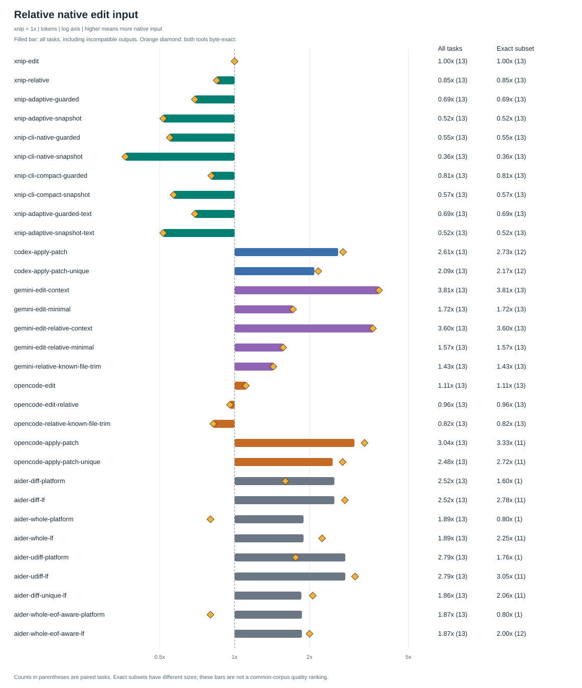
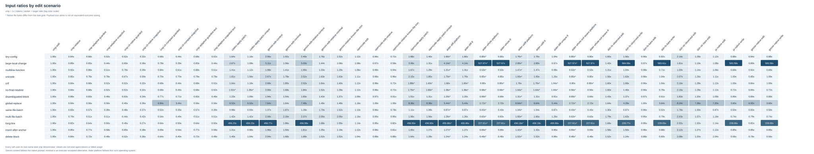
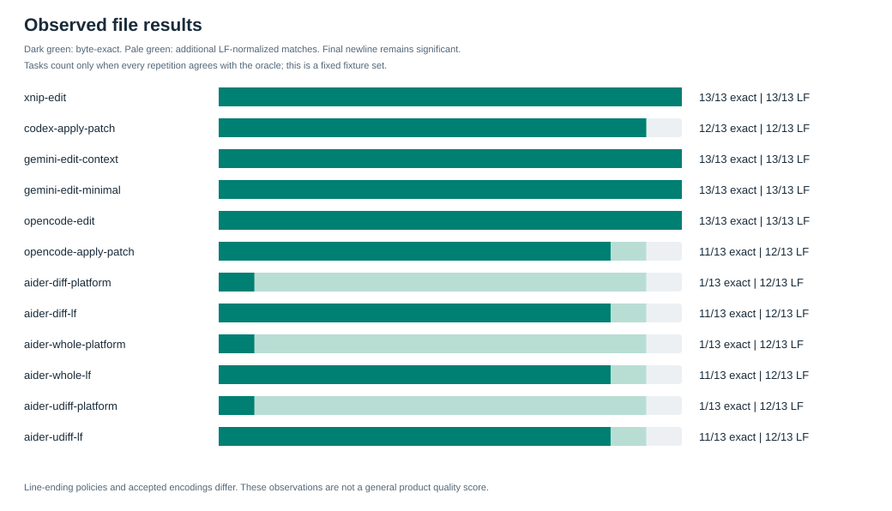

# Native editing tools versus xnip

The real native editors and xnip edited fresh copies of the same 13 fixtures. No model calls were performed. These results measure captured tool payloads and file behavior, not complete agent sessions or billed tokens.

Counter: {"encoding": "o200k_base", "tokenizer": "tiktoken", "unit": "tokens", "version": "0.14.0"}. Repetitions per task/profile: 3.
Platform: win32. xnip binary SHA-256: 46e8f6968dc62fba777628213cea2e6561f06032d07e7234cf765a6b21955085.
Raw calls, expected bytes, per-repetition hashes and source provenance: [results.json](results.json). Derived statistics: [relative-results.json](relative-results.json).

## Relative input costs

Ratio = **native input tokens / xnip input tokens on the same task**. xnip is **1.00x**. A ratio of 2x means xnip emits half as much captured edit input in that task; it does not mean the complete agent uses half as many tokens.
The aggregate is exp(mean(log(task ratio))): each task has equal weight. Three repeats check execution stability; they do not give a task three statistical votes.
The all-task column includes native outputs with different file bytes, so it describes supplied payloads only. The exact column includes a task only when both tools produce the expected bytes in every repetition. Those subsets differ between backends and must not be compared as a common-corpus ranking.

| Native backend / profile | All tasks input ratio | Byte-exact pairs input ratio | Exact pairs | All tasks except long-line |
|---|---:|---:|---:|---:|
| xnip-edit | 1.00x | 1.00x | 13/13 | 1.00x |
| codex-apply-patch | 2.61x | 2.73x | 12/13 | 1.70x |
| gemini-edit-context | 3.81x | 3.81x | 13/13 | 2.56x |
| gemini-edit-minimal | 1.72x | 1.72x | 13/13 | 1.71x |
| opencode-edit | 1.11x | 1.11x | 13/13 | 1.11x |
| opencode-apply-patch | 3.04x | 3.33x | 11/13 | 2.00x |
| aider-diff-platform | 2.52x | 1.60x | 1/13 | 1.63x |
| aider-diff-lf | 2.52x | 2.78x | 11/13 | 1.63x |
| aider-whole-platform | 1.89x | 0.80x | 1/13 | 1.27x |
| aider-whole-lf | 1.89x | 2.25x | 11/13 | 1.27x |
| aider-udiff-platform | 2.79x | 1.76x | 1/13 | 1.82x |
| aider-udiff-lf | 2.79x | 3.05x | 11/13 | 1.82x |

Tasks byte-exact across every recorded profile: 0. There is no valid shared byte-exact corpus for a 12-profile overall ranking in this run.
The last column is a sensitivity check on the same supplied-input metric: the long-line fixture is deliberately extreme and should not silently determine the conclusion.

## Captured return and combined strings

Returned ratio = native captured returned text / xnip captured returned text. Combined ratio = (native input + native captured returned text) / (xnip input + xnip captured returned text), counted independently before summation. The same equal-task geometric mean and exact-pair cohorts apply.
These are observable strings only: schemas, initialize instructions, repair requests, host framing/structured fields and the full agent workflow are excluded. xnip MCP and Codex CLI capture text at different host boundaries; this is not a uniform provider usage measurement. Aider final model output is unknown, so every aider returned/combined ratio is unavailable, not zero.

| Captured backend | Returned all tasks | Input + return all tasks | Returned exact pairs | Input + return exact pairs |
|---|---:|---:|---:|---:|
| xnip-edit | 1.00x | 1.00x | 1.00x | 1.00x |
| codex-apply-patch | 9.68x | 3.05x | 9.51x | 3.17x |
| gemini-edit-context | 12.52x | 4.35x | 12.52x | 4.35x |
| gemini-edit-minimal | 13.21x | 2.17x | 13.21x | 2.17x |
| opencode-edit | 3.53x | 1.20x | 3.53x | 1.20x |
| opencode-apply-patch | 8.90x | 3.41x | 8.56x | 3.70x |

Compare the return and combined columns alongside input costs; the conclusion below is calculated from the captured exchange in this run.

## What the data supports

- codex-apply-patch: all-task edit-input geometric mean **2.61x**; byte-exact paired subset **2.73x** (12 tasks).
- gemini-edit-context: all-task edit-input geometric mean **3.81x**; byte-exact paired subset **3.81x** (13 tasks).
- gemini-edit-minimal: all-task edit-input geometric mean **1.72x**; byte-exact paired subset **1.72x** (13 tasks).
- opencode-edit: all-task edit-input geometric mean **1.11x**; byte-exact paired subset **1.11x** (13 tasks).
- opencode-apply-patch: all-task edit-input geometric mean **3.04x**; byte-exact paired subset **3.33x** (11 tasks).
- aider-diff-lf: all-task edit-input geometric mean **2.52x**; byte-exact paired subset **2.78x** (11 tasks).
- aider-whole-lf: all-task edit-input geometric mean **1.89x**; byte-exact paired subset **2.25x** (11 tasks).

The long-line task uses 22 xnip input tokens; codex-apply-patch 10,037; gemini-edit-context 10,049; opencode-edit 25; aider-whole-lf 5,014. Literal substring editing avoids retransmitting an unchanged long line. This is a workload property, not a universal reduction factor.

On same-file-batch, Codex uses 45 input tokens versus xnip's 46 (0.98x). A single native patch can be cheaper than several xnip calls. xnip_apply is an available batch path measured in the separate representation suite; this native profile measures xnip_edit and does not establish an xnip_apply saving. xnip does not win every task.

On tiny-config, OpenCode edit emits 28 input + 4 returned tokens, versus xnip's 25 + 1. OpenCode's combined captured exchange is 1.23x of xnip's. xnip has the smaller combined captured exchange in this task.

Gemini's context profile includes its prescribed surrounding context and an instruction. The minimal profile is accepted by the executor but does not follow that full prompt rule. OpenCode's short literal interface is correspondingly close to xnip on input size.
The useful optimization target is less redundant context and fewer calls when the edit contract permits it. These fixtures do not establish total agent savings, model edit success, or repository-level correctness.

## File behavior

| Backend / profile | Version | Byte-exact cases | LF-normalized cases | Stable outcomes |
|---|---|---:|---:|---:|
| xnip-edit | 0.3.0 | 13/13 | 13/13 | 13/13 |
| codex-apply-patch | codex-cli 0.163.0-alpha.10.2 | 12/13 | 12/13 | 13/13 |
| gemini-edit-context | 0.27.2 | 13/13 | 13/13 | 13/13 |
| gemini-edit-minimal | 0.27.2 | 13/13 | 13/13 | 13/13 |
| opencode-edit | 1.19.3 | 13/13 | 13/13 | 13/13 |
| opencode-apply-patch | 1.19.3 | 11/13 | 12/13 | 13/13 |
| aider-diff-platform | 0.86.3.dev+less | 1/13 | 12/13 | 13/13 |
| aider-diff-lf | 0.86.3.dev+less | 11/13 | 12/13 | 13/13 |
| aider-whole-platform | 0.86.3.dev+less | 1/13 | 12/13 | 13/13 |
| aider-whole-lf | 0.86.3.dev+less | 11/13 | 12/13 | 13/13 |
| aider-udiff-platform | 0.86.3.dev+less | 1/13 | 12/13 | 13/13 |
| aider-udiff-lf | 0.86.3.dev+less | 11/13 | 12/13 | 13/13 |

Byte equality includes CRLF and final newline. LF normalization still distinguishes a missing final newline. Aider platform follows the current operating system; lf is an explicit separate configuration.
Aider's canonical whole-file profile uses closed code fences. An accepted unclosed final fence that preserves missing EOF is tested separately; the canonical generator does not describe every accepted native encoding.
Native success status alone never passes the file oracle. The fixtures cover existing UTF-8 text files; lifecycle, approvals, mandatory Read, post-edit formatting and model reasoning are outside scope.

## Per-task absolute measurements

Captured inputs and returned text for every task/profile

| Task | Backend | Input tokens | Returned text tokens | Input / xnip | Return / xnip | Input + return / xnip | Byte exact |
|---|---|---:|---:|---:|---:|---:|---|
| tiny-config | xnip-edit | 25 | 1 | 1.00x | 1.00x | 1.00x | True |
| tiny-config | codex-apply-patch | 41 | 12 | 1.64x | 12.00x | 2.04x | True |
| tiny-config | gemini-edit-context | 64 | 15 | 2.56x | 15.00x | 3.04x | True |
| tiny-config | gemini-edit-minimal | 48 | 15 | 1.92x | 15.00x | 2.42x | True |
| tiny-config | opencode-edit | 28 | 4 | 1.12x | 4.00x | 1.23x | True |
| tiny-config | opencode-apply-patch | 47 | 11 | 1.88x | 11.00x | 2.23x | True |
| tiny-config | aider-diff-platform | 40 | not captured | 1.60x | n/a | n/a | False |
| tiny-config | aider-diff-lf | 40 | not captured | 1.60x | n/a | n/a | True |
| tiny-config | aider-whole-platform | 20 | not captured | 0.80x | n/a | n/a | False |
| tiny-config | aider-whole-lf | 20 | not captured | 0.80x | n/a | n/a | True |
| tiny-config | aider-udiff-platform | 44 | not captured | 1.76x | n/a | n/a | False |
| tiny-config | aider-udiff-lf | 44 | not captured | 1.76x | n/a | n/a | True |
| large-local-change | xnip-edit | 36 | 1 | 1.00x | 1.00x | 1.00x | True |
| large-local-change | codex-apply-patch | 96 | 12 | 2.67x | 12.00x | 2.92x | True |
| large-local-change | gemini-edit-context | 184 | 15 | 5.11x | 15.00x | 5.38x | True |
| large-local-change | gemini-edit-minimal | 56 | 15 | 1.56x | 15.00x | 1.92x | True |
| large-local-change | opencode-edit | 39 | 4 | 1.08x | 4.00x | 1.16x | True |
| large-local-change | opencode-apply-patch | 110 | 11 | 3.06x | 11.00x | 3.27x | True |
| large-local-change | aider-diff-platform | 149 | not captured | 4.14x | n/a | n/a | False |
| large-local-change | aider-diff-lf | 149 | not captured | 4.14x | n/a | n/a | True |
| large-local-change | aider-whole-platform | 19007 | not captured | 527.97x | n/a | n/a | False |
| large-local-change | aider-whole-lf | 19007 | not captured | 527.97x | n/a | n/a | True |
| large-local-change | aider-udiff-platform | 104 | not captured | 2.89x | n/a | n/a | False |
| large-local-change | aider-udiff-lf | 104 | not captured | 2.89x | n/a | n/a | True |
| multiline-function | xnip-edit | 49 | 1 | 1.00x | 1.00x | 1.00x | True |
| multiline-function | codex-apply-patch | 69 | 12 | 1.41x | 12.00x | 1.62x | True |
| multiline-function | gemini-edit-context | 97 | 15 | 1.98x | 15.00x | 2.24x | True |
| multiline-function | gemini-edit-minimal | 69 | 15 | 1.41x | 15.00x | 1.68x | True |
| multiline-function | opencode-edit | 52 | 4 | 1.06x | 4.00x | 1.12x | True |
| multiline-function | opencode-apply-patch | 82 | 11 | 1.67x | 11.00x | 1.86x | True |
| multiline-function | aider-diff-platform | 64 | not captured | 1.31x | n/a | n/a | False |
| multiline-function | aider-diff-lf | 64 | not captured | 1.31x | n/a | n/a | True |
| multiline-function | aider-whole-platform | 26 | not captured | 0.53x | n/a | n/a | False |
| multiline-function | aider-whole-lf | 26 | not captured | 0.53x | n/a | n/a | True |
| multiline-function | aider-udiff-platform | 72 | not captured | 1.47x | n/a | n/a | False |
| multiline-function | aider-udiff-lf | 72 | not captured | 1.47x | n/a | n/a | True |
| unicode | xnip-edit | 27 | 1 | 1.00x | 1.00x | 1.00x | True |
| unicode | codex-apply-patch | 49 | 12 | 1.81x | 12.00x | 2.18x | True |
| unicode | gemini-edit-context | 72 | 15 | 2.67x | 15.00x | 3.11x | True |
| unicode | gemini-edit-minimal | 48 | 15 | 1.78x | 15.00x | 2.25x | True |
| unicode | opencode-edit | 30 | 4 | 1.11x | 4.00x | 1.21x | True |
| unicode | opencode-apply-patch | 58 | 11 | 2.15x | 11.00x | 2.46x | True |
| unicode | aider-diff-platform | 46 | not captured | 1.70x | n/a | n/a | False |
| unicode | aider-diff-lf | 46 | not captured | 1.70x | n/a | n/a | True |
| unicode | aider-whole-platform | 23 | not captured | 0.85x | n/a | n/a | False |
| unicode | aider-whole-lf | 23 | not captured | 0.85x | n/a | n/a | True |
| unicode | aider-udiff-platform | 52 | not captured | 1.93x | n/a | n/a | False |
| unicode | aider-udiff-lf | 52 | not captured | 1.93x | n/a | n/a | True |
| crlf | xnip-edit | 25 | 1 | 1.00x | 1.00x | 1.00x | True |
| crlf | codex-apply-patch | 41 | 12 | 1.64x | 12.00x | 2.04x | True |
| crlf | gemini-edit-context | 67 | 15 | 2.68x | 15.00x | 3.15x | True |
| crlf | gemini-edit-minimal | 45 | 15 | 1.80x | 15.00x | 2.31x | True |
| crlf | opencode-edit | 28 | 4 | 1.12x | 4.00x | 1.23x | True |
| crlf | opencode-apply-patch | 47 | 11 | 1.88x | 11.00x | 2.23x | False |
| crlf | aider-diff-platform | 40 | not captured | 1.60x | n/a | n/a | True |
| crlf | aider-diff-lf | 40 | not captured | 1.60x | n/a | n/a | False |
| crlf | aider-whole-platform | 20 | not captured | 0.80x | n/a | n/a | True |
| crlf | aider-whole-lf | 20 | not captured | 0.80x | n/a | n/a | False |
| crlf | aider-udiff-platform | 44 | not captured | 1.76x | n/a | n/a | True |
| crlf | aider-udiff-lf | 44 | not captured | 1.76x | n/a | n/a | False |
| no-final-newline | xnip-edit | 25 | 1 | 1.00x | 1.00x | 1.00x | True |
| no-final-newline | codex-apply-patch | 38 | 12 | 1.52x | 12.00x | 1.92x | False |
| no-final-newline | gemini-edit-context | 50 | 15 | 2.00x | 15.00x | 2.50x | True |
| no-final-newline | gemini-edit-minimal | 42 | 15 | 1.68x | 15.00x | 2.19x | True |
| no-final-newline | opencode-edit | 28 | 4 | 1.12x | 4.00x | 1.23x | True |
| no-final-newline | opencode-apply-patch | 44 | 11 | 1.76x | 11.00x | 2.12x | False |
| no-final-newline | aider-diff-platform | 34 | not captured | 1.36x | n/a | n/a | False |
| no-final-newline | aider-diff-lf | 34 | not captured | 1.36x | n/a | n/a | False |
| no-final-newline | aider-whole-platform | 17 | not captured | 0.68x | n/a | n/a | False |
| no-final-newline | aider-whole-lf | 17 | not captured | 0.68x | n/a | n/a | False |
| no-final-newline | aider-udiff-platform | 41 | not captured | 1.64x | n/a | n/a | False |
| no-final-newline | aider-udiff-lf | 41 | not captured | 1.64x | n/a | n/a | False |
| disambiguated-block | xnip-edit | 35 | 1 | 1.00x | 1.00x | 1.00x | True |
| disambiguated-block | codex-apply-patch | 43 | 12 | 1.23x | 12.00x | 1.53x | True |
| disambiguated-block | gemini-edit-context | 68 | 15 | 1.94x | 15.00x | 2.31x | True |
| disambiguated-block | gemini-edit-minimal | 54 | 15 | 1.54x | 15.00x | 1.92x | True |
| disambiguated-block | opencode-edit | 38 | 4 | 1.09x | 4.00x | 1.17x | True |
| disambiguated-block | opencode-apply-patch | 53 | 11 | 1.51x | 11.00x | 1.78x | True |
| disambiguated-block | aider-diff-platform | 42 | not captured | 1.20x | n/a | n/a | False |
| disambiguated-block | aider-diff-lf | 42 | not captured | 1.20x | n/a | n/a | True |
| disambiguated-block | aider-whole-platform | 24 | not captured | 0.69x | n/a | n/a | False |
| disambiguated-block | aider-whole-lf | 24 | not captured | 0.69x | n/a | n/a | True |
| disambiguated-block | aider-udiff-platform | 46 | not captured | 1.31x | n/a | n/a | False |
| disambiguated-block | aider-udiff-lf | 46 | not captured | 1.31x | n/a | n/a | True |
| global-replace | xnip-edit | 25 | 5 | 1.00x | 1.00x | 1.00x | True |
| global-replace | codex-apply-patch | 163 | 12 | 6.52x | 2.40x | 5.83x | True |
| global-replace | gemini-edit-context | 191 | 15 | 7.64x | 3.00x | 6.87x | True |
| global-replace | gemini-edit-minimal | 41 | 15 | 1.64x | 3.00x | 1.87x | True |
| global-replace | opencode-edit | 29 | 4 | 1.16x | 0.80x | 1.10x | True |
| global-replace | opencode-apply-patch | 209 | 11 | 8.36x | 2.20x | 7.33x | True |
| global-replace | aider-diff-platform | 136 | not captured | 5.44x | n/a | n/a | False |
| global-replace | aider-diff-lf | 136 | not captured | 5.44x | n/a | n/a | True |
| global-replace | aider-whole-platform | 68 | not captured | 2.72x | n/a | n/a | False |
| global-replace | aider-whole-lf | 68 | not captured | 2.72x | n/a | n/a | True |
| global-replace | aider-udiff-platform | 166 | not captured | 6.64x | n/a | n/a | False |
| global-replace | aider-udiff-lf | 166 | not captured | 6.64x | n/a | n/a | True |
| same-file-batch | xnip-edit | 46 | 2 | 1.00x | 1.00x | 1.00x | True |
| same-file-batch | codex-apply-patch | 45 | 12 | 0.98x | 6.00x | 1.19x | True |
| same-file-batch | gemini-edit-context | 63 | 15 | 1.37x | 7.50x | 1.62x | True |
| same-file-batch | gemini-edit-minimal | 86 | 30 | 1.87x | 15.00x | 2.42x | True |
| same-file-batch | opencode-edit | 52 | 8 | 1.13x | 4.00x | 1.25x | True |
| same-file-batch | opencode-apply-patch | 51 | 11 | 1.11x | 5.50x | 1.29x | True |
| same-file-batch | aider-diff-platform | 40 | not captured | 0.87x | n/a | n/a | False |
| same-file-batch | aider-diff-lf | 40 | not captured | 0.87x | n/a | n/a | True |
| same-file-batch | aider-whole-platform | 20 | not captured | 0.43x | n/a | n/a | False |
| same-file-batch | aider-whole-lf | 20 | not captured | 0.43x | n/a | n/a | True |
| same-file-batch | aider-udiff-platform | 48 | not captured | 1.04x | n/a | n/a | False |
| same-file-batch | aider-udiff-lf | 48 | not captured | 1.04x | n/a | n/a | True |
| multi-file-batch | xnip-edit | 57 | 3 | 1.00x | 1.00x | 1.00x | True |
| multi-file-batch | codex-apply-patch | 81 | 22 | 1.42x | 7.33x | 1.72x | True |
| multi-file-batch | gemini-edit-context | 147 | 43 | 2.58x | 14.33x | 3.17x | True |
| multi-file-batch | gemini-edit-minimal | 129 | 43 | 2.26x | 14.33x | 2.87x | True |
| multi-file-batch | opencode-edit | 66 | 12 | 1.16x | 4.00x | 1.30x | True |
| multi-file-batch | opencode-apply-patch | 89 | 21 | 1.56x | 7.00x | 1.83x | True |
| multi-file-batch | aider-diff-platform | 72 | not captured | 1.26x | n/a | n/a | False |
| multi-file-batch | aider-diff-lf | 72 | not captured | 1.26x | n/a | n/a | True |
| multi-file-batch | aider-whole-platform | 36 | not captured | 0.63x | n/a | n/a | False |
| multi-file-batch | aider-whole-lf | 36 | not captured | 0.63x | n/a | n/a | True |
| multi-file-batch | aider-udiff-platform | 94 | not captured | 1.65x | n/a | n/a | False |
| multi-file-batch | aider-udiff-lf | 94 | not captured | 1.65x | n/a | n/a | True |
| long-line | xnip-edit | 22 | 1 | 1.00x | 1.00x | 1.00x | True |
| long-line | codex-apply-patch | 10037 | 12 | 456.23x | 12.00x | 436.91x | True |
| long-line | gemini-edit-context | 10049 | 15 | 456.77x | 15.00x | 437.57x | True |
| long-line | gemini-edit-minimal | 41 | 15 | 1.86x | 15.00x | 2.43x | True |
| long-line | opencode-edit | 25 | 4 | 1.14x | 4.00x | 1.26x | True |
| long-line | opencode-apply-patch | 10043 | 11 | 456.50x | 11.00x | 437.13x | True |
| long-line | aider-diff-platform | 10029 | not captured | 455.86x | n/a | n/a | False |
| long-line | aider-diff-lf | 10029 | not captured | 455.86x | n/a | n/a | True |
| long-line | aider-whole-platform | 5014 | not captured | 227.91x | n/a | n/a | False |
| long-line | aider-whole-lf | 5014 | not captured | 227.91x | n/a | n/a | True |
| long-line | aider-udiff-platform | 10036 | not captured | 456.18x | n/a | n/a | False |
| long-line | aider-udiff-lf | 10036 | not captured | 456.18x | n/a | n/a | True |
| insert-after-anchor | xnip-edit | 26 | 1 | 1.00x | 1.00x | 1.00x | True |
| insert-after-anchor | codex-apply-patch | 34 | 12 | 1.31x | 12.00x | 1.70x | True |
| insert-after-anchor | gemini-edit-context | 51 | 15 | 1.96x | 15.00x | 2.44x | True |
| insert-after-anchor | gemini-edit-minimal | 39 | 15 | 1.50x | 15.00x | 2.00x | True |
| insert-after-anchor | opencode-edit | 29 | 4 | 1.12x | 4.00x | 1.22x | True |
| insert-after-anchor | opencode-apply-patch | 43 | 11 | 1.65x | 11.00x | 2.00x | True |
| insert-after-anchor | aider-diff-platform | 33 | not captured | 1.27x | n/a | n/a | False |
| insert-after-anchor | aider-diff-lf | 33 | not captured | 1.27x | n/a | n/a | True |
| insert-after-anchor | aider-whole-platform | 18 | not captured | 0.69x | n/a | n/a | False |
| insert-after-anchor | aider-whole-lf | 18 | not captured | 0.69x | n/a | n/a | True |
| insert-after-anchor | aider-udiff-platform | 37 | not captured | 1.42x | n/a | n/a | False |
| insert-after-anchor | aider-udiff-lf | 37 | not captured | 1.42x | n/a | n/a | True |
| delete-block | xnip-edit | 25 | 1 | 1.00x | 1.00x | 1.00x | True |
| delete-block | codex-apply-patch | 35 | 12 | 1.40x | 12.00x | 1.81x | True |
| delete-block | gemini-edit-context | 51 | 15 | 2.04x | 15.00x | 2.54x | True |
| delete-block | gemini-edit-minimal | 42 | 15 | 1.68x | 15.00x | 2.19x | True |
| delete-block | opencode-edit | 26 | 4 | 1.04x | 4.00x | 1.15x | True |
| delete-block | opencode-apply-patch | 41 | 11 | 1.64x | 11.00x | 2.00x | True |
| delete-block | aider-diff-platform | 31 | not captured | 1.24x | n/a | n/a | False |
| delete-block | aider-diff-lf | 31 | not captured | 1.24x | n/a | n/a | True |
| delete-block | aider-whole-platform | 12 | not captured | 0.48x | n/a | n/a | False |
| delete-block | aider-whole-lf | 12 | not captured | 0.48x | n/a | n/a | True |
| delete-block | aider-udiff-platform | 38 | not captured | 1.52x | n/a | n/a | False |
| delete-block | aider-udiff-lf | 38 | not captured | 1.52x | n/a | n/a | True |

Returned-text counts cover the captured native output/error, not a uniform full agent response. Aider's final model message is unavailable at its editing-kernel boundary; it is **not zero**. Adapter-return objects include instrumentation and duplicated fields, so combined observable-string ratios above exclude those objects and do not rank full agent-token costs.
Warm MCP/Node/kernel timing excludes worker initialization. Codex CLI timing includes native process startup. Raw timings remain in JSON; these unequal scopes are not ranked as universal speed.

## Matching and recovery probes

| Probe | Backend | Reports success | File unchanged | Goal byte exact | Blocked model repairs |
|---|---|---|---|---|---:|
| ambiguous-line | xnip-edit | False | True | True | 0 |
| ambiguous-line | codex-apply-patch | True | False | False | 0 |
| ambiguous-line | gemini-edit-minimal | False | True | True | 1 |
| ambiguous-line | opencode-edit | False | True | True | 0 |
| ambiguous-line | opencode-apply-patch | True | False | False | 0 |
| ambiguous-line | aider-diff-platform | True | False | False | 0 |
| ambiguous-line | aider-diff-lf | True | False | False | 0 |
| stale-context | xnip-edit | False | True | True | 0 |
| stale-context | codex-apply-patch | False | True | True | 0 |
| stale-context | gemini-edit-minimal | False | True | True | 1 |
| stale-context | opencode-edit | False | True | True | 0 |
| stale-context | opencode-apply-patch | False | True | True | 0 |
| stale-context | aider-diff-platform | False | True | True | 0 |
| stale-context | aider-diff-lf | False | True | True | 0 |
| whitespace-drift | xnip-edit | False | True | True | 0 |
| whitespace-drift | codex-apply-patch | True | False | False | 0 |
| whitespace-drift | gemini-edit-minimal | True | False | False | 0 |
| whitespace-drift | opencode-edit | True | False | False | 0 |
| whitespace-drift | opencode-apply-patch | True | False | False | 0 |
| whitespace-drift | aider-diff-platform | True | False | False | 0 |
| whitespace-drift | aider-diff-lf | True | False | False | 0 |
| overlapping-literal | xnip-edit | False | True | True | 0 |
| overlapping-literal | gemini-edit-minimal | True | False | False | 0 |
| overlapping-literal | opencode-edit | False | True | True | 0 |
| aider-accepted-unclosed-whole | aider-whole-platform | True | False | True | 0 |
| aider-accepted-unclosed-whole | aider-whole-lf | True | False | True | 0 |

Probes observe uniqueness, stale context, whitespace and repair policies. Unsupported representations are omitted. Gemini repair requests are captured and blocked before inference; no repaired model outcome or billed cost is inferred.

## Unmeasured products

| Product | Reason |
|---|---|
| Claude Code Edit / Write | No independently invocable official native executor was available; not simulated or scored. |
| Cursor native edit | Installed app has no verified independent native edit entry; not simulated or scored. |

See [method and limits](native-methodology.md) and [reproduction commands](README.md). The separate [representation report](representation-results.md) measures current xnip options and serialized formats, not native third-party execution.
